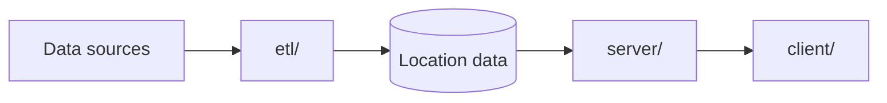

# Boston Circular Economy

A volunteer [Code for Boston](https://codeforboston.org/) project, in partnership with the Circular Economy team in the City of Boston Environment Department.

This project connects Greater Boston residents with local places to repair, reuse, or donate items, keeping more of them out of the trash.

**Live site:** https://codeforboston.github.io/boston-circular-economy/

## Join us

Everyone is welcome. Alongside developers, we need designers, researchers, and product thinkers. We meet at Code for Boston hack nights, online every Tuesday from 7 to 9:00 p.m. ET and in person on the first and third Tuesday of each month. See [codeforboston.org](https://codeforboston.org/) for how to join and RSVP, and say hi in `#circular-economy` on the [Code for Boston Slack](https://inviter.co/cfb-slack).

Once you're in, start with our [onboarding document](https://docs.google.com/document/d/1ja4MXAvy5s0U7pD5Xx5rr62x4_BU_biYdjbRFC0GQyU/edit?tab=t.0#heading=h.80ojjizca2at).

## How it fits together

| Part | What it is | Setup and details |
| --- | --- | --- |
| [`client/`](client/) | React + Typescript website | [Client README](client/README.md) |
| [`server/`](server/) | FastAPI backend that serves location data | [Server README](server/README.md) |
| [`etl/`](etl/) | Pipeline that fetches, normalizes, and merges locations from sources like Google Places and OpenStreetMap | [ETL README](etl/README.md) |
| [`packages/`](packages/) | Shared Python code used by `etl/` and `server/` | [contracts](packages/contracts/README.md), [data-store](packages/data-store/README.md) |

Designs live in our [Figma file](https://www.figma.com/design/KM7zoiBsiEhLITkrWGkpUh/Circular-Economy---Product-Design).

## Running locally

You'll need [Node.js](https://nodejs.org/) for the client and [uv](https://docs.astral.sh/uv/getting-started/installation/) for the Python parts.

To run the website with real data, follow **[Client: Running locally](client/README.md#running-locally)**. It walks through starting the API alongside the site. To work on the API or the data pipeline on their own, see the [Server README](server/README.md) or the [ETL README](etl/README.md).

## Milestones

We're working toward **Proof of Concept**: a full vertical slice that is live and usable. See all [milestones](https://github.com/codeforboston/boston-circular-economy/milestones) for what comes after.

## Contributing

Read [CONTRIBUTING.md](CONTRIBUTING.md) for team norms and how we propose, pick up, and review work. Tickets live on the [project board](https://github.com/orgs/codeforboston/projects/21).

All contributors are expected to follow the Code for Boston [Code of Conduct](https://codeforboston.org/code-of-conduct/).

## Points of contact

| Role | Name | Contact |
| --- | --- | --- |
| Project lead | Matt Clarke | Slack: `@Matt Clarke`, Github: [@MattClarke131](https://github.com/MattClarke131) |
| Project Sponsor | Allon Dubler | Slack: `@Allon Dubler`
| Lead Designer | Kitty Chan | Slack: `@Kitty Chan`, Github: [@kittychandesign](https://github.com/kittychandesign) |

## License

[MIT](LICENSE)
