# Decide: build the Decide journey, screen by screen

This guide builds one real part of the Circular Economy website:
the Decide journey. A resident types what item she holds. The site
asks three short questions. The site then sends her to the right
path: repair, reuse, recycle, or maintain. When you finish this
guide, the journey works end to end in a browser.

## The journey at a glance

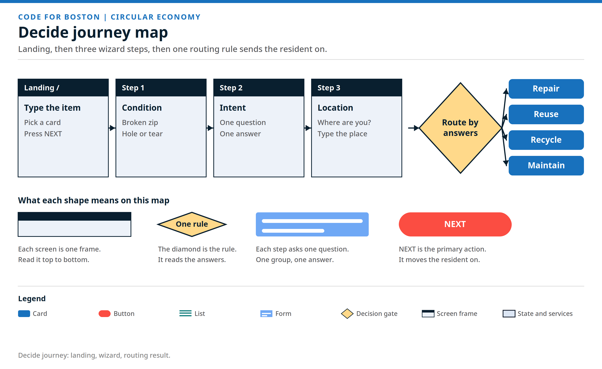

The map above shows the whole journey. The resident starts on the
landing page. She types her item and presses NEXT. The wizard asks
three questions, one step at a time: the condition of the item, what
the resident wants to do with it, and where the resident is. The
last step routes by the answers. One function maps answers to a
route, so the rule lives in one place.

## The build at a glance

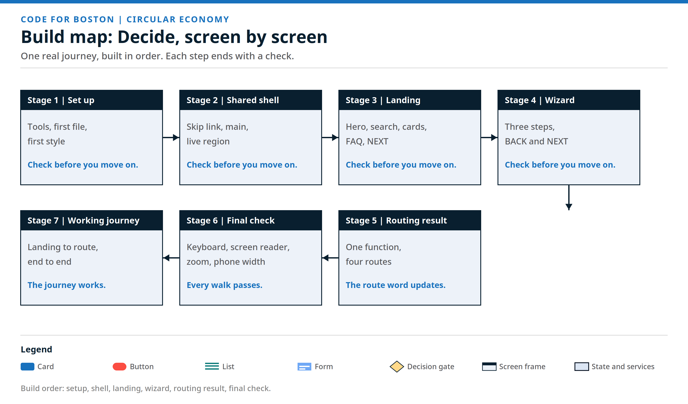

The map above shows the build order. You start from zero. You set
up your tools. You make your first file. You build the shared shell.
You build the landing page, one component at a time. You build the
wizard, one step at a time. You run the final check. Each step ends
with a check. Run the check before you move on.

## How each screen section works

Every screen in Part 2 follows the same shape:

1. What you build, and the page model for the screen.
2. The diagram, which shows the parts and how they connect.
3. The build steps, one component per step. Each step shows the
   code, a small picture of what the code just made, what you
   should see in the browser, and a check.
4. The accessibility notes for the screen.

The guide names files by their exact path. Type the path exactly as
shown. The guide names patterns by their canonical names only. A
pattern is a named solution to a known problem. The names come from
two books: Gamma, Helm, Johnson, and Vlissides, "Design Patterns"
(1994), and Fowler, "Patterns of Enterprise Application
Architecture" (2002). A pattern with no name in those books is
called a React idiom. A React idiom is a common way to write React
code. It has no book name, so the guide gives it none.

The guide names styles by their Fleet class names. Fleet is the City
of Boston design system. Its stylesheet is
`design-theme/fleet-theme.css`. Keep the Fleet name where Fleet
defines one. A screen that needs a class Fleet does not define gets
a new class in the theme first, then the component.

---

# Part 1: Start from zero

This part assumes nothing. You install four tools. You make your
first file. You open it in a browser. You learn to read an error.
You learn the words Part 2 uses. If you have built a webpage
before, skim this part and start at Part 2.

## 1.1 What a webpage is

A webpage is a document a browser shows. A browser is a program
that reads web documents and shows them on a screen. Chrome,
Firefox, and Safari are browsers.

A webpage is made of three parts.

- HTML gives the page its parts. HTML stands for HyperText Markup
  Language. A part is a heading, a paragraph, a button, or a field.
  You write a part with a tag. A tag is a word in angle brackets,
  like `<h1>` for a heading. Most tags come in pairs. The second
  tag has a slash, like `</h1>`. The text sits between the two
  tags.
- CSS gives the page its look. CSS stands for Cascading Style
  Sheets. CSS sets colours, sizes, and spacing. A CSS rule names a
  class and sets its look. A class is a name you put on an HTML
  part. The rule then styles every part with that name.
- JavaScript gives the page its behaviour. JavaScript is a language
  that runs in the browser. It reads what the resident types. It
  changes what the page shows. It asks a server for data.

A server is a computer that holds data and answers requests. An API
is the set of requests a server answers. API stands for Application
Programming Interface. The app asks the API for locations. The API
answers with a list.

## 1.2 What a web app is

This site is a mobile-first website, not an app. A resident opens
it in a browser. No one installs anything. The first designs target
a 390 pixel phone screen. A pixel is one dot on a screen. 390 pixels
is the width of a common phone.

The site is built with React. React is a JavaScript library for
building pages from parts. A component is a React part. A component
is a function that returns HTML. You build a page from components.
A page is a component. A button is a component. A form field is a
component.

The code is TypeScript. TypeScript is JavaScript with types. A type
says what kind of value a thing holds, like text or a number. A file
with React code and types ends in `.tsx`.

State is a value a component remembers. A component holds state
while it is on screen. When state changes, React draws the component
again with the new value. A prop is a value a parent passes to a
child. A parent is a component that holds another component. A child
is the component inside it.

A route is an address in the app. The landing page lives at `/`. The
Decide wizard lives at `/decide`. A URL is the address you see in
the browser bar. The URL can hold state. State in the URL survives a
reload. A reload is when the browser reads the page again. A shared
link carries the URL state to the next person.

## 1.3 The tools to install

You need four tools. Install them in this order. One idea per step:
install one tool, then check it, then move on.

### Step 1: Install a code editor

A code editor is a program for writing code. It shows line numbers.
It marks errors as you type. Any plain code editor works. Visual
Studio Code is one common choice. It is free.

What you should see: the editor opens and shows a blank window with
a menu. Check: type a few words. The words show on screen.

### Step 2: Pick a web browser

Any modern browser works. Chrome and Firefox both work. The browser
shows your page. Its developer tools show errors. Developer tools
are the browser tools that show page code and errors.

What you should see: the browser opens and shows its home page.
Check: the address bar shows at the top of the window.

### Step 3: Install Node.js

Node.js runs JavaScript outside the browser. The build tools need
it. Install the current stable release from the Node.js site. The
install also gives you `npm`. npm installs packages. A package is a
set of code someone else wrote.

What you should see: the install finishes with no error. Check:
open a terminal and type `node --version`. The terminal prints a
version number, like `v22.0.0`. If it prints an error, the install
did not work. Fix it before you go on.

### Step 4: Open a terminal

A terminal is a window where you type commands. A command is one
line of text that tells the computer to do one thing. On a Mac, open
Terminal. On Windows, open the terminal that comes with your
editor.

What you should see: a window with a prompt. A prompt is the mark
that waits for your command. Check: type `pwd` and press Enter. The
terminal prints the folder you sit in.

## 1.4 The first file

Make a folder for your practice. Call it `practice`. Open the
folder in your editor. Make a file called `hello.html`. Type this
code.

```html
<!DOCTYPE html>
<html>
  <head>
    <title>My first page</title>
  </head>
  <body>
    <h1>Hello, Boston</h1>
    <p>This is my first webpage.</p>
    <button>Press me</button>
  </body>
</html>
```

Each line does one thing.

- `<!DOCTYPE html>` tells the browser this file is HTML.
- `<html>` opens the page. `</html>` closes it.
- `<head>` holds facts about the page. `<title>` sets the text the
  browser tab shows.
- `<body>` holds what the resident sees.
- `<h1>` is the main heading. `<p>` is a paragraph. `<button>` is a
  button.

Your file tree now looks like this.

```text
practice/
  hello.html
```

Save the file. Open it in your browser. Use the browser menu and
pick Open File, or drag the file into a browser window.

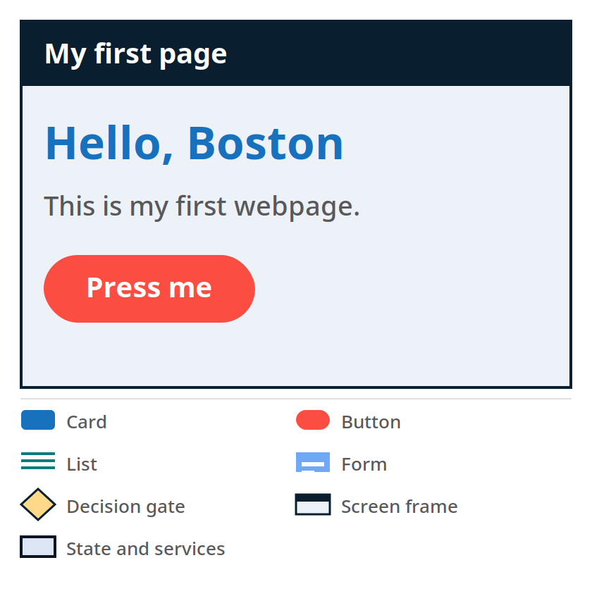

What you should see: the browser shows "Hello, Boston" in dark
text, a paragraph under it, and a button. The button does nothing
yet. That is fine. Check: the tab title reads "My first page". You
have made a webpage.

## 1.5 The first style

Make a file called `hello.css` in the same folder. Type this code.

```css
h1 {
  color: #1871BD;
}
```

`#1871BD` is Optimistic Blue. It is the Fleet colour for links and
primary buttons. Add this line inside the `<head>` of `hello.html`,
after the title.

```html
<link rel="stylesheet" href="hello.css">
```

Your file tree now looks like this.

```text
practice/
  hello.html
  hello.css
```

Save both files. Reload the browser page. A reload reads the files
again.


What you should see: the heading turns Optimistic Blue. The rest
stays the same. Check: the heading colour matches the blue in the
picture above. The HTML names the part. The CSS names the look.
That split is the whole idea. Keep it in mind for every screen you
build.

## 1.6 How to open the app in a browser

The real app is not one HTML file. It is many files. A build tool
joins them into a page the browser can read. The build tool here is
Vite. Vite is a program that builds the app and serves it while you
work. To serve means to send the page to the browser on request.

Open a terminal in the project folder. The project folder is the
folder that holds the `client` folder. Run the command that starts
the development server. The project readme names that command. The
server prints an address, like `http://localhost:5173`. Open that
address in your browser. The app shows. Keep the terminal open
while you work. When you save a file, the page updates in the
browser.

To check the whole app builds, run this command in the terminal.

```bash
tsc -b && vite build
```

- `tsc -b` runs the TypeScript checker. It reads every file. It
  reports type errors. A type error is a value used in the wrong
  way.
- `&&` means run the second command only if the first one passes.
- `vite build` builds the app for real use.

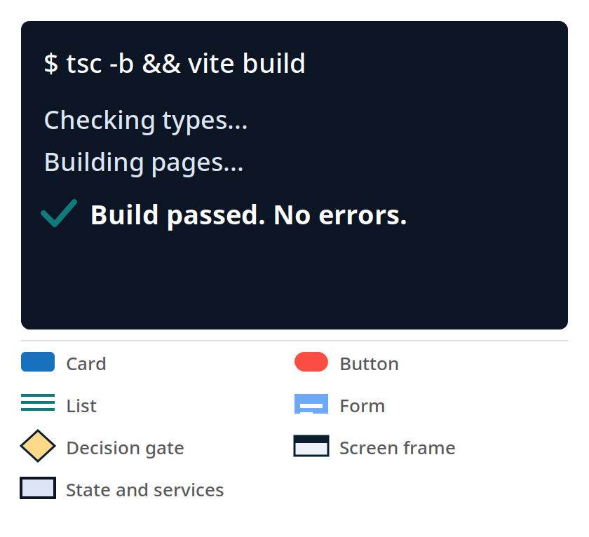

What you should see: the terminal prints lines that end with no
errors, and the build reports success. Check: the last lines name
the files the build wrote. If either step fails, read the error.
The next section shows how.

## 1.7 How to read an error

An error message has three parts. Find them in order.

1. The file name and line number. The message names the file and
   the line where the problem sits. Open that file. Go to that
   line.
2. The short message. The message says what is wrong in one line.
   Read it slowly. It often names the value that is wrong.
3. The lines around it. The message shows the lines near the error.
   The real cause often sits one or two lines above the line
   named.

Common errors and what they mean:

- "Cannot find module" means the file path is wrong, or the file
  does not exist yet. Check the path letter by letter.
- "is not defined" means you used a name the file does not know.
  Check the import at the top of the file. An import is a line
  that brings a name from another file into this file.
- "Unexpected token" means a bracket or quote is missing, or one
  too many. Count the opening and closing brackets in the lines
  near the error.
- A blank page with no error in the terminal means the error is in
  the browser. Open the browser developer tools. Press F12, or
  right-click the page and pick Inspect. Click the Console tab.
  The console shows the error in red.

Fix one error at a time. Save the file. Reload the page. If the
error is gone, move on. If a new error shows, read it the same way.

What you should see after a fix: the page loads, and the terminal
shows no red text. Check: the screen you expect shows in the
browser, with no error in the console.

## 1.8 The words you will meet in Part 2

| Word | What it means |
| --- | --- |
| Component | A React part. A function that returns HTML. |
| State | A value a component remembers while it is on screen. |
| Prop | A value a parent passes to a child. |
| Route | An address in the app, like `/decide`. |
| Service | The one place that calls the API. No page calls the API direct. |
| Hook | A function that holds reusable logic. A hook name starts with `use`. |
| Query client | The store that caches API answers, so a repeat visit loads fast. |
| Cache | Saved answers. The app reuses a saved answer instead of asking again. |
| Container | A component that fetches data or holds state. |
| Presentational part | A component that only renders. It takes props and shows them. |
| Pattern | A named solution to a known problem, from the books named above. |
| Composite | A pattern. A tree of parts. The page is the root. Parts hold parts. |
| State pattern | A pattern. The next step is a function of the answers so far. |
| Decorator | A pattern. A wrapper that adds behaviour around a view. |
| Observer | A pattern. Children update when the state they watch changes. |
| Strategy | A pattern. One function per rule. The caller picks the rule set. |
| Mediator | A pattern. One part links two parts that never talk direct. |
| Iterator | A pattern. Take items in order, stop after ten, move to the next ten. |
| Provider | A React idiom. One value, given at the entry, reaches every screen. |
| DataState | The shared component that renders loading, error, and empty views. |
| Live region | A hidden part of the page that a screen reader reads aloud. |
| Screen reader | Software that reads the page aloud for a person who cannot see it. |
| Focus | The control the keyboard acts on now. Tab moves focus. |

---

# Part 2: Build this journey

## 2.0 The eight-step page-design sequence

Follow this order for a new page. Do not skip a step. Each step ends
when its check passes.

### Step 1: Start from the journey and the page model

Name the journey step the page serves, and the persona. Then write
the page model. A page model is every piece of state, where it lives,
and what changes it. If a piece of state has no home, it does not
exist yet. Do not write a component first.

### Step 2: Pick the widgets from the register

Take the widgets for this page from the widget register. Each widget
has a stub number. A widget with no stub does not exist yet. Add it
to the register first.

### Step 3: Pick the Fleet classes from the theme

Take the classes from `design-theme/fleet-theme.css` and
`DESIGN-THEME.md`. Keep the Fleet name where Fleet defines one. A
widget with no Fleet class gets a new class in the theme first, then
the component.

### Step 4: Compose the page tree (Composite)

The page is the root. Containers hold the state. Presentational parts
take props and render. A part that fetches is a container. A part
that only renders takes props. Do not mix the two in one file.

### Step 5: Wire the state (URL / query / form / selection)

Shareable state goes in the URL. Results go in the query client.
Form state stays in the form. Selection stays in the page. One owner
per piece of state. Two owners for one piece is a defect.

### Step 6: Add the loading / error / empty states (Decorator)

Wrap the page in `DataState`. The page writes only its success view.
Loading says so in words. An error says so in words, with a next
step. Empty says so in words, never a blank area.

### Step 7: Add keyboard and accessibility behaviour (Stub 30)

Every control works by keyboard alone. Focus moves to the page
heading on load, into a dialog when it opens, and back to the opener
when it closes. Meaning never rests on colour alone. Test at 200%
zoom.

### Step 8: Verify it in the browser

Build it (`tsc -b && vite build`). Walk it fresh and seeded. Fresh
means no data yet. Seeded means test data is in place. Walk it by
keyboard alone. Walk it with a screen reader. Walk it at 200% zoom
and at phone width. Walk it with the map failed, so the list still
works. A passing gate count is text only. It is not a pass on its
own.

## 2.1 Build the shared shell first

Every screen in this journey shares one shell. Build it before any
other widget. The shell lives in `client/src/pages/__root.tsx`. It
holds three parts. Build one part per step. One idea per step.

### Step 1: Add the skip link

A skip link jumps past the header to the main content. A keyboard
user presses Tab once, then Enter, and lands on the main content.
The class is `.a11y--h`.

Type this code in `client/src/pages/__root.tsx`.

```tsx
// client/src/pages/__root.tsx: the shared shell, every page inherits this
// The skip link comes first, so a keyboard user reaches it on the first Tab.
// The link points to #main, so Enter jumps past the header to the main content.
<a className="a11y--h" href="#main">Skip to main content</a>
```

Your file tree now looks like this.

```text
client/
  src/
    pages/
      __root.tsx
```

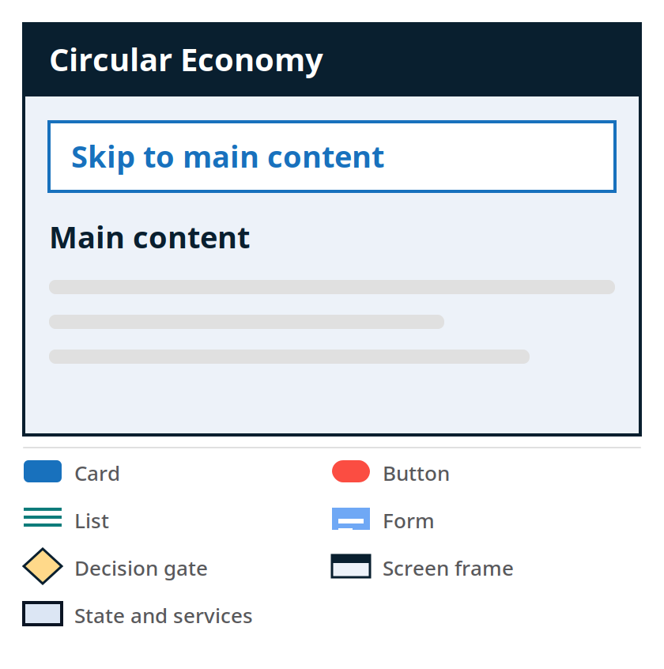

What you should see: open any page and press Tab once. A link
reads "Skip to main content" at the top of the page, in Optimistic
Blue text on white. Check: press Enter. Focus moves past the header
to the main content.

### Step 2: Add the main content

`<main id="main">` holds the page. The page renders inside it
through `<Outlet />`. An outlet is the place where the current page
renders inside the shell.

Add this code under the skip link in `client/src/pages/__root.tsx`.

```tsx
// The main element holds the page. The id matches the skip link target, so the jump lands here.
// The outlet renders the current page inside the shell, so every page shares this frame.
<main id="main"><Outlet /></main>
```

Your file tree now looks like this.

```text
client/
  src/
    pages/
      __root.tsx
```


What you should see: the page shows inside a pale frame with a
Charles Blue header bar at the top. The skip link still works.
Check: press Tab once, then Enter. Focus lands on the main content.

### Step 3: Add the live region

A live region is a plain `<div aria-live="polite">`. It holds text
a screen reader reads aloud when the text changes. It has no visual
style of its own. The class `.sr-only` hides it from sight but
keeps it readable by a screen reader.

Add this code under the main element in `client/src/pages/__root.tsx`.

```tsx
// The live region announces results in words. It holds text only, so a screen reader reads it and a sighted user sees nothing.
// The class sr-only hides the region from sight, so the page looks the same and the announcement still works.
<div aria-live="polite" className="sr-only">{announce}</div>
// Rule: meaning never rests on colour alone. Every state also changes text, a border, or an icon. Words carry the meaning for a user who cannot see colour.
```

Your file tree now looks like this.

```text
client/
  src/
    pages/
      __root.tsx
```


What you should see: the page looks the same as after step 2. The
live region adds nothing visible. Check: turn on a screen reader
and load a page. The reader announces the page heading. The shell
is done.

Focus moves to follow on every screen:

- Page loads, focus goes to the page heading.
- A dialog opens, focus goes inside it and stays there until it
  closes.
- A dialog closes, focus returns to the button that opened it.
- Escape closes a dialog. A click on the dimmed layer behind the
  dialog closes it. A click inside does not, so the dialog stays
  open while the user works in it.

Test with a keyboard alone, then with a screen reader, at 200%
zoom.

## 2.2 Screen 1: The landing page, `/`

What the resident does: she types her item in "What is your
item?" She picks a service-type card. She presses NEXT. She can
open the FAQ sections.

### Page model

| State | Lives | Changes it |
| --- | --- | --- |
| Item, as typed | Component state | Typing in "What is your item?" |
| Service type, when a card is picked | URL, then the next page | Card click |
| FAQ open, one section | Component state | Header click |

The landing page holds almost no state. The item moves to the URL
on NEXT, so the next page can read it from the link.

```tsx
// Page model: /: the landing holds almost no state. The item moves to the URL on NEXT, so the next page can read it from the link.
// const [item, setItem] = useState(""); // Component state holds the item until NEXT. The URL takes over after that, so the item survives a reload.
// NEXT: navigate(`/decide?item=${item}`); // Then the URL owns the item, so a shared link carries it to the next page.
```

### Diagram

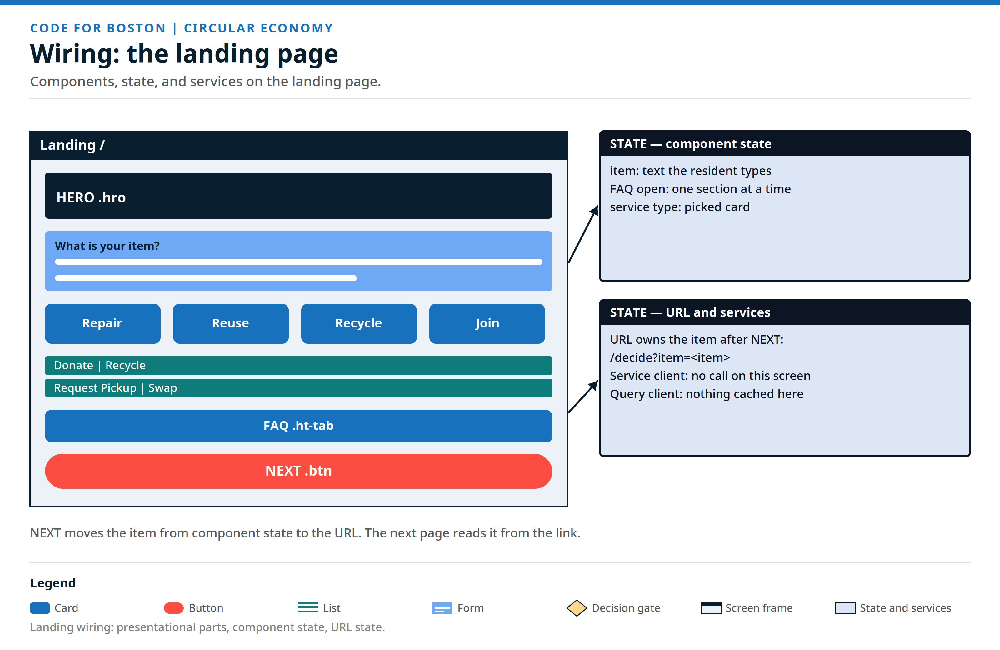

The diagram shows the wiring. The hero, the search input, the
cards, and the FAQ are presentational parts. They take props and
render. The page holds the item in component state. NEXT moves the
item to the URL. The service client makes no call on this screen:
the landing page asks the resident a question, and it fetches
nothing.

### Build steps

Build one component per step, in the order the resident reads the
page: top to bottom.

### Step 1: Add the hero

The hero is the top band of the page. It holds the title and the
intro. The classes are `.hro`, `.hro-c`, `.hro-t`, `.hro-i`. The
title is Montserrat bold uppercase white. The intro is Lora italic
white. The demo hero uses the stripe variant with the TV story.

Type this code for the hero part of the landing page.

```tsx
// The hero sits at the top of the page, so the resident reads it first.
// The title names the site in plain words, and the intro says what the site does.
<header className="hro hro--d">
  <div className="hro-c">
    <h1 className="hro-t">Give your things a next life</h1>
    <p className="hro-i">Repair it, share it, or pass it on.</p>
  </div>
</header>
```

Your file tree now looks like this.

```text
client/
  src/
    pages/
      __root.tsx
```

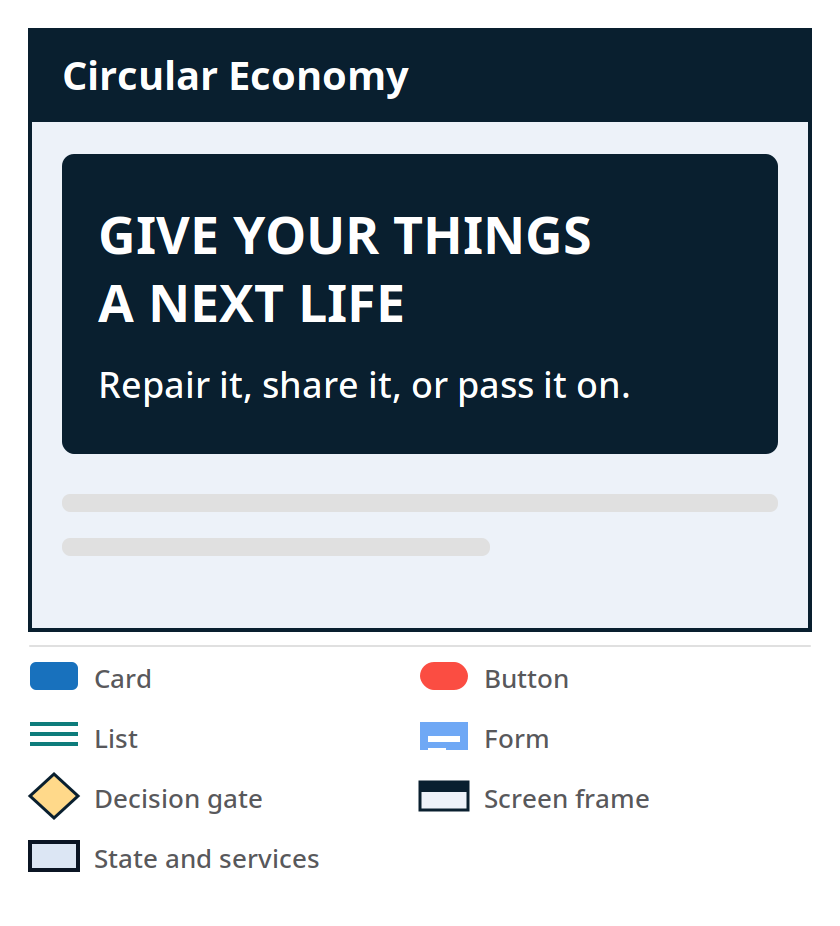

What you should see: a Charles Blue band at the top of the page
with a white uppercase title and a white italic intro line under
it. Check: at 390 pixels wide, the title still fits and nothing
overflows the band.

### Step 2: Add the search input

The search input is the field "What is your item?" The widget is
W-06. The classes are `.sf`, `.sf-hl`, and `.txt-f`. The field
searches as the resident types, with matching letters in bold. The
match is Yellow background with Charles Blue bold text, so the
match is never marked by colour alone. Debounce waits 200 ms for a
pause before the search runs. An empty query shows nothing, not
the whole list.

Type this code under the hero.

```tsx
// client/src/components/ui/SearchInput.tsx
// The parent owns the query, so the input holds nothing and the page stays in charge.
// The hook waits 200 ms for a pause, then calls the service. The pause stops a call on every keystroke, so typing stays fast.
const [query, setQuery] = useState("");
const results = useDebouncedSearch(query, 200);
<input className="sf" type="text" value={query} onChange={(e) => setQuery(e.target.value)} />
{results.map((r) => <li key={r.id}><HighlightedItem item={r.name} match={query} /></li>)}
```

Your file tree now looks like this.

```text
client/
  src/
    components/
      ui/
        SearchInput.tsx
    pages/
      __root.tsx
```

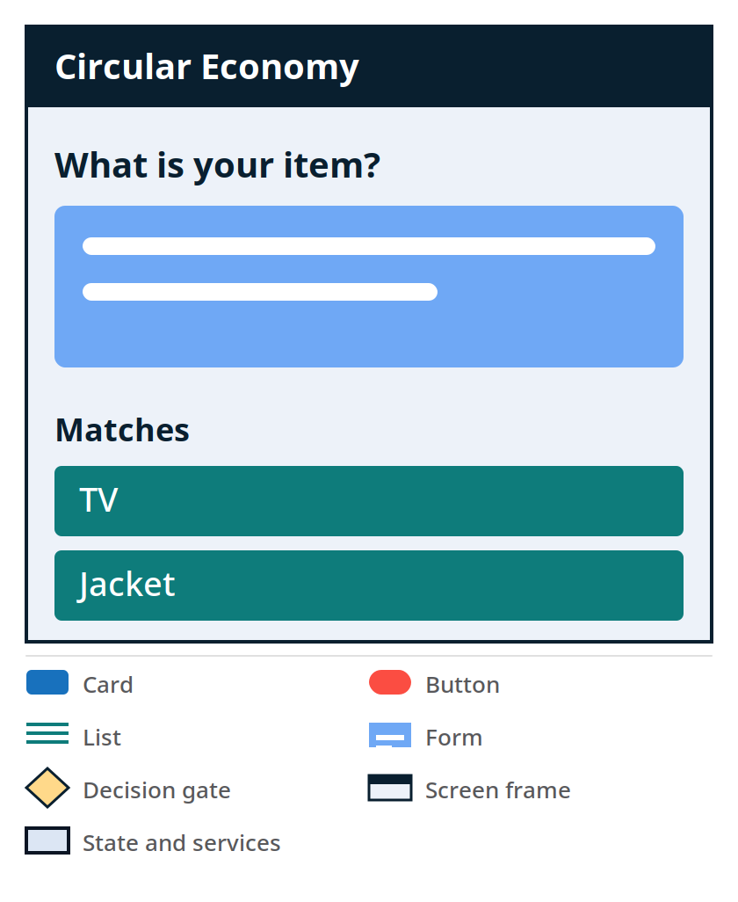

What you should see: a wide field under the hero with the label
"What is your item?" Type a letter. Matches show under the field
with the matching letters in bold on Yellow. Check: clear the
field. The matches go away. The field shows nothing, not the whole
list.

### Step 3: Add the service-type cards

Four service-type cards sit under the search: Repair, Reuse,
Recycle, Join. The class is `.cdfg`, the full-bleed gradient card.
Each card has an icon circle 45 pixels wide with a 3 pixel Charles
Blue border, a Montserrat bold uppercase title, and a Lora italic
description. The variants are `--ob`, `--cb`, and `--r`. Only
Repair is wired in this journey: a card click picks the service
type, and the URL carries it to the next page.

Type this code under the search input.

```tsx
// The cards name the four paths in plain words, so the resident picks one by reading it.
// A card is a button, so a keyboard user reaches it with Tab and picks it with Enter.
// The click stores the service type, and the URL carries it to the next page.
<div>
  <button className="cdfg cdfg--ob">Repair</button>
  <button className="cdfg cdfg--cb">Reuse</button>
  <button className="cdfg cdfg--r">Recycle</button>
  <button className="cdfg">Join</button>
</div>
```

Your file tree now looks like this.

```text
client/
  src/
    components/
      ui/
        SearchInput.tsx
    pages/
      __root.tsx
```

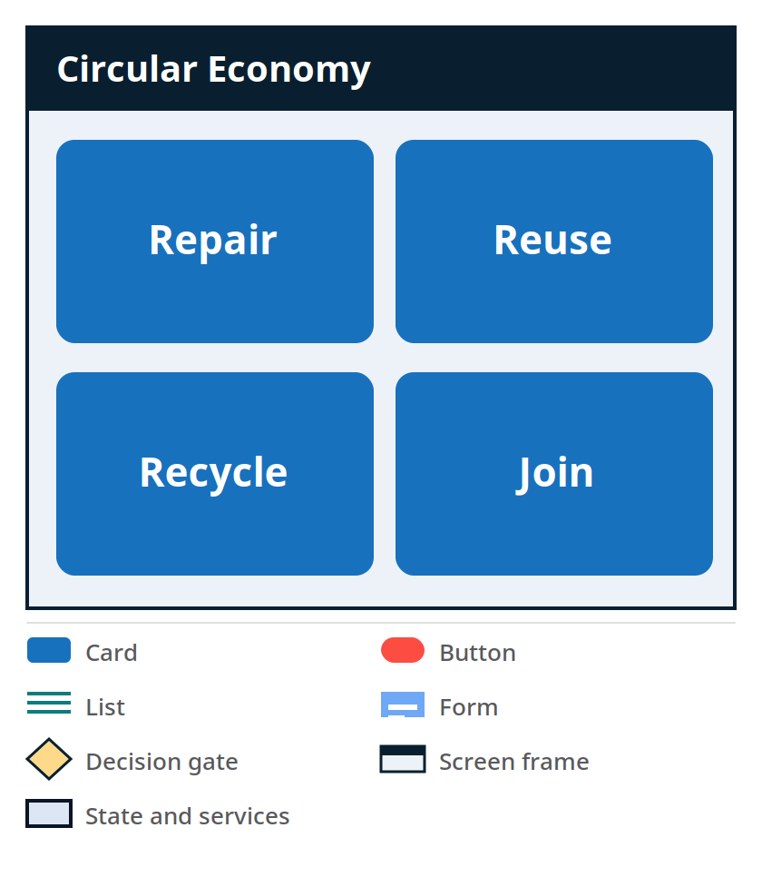

What you should see: four Optimistic Blue cards in a row, each with
a white title. On a phone they stack full width. Check: press Tab
to a card. The 3 pixel Optimistic Blue focus ring shows around it.

### Step 4: Add the grid icon cards

Four grid icon cards sit under the service cards: Donate, Recycle,
Request Pickup, Swap. The classes are `.cds`, `.cds-i`, `.cds-t`.
Each card is centred, with a Montserrat bold uppercase title. Hover
underlines the title and turns the icon stroke Optimistic Blue.

Type this code under the service-type cards.

```tsx
// The icon cards name four more paths, so the resident sees every path on one screen.
// Each card is a link, so a keyboard user reaches it with Tab and opens it with Enter.
// The title underlines on hover, so the hover state is a shape change and a colour change, never colour alone.
<div>
  <a className="cds" href="/donate">Donate</a>
  <a className="cds" href="/decide">Recycle</a>
  <a className="cds" href="/donate">Request Pickup</a>
  <a className="cds" href="/find">Swap</a>
</div>
```

Your file tree now looks like this.

```text
client/
  src/
    components/
      ui/
        SearchInput.tsx
    pages/
      __root.tsx
```

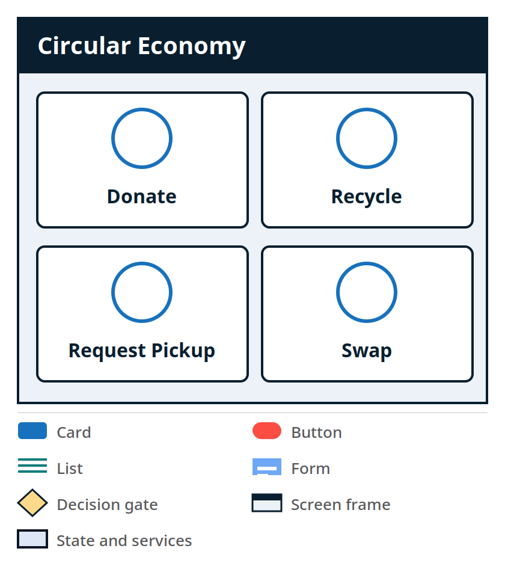

What you should see: four centred cards, each with an icon circle
and an uppercase title. Check: hover a card. The title underlines
and the icon stroke turns Optimistic Blue.

### Step 5: Add the FAQ

The FAQ is a collapsible list. The classes are `.ht-tab`,
`.ht-tab-h`, `.ht-tab-t`, `.ht-tab-c`, `.ht-tab-ic`. The background
is grey `#F3F3F3`. The open header is Charles Blue with a white
title. Hover or focus turns the header Optimistic Blue. The open
state shows the word "hide" at the top right. Content stays hidden
until the section opens. One section opens at a time.

Type this code under the icon cards.

```tsx
// The FAQ answers common questions in plain words, so the resident reads on before she asks.
// The header is a real button, so a keyboard user opens it with Enter or Space.
// aria-expanded carries the open state, so a screen reader announces open and closed.
<button className="ht-tab-h" aria-expanded="false">
  <span className="ht-tab-t">How does repair work?</span>
</button>
<div className="ht-tab-c">Bring your item to a free clinic. A coach helps you fix it.</div>
```

Your file tree now looks like this.

```text
client/
  src/
    components/
      ui/
        SearchInput.tsx
    pages/
      __root.tsx
```

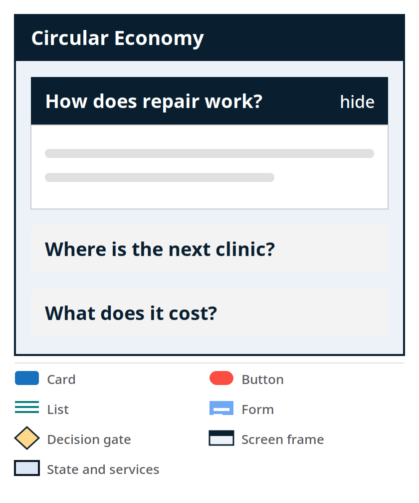

What you should see: grey FAQ rows under the cards. The first row
reads "How does repair work?" Check: press Enter on a row header.
The row opens, the header turns Charles Blue with white text, and
the word "hide" shows at the top right.

### Step 6: Add the NEXT button

NEXT is the primary action on the page. The class is `.btn`, the
full-width primary button on the landing page. NEXT moves the item
to the URL and opens the wizard. A primary action is a visible
button, never a bare text link.

Type this code under the FAQ.

```tsx
// NEXT is a visible button, so the resident sees the way forward without hunting for it.
// NEXT moves the item to the URL, so the next page reads the item from the link.
// The URL owns the item after NEXT, so a shared link carries it to the next page.
<button className="btn btn--b" onClick={() => navigate(`/decide?item=${item}`)}>Next</button>
```

Your file tree now looks like this.

```text
client/
  src/
    components/
      ui/
        SearchInput.tsx
    pages/
      __root.tsx
```

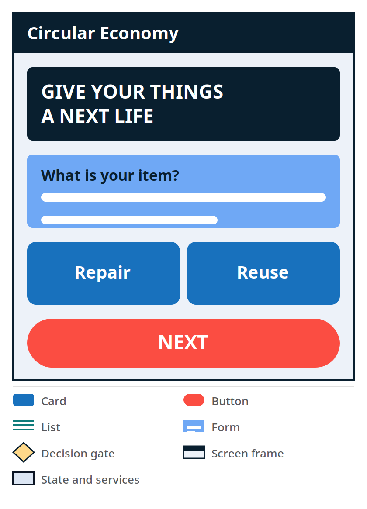

What you should see: a Freedom Trail Red pill button that reads
"NEXT" in white uppercase text, full width, under the FAQ. Check:
type an item, then press NEXT. The browser address changes to
`/decide?item=` followed by your item. The landing page is done.

### Accessibility on the landing page

- The FAQ header is a real `<button>`. `aria-expanded` carries the
  open state.
- The search input is a real input. The cards are real buttons and
  links.
- Focus ring is the 3 pixel Optimistic Blue ring on every control.
- The skip link jumps past the header to `#main`.
- At 200% zoom the page behaves like a narrow viewport: the cards
  stack full width and nothing clips.
- Meaning never rests on colour alone: the search match is bold
  text on Yellow, and the open FAQ shows the word "hide".

## 2.3 Screen 2: The Decide wizard, `/decide`

What the resident does: she answers one question group per step.
Step 1 asks the condition of the item. Step 2 asks what she wants
to do with it. Step 3 asks where she is. BACK goes back. NEXT goes
forward. A step with no answer blocks NEXT. The last step routes by
the answers.

### Page model

| State | Lives | Changes it |
| --- | --- | --- |
| Item | URL `?item=` | Landing NEXT, typing |
| Condition, intent, location | Form state | Radio change (Stub 6), typing (Stub 7) |
| Step, 1 to 3 | Component state | BACK / NEXT (Stub 12) |
| Routing result | Derived, no state | Condition + intent change |

The routing result is derived from condition and intent. It is
computed, not stored, so it never goes stale. The routing values
are repair, reuse, recycle, and maintain.

```tsx
// Page model: /decide: step and answers live in the page. The routing result is derived.
// const [step, setStep] = useState(1);
// const [answers, setAnswers] = useState({ condition: "", intent: "" });
// const route = routeByAnswers(answers); // "repair" | "reuse" | "recycle" | "maintain". One function maps answers to a route, so the rule lives in one place.
```

The wizard is a State pattern flow: the next step is a function of
the answers so far. The step and the answers are the state. The
question groups inside each step use the Composite pattern.

### Diagram

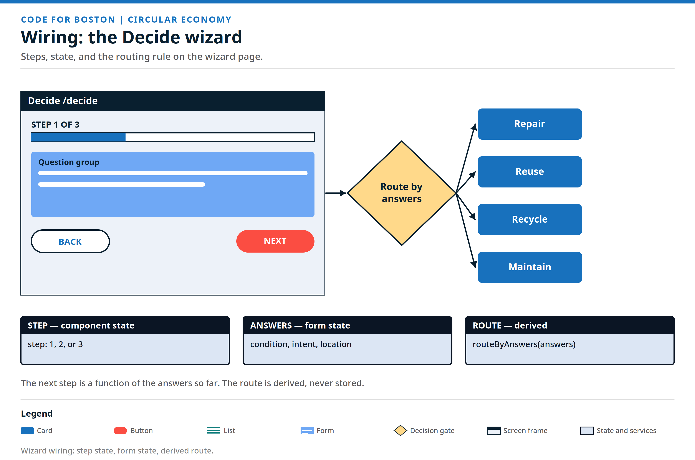

The diagram shows the wiring. The page holds the step in component
state and the answers in form state. Each step shows one question
group. The question group holds the answer in context, and the
options read it from context. NEXT needs an answer. The last step
runs the routing function. The routing function is one pure
function: it takes the answers and returns a route. No service call
runs on this screen. The wizard asks questions and routes. It
fetches nothing.

### Build steps

Build one idea per step, in the order the resident sees the wizard.

### Step 1: Add the wizard shell

The wizard shell holds the step indicator and the progress bar. The
step indicator is `.stp`, with `.stp-n` for the number, `.stp--done`
for a done step, and `.stp--now` for the current step. The progress
bar is `.prg`, a native `<progress>` element: height 20 pixels, 3
pixel Charles Blue border, white track, Optimistic Blue fill, 0.5
second width transition. The page file is
`client/src/pages/decide/index.tsx`.

Type this code in `client/src/pages/decide/index.tsx`.

```tsx
// client/src/pages/decide/index.tsx
// The step is the state. It holds 1, 2, or 3, so the page shows one step at a time.
// The step indicator shows where the resident stands, so she knows how much is left.
const [step, setStep] = useState(1);
<p className="prg">Step {step} of 3</p>
<progress className="prg" value={step} max={3} />
```

Your file tree now looks like this.

```text
client/
  src/
    components/
      ui/
        SearchInput.tsx
    pages/
      __root.tsx
      decide/
        index.tsx
```

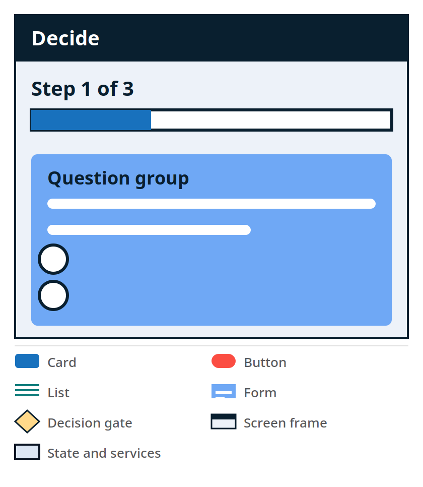

What you should see: a Charles Blue header bar, then "Step 1 of 3"
in Montserrat uppercase text, then a progress bar with an Optimistic
Blue fill one third full. Check: the bar shows one third filled,
and the step number reads 1.

### Step 2: Add the question group

A question group is one question with its options. The pattern is
Composite. The parent holds the answer. Children read it through
context, never as props from the page. The widget is W-25. The
classes are `.ra-f` for radios, `.ra-l` for radio labels, `.cb-f`
for checkboxes, `.cb-l` for checkbox labels.

Type this code for the question group. It is the shared part the
three steps reuse.

```tsx
// The parent holds the answer, so one place owns the value and the options never drift apart.
// The children read the answer through context, so the page passes no answer down as a prop.
// A radio group moves with arrow keys, so a keyboard user picks an option without a mouse.
<QuestionGroup id="damage">
  <QuestionOption value="zip">Broken zip</QuestionOption>
  <QuestionOption value="hole">Hole or tear</QuestionOption>
</QuestionGroup>
```

Your file tree now looks like this.

```text
client/
  src/
    components/
      ui/
        SearchInput.tsx
    pages/
      __root.tsx
      decide/
        index.tsx
```


What you should see: the wizard frame from step 1, now with a
question group under the progress bar. Check: press Tab to an
option, then use the arrow keys. Focus moves between the options,
and the picked option shows the Optimistic Blue checked radio.

### Step 3: Add step 1: the condition question

Step 1 asks the condition of the item. The answers live in form
state and change on radio change. The option words come from the
decision matrix in issue #76. The guide shows the damage example
from the sources: "Broken zip" and "Hole or tear".

Type this code in the wizard page, under the shell.

```tsx
// Step 1 asks the condition, so the routing rule knows what state the item is in.
// The form owns the answer, so the page reads it from one place when it routes.
// The option words come from the decision matrix, so the words match the rule that reads them.
{step === 1 && (
  <QuestionGroup id="condition">
    <QuestionOption value="zip">Broken zip</QuestionOption>
    <QuestionOption value="hole">Hole or tear</QuestionOption>
  </QuestionGroup>
)}
```

Your file tree now looks like this.

```text
client/
  src/
    components/
      ui/
        SearchInput.tsx
    pages/
      __root.tsx
      decide/
        index.tsx
```

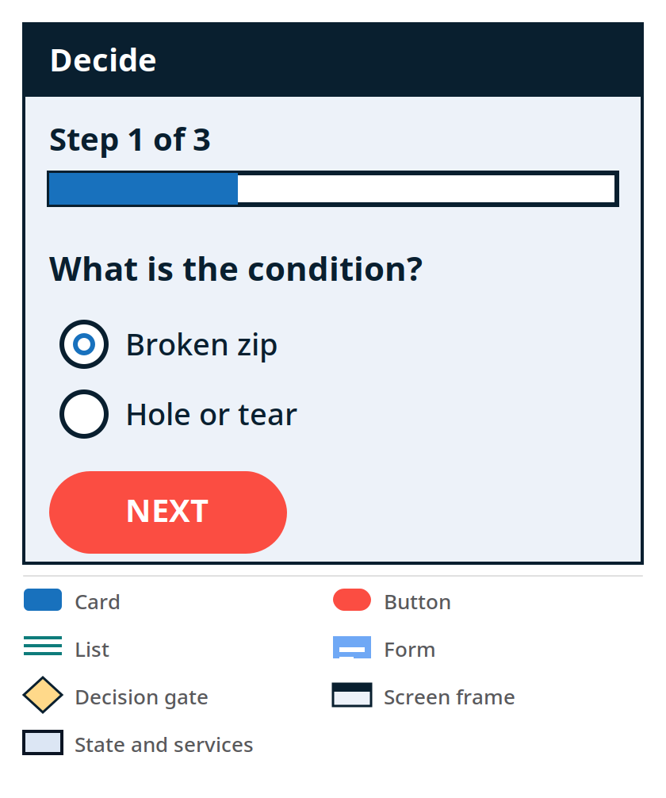

What you should see: "Step 1 of 3", the progress bar one third
full, and the condition question with two radio options: "Broken
zip" and "Hole or tear". Check: pick an option. The radio fills
Optimistic Blue with a white inner ring. The NEXT button becomes
active.

### Step 4: Add step 2: the intent question

Step 2 asks what the resident wants to do with the item. It uses
the same question group shape as step 1. Same component, new
question. One idea per step: this step adds the intent question
only. The option words come from the decision matrix in issue #76.
Put those words in the options below. The values shown here are
placeholders: replace them with the matrix words.

Type this code under the step 1 block.

```tsx
// Step 2 asks the intent, so the routing rule knows what the resident wants to do.
// The step shows only when step is 2, so the resident answers one question at a time.
// One question at a time keeps the form short, so the resident finishes it.
{step === 2 && (
  <QuestionGroup id="intent">
    {/* The option words come from the decision matrix in issue #76. Put those words here. */}
    <QuestionOption value="first-choice">First choice</QuestionOption>
    <QuestionOption value="second-choice">Second choice</QuestionOption>
  </QuestionGroup>
)}
```

Your file tree now looks like this.

```text
client/
  src/
    components/
      ui/
        SearchInput.tsx
    pages/
      __root.tsx
      decide/
        index.tsx
```

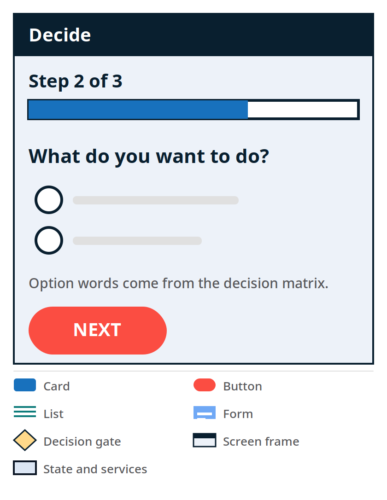

What you should see: press NEXT from step 1. The page shows "Step
2 of 3", the progress bar two thirds full, and the intent question
with its options. Check: press BACK. The page returns to step 1,
and the condition answer is still picked.

### Step 5: Add step 3: the location question

Step 3 asks where the resident is. The location field is a
controlled input. The pattern is Stub 7, a controlled component
with the Observer shape. The form owns the value. The input holds
nothing. The classes are `.fld`, `.txt-f`, and `.sel-f`. If a
parent needs the value to decide the next step, the component is
controlled. The wizard needs the location to route, so this input
is controlled.

Type this code under the step 2 block.

```tsx
// Step 3 asks the location, so the routing rule knows where the resident is.
// The form owns the value and the input holds nothing, so the page reads the location from one place.
// A controlled input updates when the form state changes, so the field and the state never drift apart.
{step === 3 && (
  <div className="fld">
    <label className="txt-l" htmlFor="location">Where are you?</label>
    <ItemInput value={answers.location} onChange={(v) => setAnswers({ ...answers, location: v })} />
  </div>
)}
```

Your file tree now looks like this.

```text
client/
  src/
    components/
      ui/
        SearchInput.tsx
    pages/
      __root.tsx
      decide/
        index.tsx
```

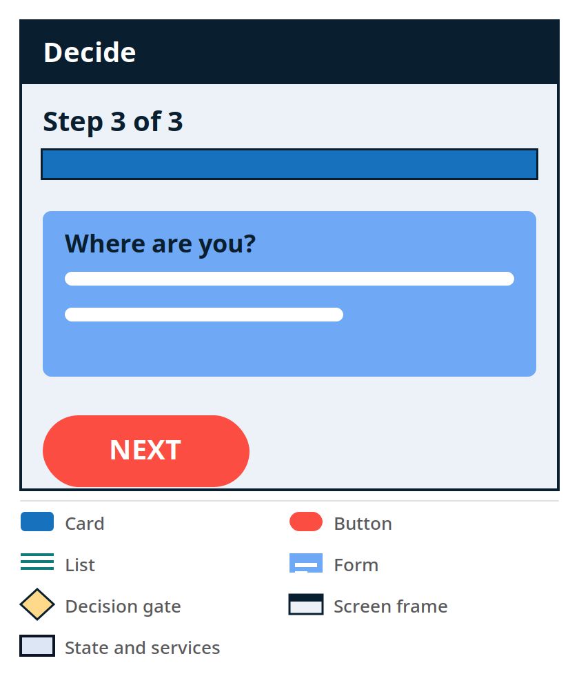

What you should see: press NEXT from step 2. The page shows "Step
3 of 3", the progress bar full, and a light-blue form box with the
label "Where are you?" and a text field with a 3 pixel Charles Blue
border. Check: type in the field. The text shows in Lora 16 pixel
type, and the value stays when you press BACK and return.

### Step 6: Add BACK and NEXT

BACK goes back. NEXT goes forward. A step with no answer blocks
NEXT. NEXT is `.btn`. BACK is `.btn--br`, white with a blue border
and blue text. The NEXT button is disabled until the step has an
answer. A disabled button shows a `#E0E0E0` background with
`#828282` text and a default cursor. A disabled control never takes
focus styling.

Type this code under the question blocks.

```tsx
// stepKey maps a step number to its answer key, so NEXT checks the answer for this step only.
// Step 1 checks condition. Step 2 checks intent. Step 3 checks location.
const stepKey = (s: number) => (s === 1 ? "condition" : s === 2 ? "intent" : "location");
// BACK moves back one step, so the resident can fix an earlier answer.
// NEXT needs an answer, so a step with no answer blocks NEXT and the resident cannot skip a question.
// The disabled NEXT is grey with grey text, so the block is a word and a colour change, never colour alone.
const canNext = answers[stepKey(step)] !== undefined;
<button className="btn--br" onClick={() => setStep(step - 1)}>Back</button>
<button className="btn" disabled={!canNext} onClick={() => setStep(step + 1)}>Next</button>
```

Your file tree now looks like this.

```text
client/
  src/
    components/
      ui/
        SearchInput.tsx
    pages/
      __root.tsx
      decide/
        index.tsx
```


What you should see: a white BACK button with a blue border on the
left, and a Freedom Trail Red NEXT pill on the right. On a fresh
step, NEXT is grey with grey text. Check: pick an option. NEXT
turns Freedom Trail Red with white text. Press NEXT with no answer
picked: nothing happens, and NEXT stays grey.

### Step 7: Add the routing result

The last step routes by the answers. The routing result is derived.
One function maps answers to a route. The values are repair, reuse,
recycle, and maintain. The rule lives in one place, so a rule
change touches one function.

Type this code in the wizard page.

```tsx
// The routing result is derived, so it is computed from the answers and never stored.
// A derived value cannot go stale, so the route always matches the answers on screen.
// One function maps answers to a route, so the rule lives in one place.
const route = routeByAnswers(answers); // "repair" | "reuse" | "recycle" | "maintain"
// The last step shows the route, so the resident sees where the answers send her.
{step === 3 && canNext && (
  <div>
    <p>Your path is {route}.</p>
    <button className="btn" onClick={() => navigate(`/${route}`)}>Continue</button>
  </div>
)}
```

Your file tree now looks like this.

```text
client/
  src/
    components/
      ui/
        SearchInput.tsx
    pages/
      __root.tsx
      decide/
        index.tsx
```

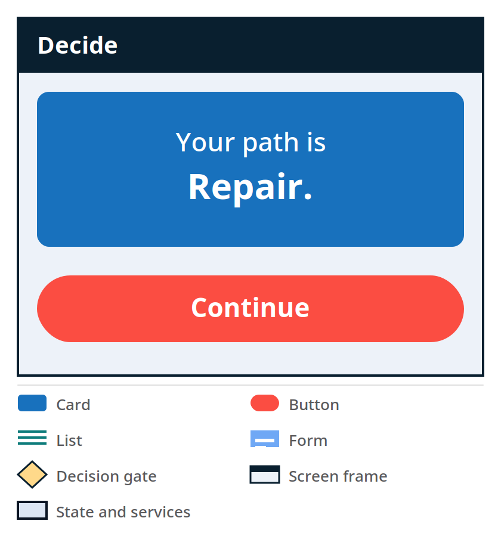

What you should see: after the third answer, a card reads "Your
path is Repair." with a Freedom Trail Red Continue pill under it.
Check: press Continue. The browser opens the repair path. Change
an answer with BACK and come forward again: the path word updates
to match the new answers. The wizard is done.

### Accessibility on the wizard

- Radios move with arrow keys. Space toggles a checkbox.
- A step with no answer blocks NEXT, and the NEXT button is
  disabled: grey `#E0E0E0` background, `#828282` text, default
  cursor. A disabled control never takes focus styling.
- Focus moves to the page heading on load. Focus moves to the new
  step heading when the step changes, so a screen reader announces
  the new step.
- The step indicator shows "Step 1 of 3" in words, and the progress
  bar is a native `<progress>` element, so a screen reader reads
  its value.
- Meaning never rests on colour alone: the blocked NEXT is grey
  and disabled, the picked radio is filled and labelled, and the
  route is a word on the result card.

## 2.4 Final check: walk the whole journey

Build it first.

```bash
tsc -b && vite build
```

What you should see: the checker and the build both pass with no
errors. Check: the terminal shows no red text.

Then walk the journey in the browser, in order.

1. Open the landing page. Type an item. Press NEXT. The address
   changes to `/decide?item=` followed by your item.
2. Answer the condition question. Press NEXT. The step indicator
   reads "Step 2 of 3".
3. Answer the intent question. Press NEXT. The step indicator reads
   "Step 3 of 3".
4. Type your location. The routing result shows your path in words.
   Press Continue. The browser opens the matching path.
5. Press BACK from step 2. The condition answer is still picked.
6. Walk the whole journey by keyboard alone: Tab, arrow keys, Enter,
   Space. Every control works without a mouse.
7. Walk it with a screen reader. The step changes, the answers, and
   the route are all announced in words.
8. Walk it at 200% zoom and at 390 pixel phone width. The cards
   stack full width. Nothing clips. Nothing overflows.
9. Walk it fresh, with no answers, and seeded, with answers in
   place. The blocked NEXT holds on a fresh step, and the saved
   answers hold on a seeded walk.

The journey is done when every walk passes. A green gate count is
text only. It is not a pass on its own.

## The files in this journey

| File | What it holds |
| --- | --- |
| `client/src/pages/__root.tsx` | The shared shell: skip link, main, live region |
| `client/src/pages/decide/index.tsx` | The Decide wizard page |
| `client/src/components/ui/SearchInput.tsx` | The search input on the landing page |

The landing page itself has no file path in the sources. The search query in `client/src/api/search.ts` makes no call on the landing page or the wizard. Those screens ask questions and route. The query serves the results pages the routes open.
