# Donate and pickup: build the journey Jason uses

This guide builds one real part of the Circular Economy site. You build the `/donate` journey, screen by screen, in the order Jason sees it. At the end, the journey works. Jason names an item, learns if a provider takes it, books a pickup, and finds a drop-off site on foot or by transit.

Jason moves out of his home. He has bulky items to give away. Bulky items are hard to give away. He finds the City pickup through Google and the City site. He picks City pickup and drop-off boxes. He has no car. Six of nine residents move bulky items without a car. This journey works without a car. That is what makes it work for Jason.

The journey has three parts, all on `/donate`:

1. The acceptance checker. Jason names an item. The checker answers Yes, No, or Maybe, in words, with the reason.
2. The pickup scheduler. Jason picks an item size, a day, and a time slot. He reads a plain-word summary of his pickup.
3. The drop-off locator. Jason picks how he gets there: walking, transit, or car. The map shows the drop-off sites he can reach that way.

This guide is for a developer who has never coded a webpage before. Part 1 starts from zero. It explains every term in plain words. Part 2 builds the journey, one component at a time. You type the code as you go. You check each step in a browser before you move on.

## The journey at a glance

Read this picture first. It shows the whole journey, left to right. Jason moves out. He checks an item. He books a pickup. He finds a drop-off site. The gold diamond is the one question that splits the path: will they take it?

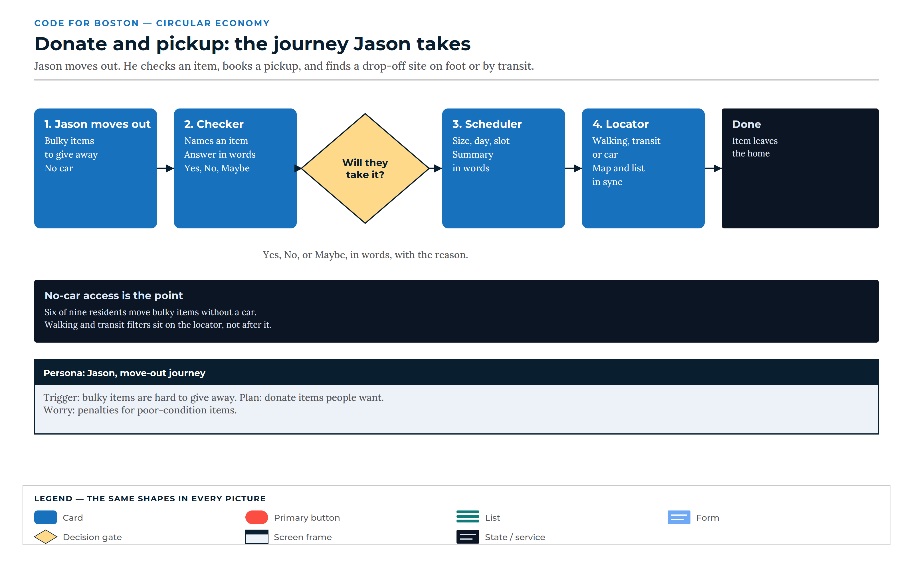

## The build at a glance

Read this picture second. It shows the build order, left to right. You build the shared shell first, then the service and the hook, then the three parts in the order Jason sees them. Each part follows the same eight steps. The gold diamonds are the checks that end each part: the answer is in words, the slot comes from the server, the list works when the map fails.

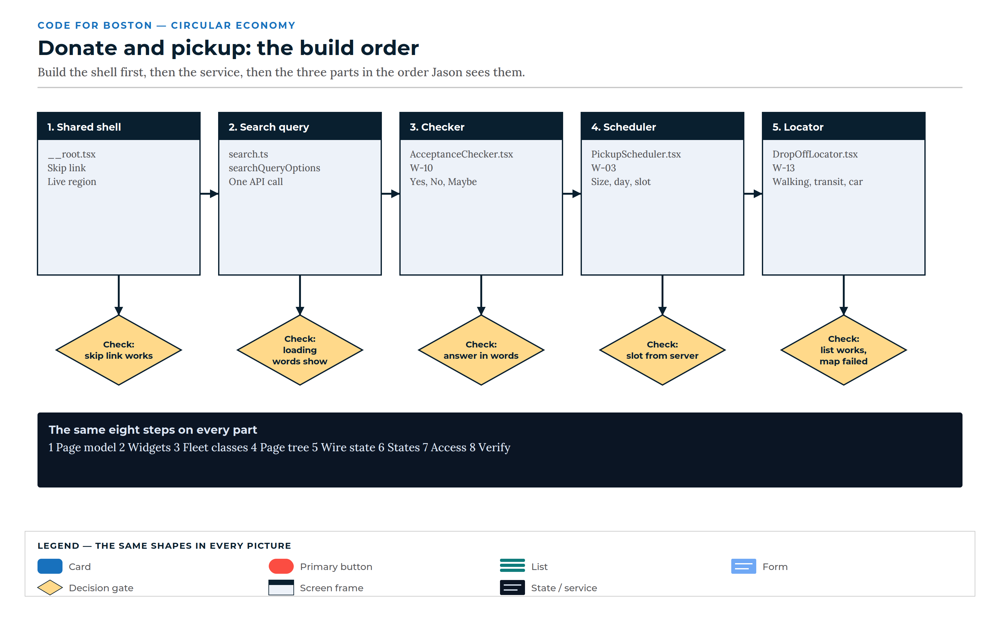

## How to use this guide

Read Part 1 first, in order. Each section builds on the last one. Part 2 follows the order Jason sees the parts. Build the parts in that order. Do not skip a part.

Every build step in Part 2 has the same shape:

1. What you build. One idea only. One component only.
2. The picture. A small picture of the screen at that point in the build.
3. The code. The exact code to type, with comments that say why each step exists.
4. What you should see. The exact thing the browser shows, in Fleet colours.
5. Check. One checkable outcome. Run it before you move on.

After every change, the guide shows the file tree. The tree shows where you are. Read it after each step. If your tree looks different, stop and fix it before you go on.

The guide names files by their exact path. Type the path exactly as shown. The guide names patterns by their canonical names only. A pattern is a named solution to a known problem. The names come from two books: Gamma, Helm, Johnson, and Vlissides, "Design Patterns" (1994), and Fowler, "Patterns of Enterprise Application Architecture" (2002). Dependency Injection is Fowler (2004). A pattern with no name in those books is called a React idiom. A React idiom is a common way to write React code. It has no book name, so the guide gives it none.

The guide names styles by their Fleet class names. Fleet is the City of Boston design system. Its stylesheet is `design-theme/fleet-theme.css`. Keep the Fleet name where Fleet defines one. A part that needs a class Fleet does not define gets a new class in the theme first, then the component.

The pictures in this guide use one fixed visual language. A card is Optimistic Blue `#1871BD`, a rounded rectangle. A primary action button is Freedom Trail Red `#FB4D42`, a pill shape. A list is teal `#0E7C7B`, stacked horizontal rows. A form is light-blue `#6FA8F5`, a rectangle with input lines. A decision gate is an amber `#FFD98A` diamond. A screen frame is a Charles Blue `#091F2F` header bar with a pale `#EDF2F9` body. State and services are navy `#0B1524` with pale `#DCE6F4`. Every picture carries this mapping in its legend.

## The files you will build

| File | What it holds |
| --- | --- |
| `client/src/pages/__root.tsx` | The shared shell: skip link, main, live region |
| `client/src/api/search.ts` | The search query that calls the API |
| `client/src/api/client.ts` | The typed client and the unwrap helper |
| `client/src/api/queryClient.ts` | The query client |
| `client/src/lib/validate.ts` | One validation function per form |
| `client/src/components/donate/AcceptanceChecker.tsx` | The acceptance checker |
| `client/src/components/donate/PickupScheduler.tsx` | The pickup scheduler |
| `client/src/components/map/DropOffLocator.tsx` | The drop-off locator |
| `client/src/components/map/SearchMap.tsx` | The map the locator reuses |

The `/donate` page holds the three parts. The guide gives the page model for `/donate` and the files for each part. The guide does not name a file for the page itself.

---

# Part 1 — Start from zero

## 1.1 What a webpage is

A webpage is a document a browser shows. A browser is a program that reads web documents and shows them on a screen. Chrome, Firefox, and Safari are browsers.

A webpage is made of three parts.

- HTML gives the page its parts. HTML stands for HyperText Markup Language. A part is a heading, a paragraph, a button, or a field.
- CSS gives the parts their look. CSS stands for Cascading Style Sheets. It sets colours, sizes, and spacing.
- JavaScript gives the page its behaviour. It reacts when the resident presses a button or types in a field.

This app adds one more idea. React builds the page from components. A component is a React part. A component is a function that returns HTML. You build a page by joining small components into a tree. The page is the root. Parts hold parts.

## 1.2 The tools to install

You need four tools. Install them in this order.

1. A code editor. An editor is a program for writing code. It shows line numbers. It marks errors as you type. Any plain code editor works. Visual Studio Code is one common choice. It is free.
2. A web browser. Any modern browser works. Chrome and Firefox both work. The browser shows your page. Its developer tools show errors.
3. Node.js. Node.js runs JavaScript outside the browser. The build tools need it. Install the current stable release from the Node.js site. The install also gives you `npm`. npm installs packages. A package is a set of code someone else wrote.
4. A terminal. A terminal is a window where you type commands. A command is one line of text that tells the computer to do one thing. On a Mac, open Terminal. On Windows, open the terminal that comes with your editor.

Check each install. Open a terminal. Type `node --version`. The terminal prints a number. If it prints an error, the install did not work. Fix it before you go on.

## 1.3 The first file

Make a folder for your practice. Call it `practice`. Open the folder in your editor. Make a file called `hello.html`. Type this code.

```html
<!DOCTYPE html>
<html>
  <head>
    <title>My first page</title>
  </head>
  <body>
    <h1>Hello, Boston</h1>
    <p>This is my first webpage.</p>
    <button>Press me</button>
  </body>
</html>
```

Each line does one thing.

- `<!DOCTYPE html>` tells the browser this file is HTML.
- `<html>` opens the page. `</html>` closes it.
- `<head>` holds facts about the page. `<title>` sets the text the browser tab shows.
- `<body>` holds what the resident sees.
- `<h1>` is the main heading. `<p>` is a paragraph. `<button>` is a button.

Save the file. Open it in your browser. Use the browser menu and pick Open File, or drag the file into a browser window.

The browser shows a white page. The heading reads "Hello, Boston" in black. Below it, a paragraph reads "This is my first webpage." Below that, a grey button reads "Press me". The button does nothing yet. That is fine. You have made a webpage.

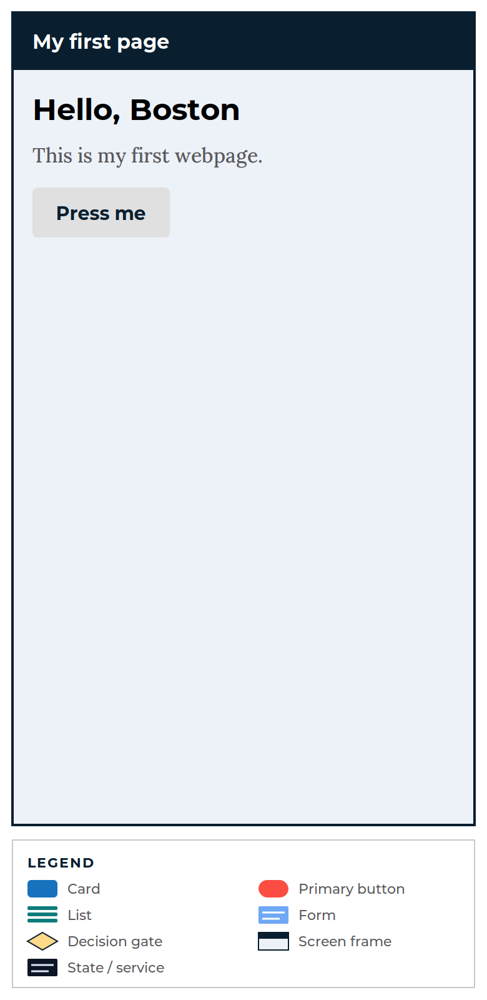

Check: the browser shows "Hello, Boston" and the button. If it shows the code itself, you opened the file in the editor, not the browser. Open it in the browser.

Your file tree looks like this now:

```text
practice/
  hello.html
```

Now add a style. Make a file called `hello.css` in the same folder. Type this code.

```css
h1 {
  color: #1871BD;
}
```

`#1871BD` is Optimistic Blue. It is the Fleet colour for links and primary buttons. Add this line inside the `<head>` of `hello.html`, after the title.

```html
<link rel="stylesheet" href="hello.css">
```

Save both files. Reload the browser page. A reload reads the files again. The heading turns Optimistic Blue. The HTML names the part. The CSS names the look. That split is the whole idea. Keep it in mind for every screen you build.

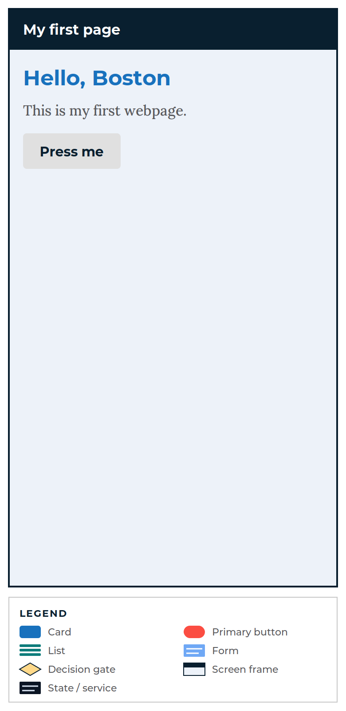

Check: the heading is Optimistic Blue `#1871BD` and the button is still grey. If the heading stays black, the link line sits in the wrong place, or the file name is wrong. Check both.

Your file tree looks like this now:

```text
practice/
  hello.html
  hello.css
```

## 1.4 How to open the app in a browser

The real app is not one HTML file. It is many files. A build tool joins them into a page the browser can read. The build tool here is Vite. Vite is a program that builds the app and serves it while you work. To serve means to send the page to the browser on request.

Open a terminal in the project folder. The project folder is the folder that holds the `client` folder. Run the command that starts the development server. The project readme names that command. The server prints an address, like `http://localhost:5173`. Open that address in your browser. The app shows. Keep the terminal open while you work. When you save a file, the page updates in the browser.

To check the whole app builds, run this command in the terminal.

```bash
tsc -b && vite build
```

- `tsc -b` runs the TypeScript checker. It reads every file. It reports type errors. A type error is a value used in the wrong way.
- `&&` means run the second command only if the first one passes.
- `vite build` builds the app for real use.

If both pass with no errors, the app builds. The terminal prints a short build report and returns to the prompt. If either fails, read the error. The next section shows how.

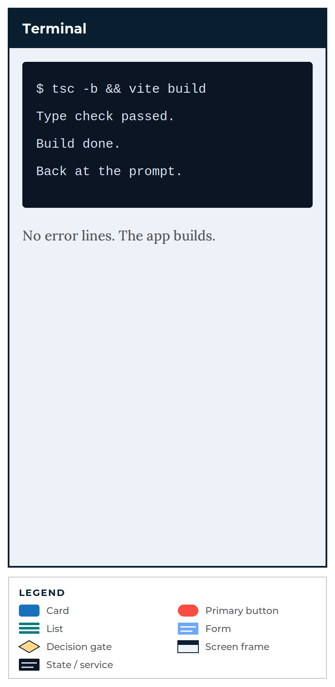

Check: the terminal returns to the prompt with no error lines. If it prints errors, read them with the next section before you go on.

## 1.5 How to read an error

An error message has three parts. Find them in order.

1. The file name and line number. The message names the file and the line where the problem sits. Open that file. Go to that line.
2. The short message. The message says what is wrong in one line. Read it slowly. It often names the value that is wrong.
3. The lines around it. The message shows the lines near the error. The real cause often sits one or two lines above the line named.

Common errors and what they mean:

- "Cannot find module" means the file path is wrong, or the file does not exist yet. Check the path letter by letter.
- "is not defined" means you used a name the file does not know. Check the import at the top of the file. An import is a line that brings a name from another file into this file.
- "Unexpected token" means a bracket or quote is missing, or one too many. Count the opening and closing brackets in the lines near the error.
- A blank page with no error in the terminal means the error is in the browser. Open the browser developer tools. Press F12, or right-click the page and pick Inspect. Click the Console tab. The console shows the error in red.

Fix one error at a time. Save the file. Reload the page. If the error is gone, move on. If a new error shows, read it the same way.

Check: after each fix, the terminal build passes or the browser shows the page again. One fix, one check. Never fix two errors at once.

## 1.6 The words you will meet in Part 2

| Word | What it means |
| --- | --- |
| Component | A React part. A function that returns HTML. |
| State | A value a component remembers while it is on screen. |
| Prop | A value a parent passes to a child. |
| Route | An address in the app, like `/donate`. |
| Service | The one place that calls the API. No page calls the API direct. |
| Hook | A function that holds reusable logic. A hook name starts with `use`. |
| Query client | The store that caches API answers, so a repeat visit loads fast. |
| Cache | Saved answers. The app reuses a saved answer instead of asking again. |
| Container | A component that fetches data or holds state. |
| Presentational part | A component that only renders. It takes props and shows them. |
| Pattern | A named solution to a known problem, from the books named above. |
| Composite | A pattern. A tree of parts. The page is the root. Parts hold parts. |
| State pattern | A pattern. The next step is a function of the answers so far. |
| Decorator | A pattern. A wrapper that adds behaviour around a view. |
| Observer | A pattern. Children update when the state they watch changes. |
| Strategy | A pattern. One function per rule. The caller picks the rule set. |
| Mediator | A pattern. One part links two parts that never talk direct. |
| Iterator | A pattern. Take items in order, stop after ten, move to the next ten. |
| Provider | A React idiom. One value, given at the entry, reaches every screen. |
| Live region | A hidden part of the page that a screen reader reads aloud. |
| Screen reader | Software that reads the page aloud for a person who cannot see it. |
| Focus | The control the keyboard acts on now. Tab moves focus. |

---

# Part 2 — Build this journey

## 2.0 The eight-step page-design sequence

Follow this order for a new page. Do not skip a step. Each step ends when its check passes.

1. Start from the journey and the page model.
2. Pick the widgets from the register.
3. Pick the Fleet classes from the theme.
4. Compose the page tree.
5. Wire the state.
6. Add the loading, error, and empty states.
7. Add keyboard and accessibility behaviour.
8. Verify it in the browser.

A page model is the state a page holds, where each piece lives, and what changes it. If a piece of state has no home, it does not exist yet. Do not write a component first.

One owner holds each piece of state. Two owners for one piece is a defect. Shareable state goes in the URL. Results go in the query client. Form state stays in the form. Selection stays in the page.

A container fetches data or holds state. A presentational part takes props and renders. A part that fetches is a container. A part that only renders takes props. Do not mix the two in one file.

The eight steps follow the layer order of a journey page. Layer 1 is the journey and the page model. Layer 2 is the shell. Layer 3 is the widgets. Layer 4 is the state wiring. Layer 5 is the services. Layer 6 is the states, access, and mobile. Each part in this guide builds in that order, one component per step, one idea per step. A step never introduces two new ideas.

## 2.1 Build the shared shell first

What you build: the shell every screen inherits. Build it before any other widget. The shell lives in `client/src/pages/__root.tsx`. It holds three parts.

- A skip link. A skip link jumps past the header to the main content. A keyboard user presses Tab once, then Enter, and lands on the main content. The class is `.a11y--h`.
- The main content. `<main id="main">` holds the page. The page renders inside it through `<Outlet />`. An outlet is the place where the current page renders inside the shell.
- A live region. A live region is a plain `<div aria-live="polite">`. It holds text a screen reader reads aloud when the text changes. It has no visual style of its own. The class `.sr-only` hides it from sight but keeps it readable by a screen reader.

Type this code in `client/src/pages/__root.tsx`.

```tsx
// client/src/pages/__root.tsx — the shared shell, every page inherits this
// The skip link comes first, so a keyboard user reaches it on the first Tab.
// The link points to #main, so Enter jumps past the header to the main content.
<a className="a11y--h" href="#main">Skip to main content</a>
// The main element holds the page. The id matches the skip link target, so the jump lands here.
<main id="main"><Outlet /></main>
// The live region announces results in words. It holds text only, so a screen reader reads it and a sighted user sees nothing.
<div aria-live="polite" className="sr-only">{announce}</div>
// Rule: meaning never rests on colour alone. Every state also changes text, a border, or an icon. Words carry the meaning for a user who cannot see colour.
```

What you should see: open any page and press Tab once. The skip link shows at the top of the page as a Charles Blue bar with white text that reads "Skip to main content". The page body below it is pale `#EDF2F9` under a Charles Blue header bar.

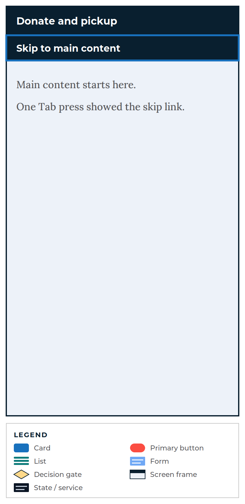

Check: press Enter after the skip link shows. Focus moves to the main content. That check passes when the jump works by keyboard alone.

Focus moves to follow on every screen:

- Page loads, focus goes to the page heading.
- A dialog opens, focus goes inside it and stays there until it closes.
- A dialog closes, focus returns to the button that opened it.
- Escape closes a dialog. A click on the dimmed layer behind the dialog closes it. A click inside does not, so the dialog stays open while the user works in it.

Test with a keyboard alone, then with a screen reader, at 200% zoom.

Your file tree looks like this now:

```text
client/src/pages/
  __root.tsx
```

## 2.2 The service and the hook

What you build: the one place that calls the API, and the hook that reads the answer. Build these before the locator, because the locator reads its sites through them. No page writes its own fetch.

Pattern: Provider, hook, and container (React idioms). The API client, provided at the entry, is the one typed client. Pages and services use that client. Tests provide a client with the same contract shape.

The service lives in `client/src/api/search.ts`. It holds `searchQueryOptions`. It is the one place that calls the API for locations. The call goes to `GET /api/v1/search`. The route returns every location. The page filters the list and shows the first 10 that match. The query key is `['search']`. The answer stays fresh for ten minutes. A result is a `SearchResult` with id, name, lat, lon, address, services, contact, availability, last_verified. The id form is `<data_source>:<data_source_id>`.

The typed client lives in `client/src/api/client.ts`. It builds the client from the generated schema. `unwrap` turns a failed call into a thrown error, so the query enters its error state. The query client lives in `client/src/api/queryClient.ts`. It keeps an answer fresh for 60 seconds. The app entry provides it.

Type this code in `client/src/api/search.ts`.

```ts
// client/src/api/search.ts
// The search query is the one place that calls the API for locations. No page calls the API direct.
// One place means a change to the call touches one file.
import { queryOptions } from '@tanstack/react-query'
import { api, unwrap } from './client'
import type { components } from './schema'

export type SearchResult = components['schemas']['SearchResult']

// GET /api/v1/search returns every location. The page filters the list.
export const searchQueryOptions = queryOptions({
  queryKey: ['search'],
  queryFn: async (): Promise<SearchResult[]> => {
    const response = await unwrap(api.GET('/api/v1/search'))
    return response.results ?? []
  },
  // Results change only when the ETL runs, so the answer stays fresh longer.
  staleTime: 10 * 60_000,
})
```

The route loader warms the cache before the page shows. The page reads the answer with the query. The loader line sits in the route. The read line sits in the page.

```tsx
// The loader starts the request before the page shows. It reuses the saved answer when fresh.
loader: ({ context }) => context.queryClient.ensureQueryData(searchQueryOptions),
// useSuspenseQuery reads the saved answer. The page filters by the search values and shows the first 10 that match.
const { data: sites } = useSuspenseQuery(searchQueryOptions)
```

What you should see: while the call runs, the page shows a progress bar (`.prg`) with Optimistic Blue fill and the words "Loading results…". The list appears when the API answers. The loading bar sits in a navy state box with pale text, above a pale body.

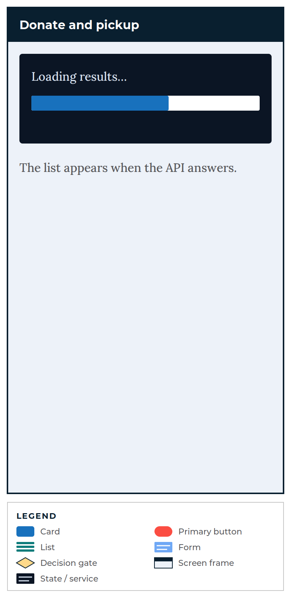

Check: open the page with the network slow. The words "Loading results…" show before the list shows. If the list shows with no loading words first, the page does not use the query shape. Fix it before you go on.

Your file tree looks like this now:

```text
client/src/
  api/
    client.ts
    queryClient.ts
    search.ts
    schema.d.ts
  pages/
    __root.tsx
```

---

---

## Screen 1 — `/donate` — the acceptance checker

### What Jason does

Jason names an item. The checker answers Yes, No, or Maybe, in words, with the reason. A rule that needs a human stays "maybe". The page never guesses, so Jason never gets a wrong yes or no.

The wiring picture shows how the parts connect. The form takes the item. The checker runs one rule per provider. The first rule that answers wins. The answer is derived, never stored, so it always matches the provider rules.

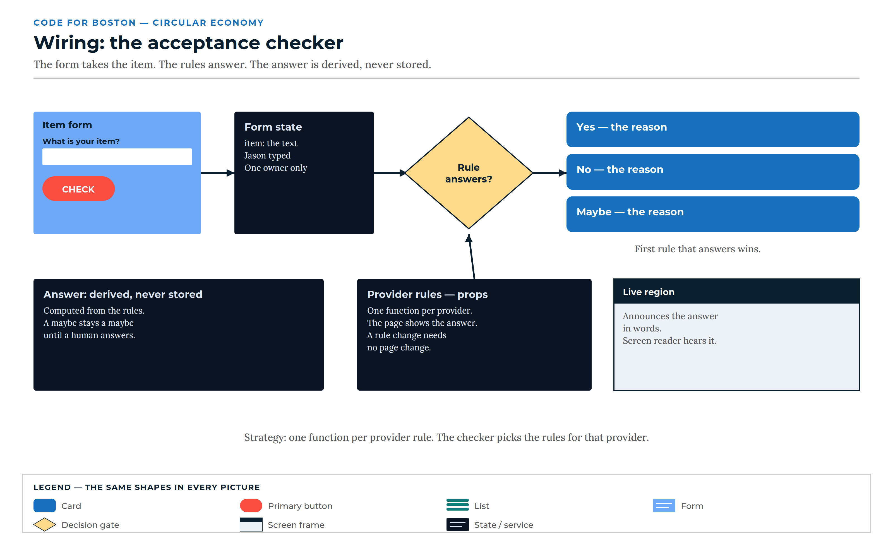

### Step 1 — Page model

| State | Lives | Changes it |
| --- | --- | --- |
| Item, as typed | Form state | Typing in the item field |
| Acceptance answer | Derived from provider rules | Item and provider change |
| Provider rules | Props, from the provider | The provider changes its rules |

The answer is derived, never stored. A "maybe" stays a maybe until a human answers. The rules live on the server. The page only shows the answer, so a rule change needs no page change.

Widgets: W-10, the acceptance checker. Fleet classes: `.ac` for the checker, `.ac-a` for the answer, `.ac-a--yes`, `.ac-a--no`, `.ac-a--maybe` for the three answers. Form fields use `.txt-f` and `.btn`.

### Step 2 — The question form

What you build: the form Jason types in. One idea only: a field and a button. The form owns the item. The input holds nothing on its own. That is a controlled input, Observer shape (GoF).

Type this code in `client/src/components/donate/AcceptanceChecker.tsx`.

```tsx
// client/src/components/donate/AcceptanceChecker.tsx
// The form owns the item. The input holds nothing, so the form is the one owner of the value.
const [item, setItem] = useState("");
// checked starts false, so the page shows no answer until Jason presses CHECK.
const [checked, setChecked] = useState(false);
// The field is a Fleet textbox. The label names it in words.
<div className="ac">
  <label className="txt-l" htmlFor="item">What is your item?</label>
  <input className="txt-f" id="item" type="text" value={item} onChange={(e) => setItem(e.target.value)} />
  <button className="btn" onClick={() => setChecked(true)}>Check</button>
</div>
```

What you should see: a light-blue form box on a pale body. The label reads "What is your item?" in Charles Blue capitals. Below it, a white field with a 3px Charles Blue border. Below that, a red pill button that reads "CHECK". No answer shows yet. An empty answer area is a plain-word sentence, never a blank area.

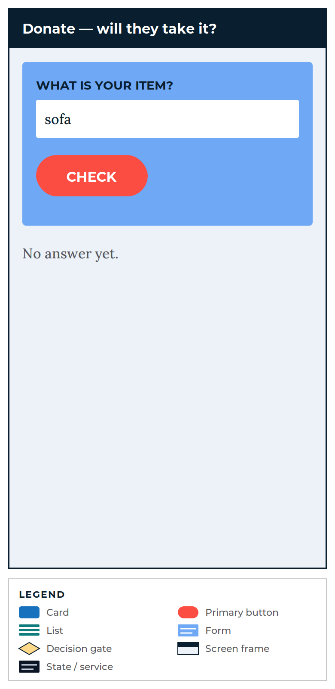

Check: type "sofa" in the field and press the CHECK button. The field keeps "sofa". The page does not reload. If the page reloads, the button sits outside the form or the click does not run. Fix it before you go on.

Your file tree looks like this now:

```text
client/src/
  components/
    donate/
      AcceptanceChecker.tsx
  api/
    client.ts
    queryClient.ts
    search.ts
    schema.d.ts
  pages/
    __root.tsx
```

### Step 3 — The answer

What you build: the answer in words. One idea only: run the rules and show the verdict. Pattern: Strategy (GoF). Each provider screening rule is one function. The checker picks the rules for that provider. The first rule that answers wins.

Add this code to `client/src/components/donate/AcceptanceChecker.tsx`, below the form.

```tsx
// The checker runs the provider rules in turn. The first rule that answers wins.
// One rule per provider keeps each rule small, so a rule change touches one function.
// The answer exists only after Jason presses CHECK. Before that, the page shows no answer.
const answer = checked ? checkAcceptance(item, providerRules) : null; // { verdict: "yes" | "no" | "maybe", reason: string }
// The answer holds a verdict and a reason. The page shows the answer in words.
{checked && <p className="ac-a ac-a--yes">Yes — {answer.reason}</p>}
// The rules come from the provider as props, not from the page.
// The page only shows the answer, so a rule change needs no page change.
// A rule that needs a human stays "maybe". The page never guesses, so a resident never gets a wrong yes or no.
```

What you should see: after Jason presses CHECK for an item the provider takes, an Optimistic Blue card shows the word "Yes" and the reason in white text, for example "Yes — the provider takes sofas in good shape." The form stays above the card. The answer is words, never colour alone.

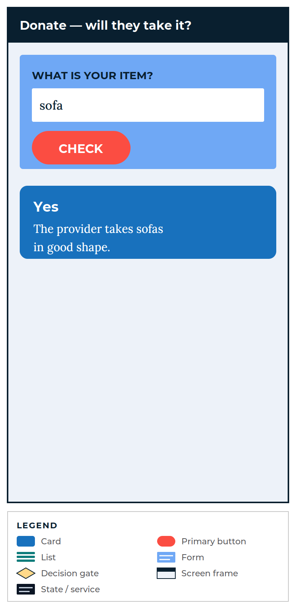

Check: type an item the provider takes and press CHECK. The card reads "Yes" and names the reason. If no card shows, the answer did not reach the page. Check that `checkAcceptance` returns a verdict and a reason.

A "maybe" looks the same, in words. When no rule can answer, the card reads "Maybe" and the reason, for example "Maybe — the provider must see the item first." The card is amber `#FFD98A` with Charles Blue text. The word carries the meaning, not the colour.

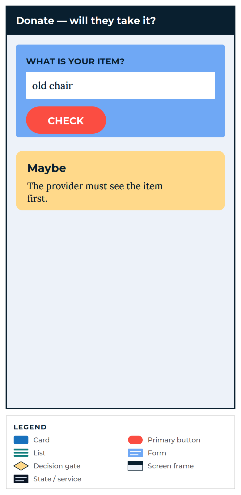

Check: type an item no rule can answer and press CHECK. The card reads "Maybe" and names the reason. If the page guesses Yes or No, a rule answers when it should not. Fix the rule before you go on.

### Step 4 — Check the form before it answers

What you build: one validation function for this form. One idea only: an empty item gets a plain-word error. Pattern: Validation (React idiom). No GoF name fits, so the guide gives it none.

Type this code in `client/src/lib/validate.ts`.

```ts
// client/src/lib/validate.ts
// One function per form checks each field and returns errors in plain words.
// An empty list means the form passes. The caller reads one value, so no field needs its own check call.
export function validateAcceptance(item: string): FieldError[] {
  const errors: FieldError[] = [];
  if (!item.trim()) errors.push({ field: "item", message: "Name the item first." });
  return errors;
}
// The page shows one message per field, in words.
// A plain-word message tells the resident what to fix, and an error code would not.
```

Change the CHECK button so it runs the check first. Add this code to `client/src/components/donate/AcceptanceChecker.tsx`.

```tsx
// CHECK runs the validation first. An error stops the check, so no answer shows for an empty item.
function runCheck() {
  const errors = validateAcceptance(item);
  if (errors.length > 0) return;
  setChecked(true);
}
// The button now calls runCheck, not setChecked. One function guards the check, so the form cannot answer an empty item.
<button className="btn" onClick={runCheck}>Check</button>
```

What you should see: Jason presses CHECK with an empty field. The field border turns Freedom Red. Below the field, Dark Red text reads "Name the item first." No answer shows. The CHECK button stays a red pill.

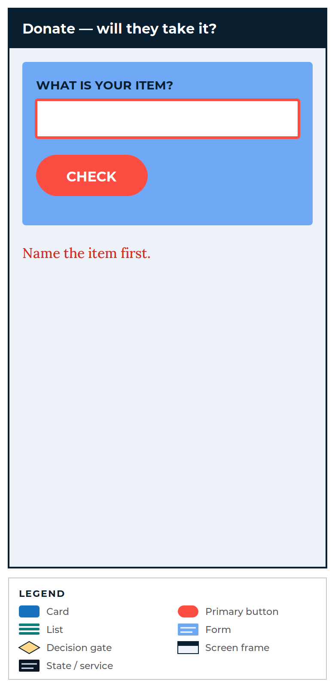

Check: press CHECK with the field empty. The message "Name the item first." shows under the field, and no answer shows. If an answer shows, the form did not call the check. Fix it before you go on.

Your file tree looks like this now:

```text
client/src/
  components/
    donate/
      AcceptanceChecker.tsx
  api/
    client.ts
    queryClient.ts
    search.ts
    schema.d.ts
    validate.ts
  pages/
    __root.tsx
```

### Step 5 — Loading, error, and empty states

The route shows loading and error. The page writes only its success view. Loading says so in words, with a progress bar (`.prg`). An error says what failed and what to do next. Empty says so in words, never a blank area.

Check: while the rules load, the words "Loading results…" show with the progress bar. If the rules fail to load, the page says what failed and what to do next, and the form stays on screen.

### Step 6 — Keyboard and access

The answer is always in words. The focus ring is the 3px Optimistic Blue ring on every control. Focus moves to the page heading on load. The live region announces the answer in words when it arrives, so a screen reader user hears "Yes" and the reason without moving focus.

Check: walk the checker by keyboard alone. Tab reaches the field, then the CHECK button. Type an item, press Enter, and hear or read the answer in the live region. Test at 200% zoom. The form goes full width and nothing clips.

### Step 7 — Verify it in the browser

Run `tsc -b && vite build`. Walk the checker fresh, with no item typed. Walk it with an item the provider takes, one it refuses, and one no rule can answer. Walk it by keyboard alone. Walk it with a screen reader. Walk it at 200% zoom and at phone width. Only when every walk passes is this part done.

---

## Screen 2 — `/donate` — the pickup scheduler

### What Jason does

Jason picks an item size, then a day, then sees the open slots for that day, picks a slot, and reads a plain-word summary: "Pickup: {size}, {day}, {slot}." He books the pickup without a car, so the size and the day matter more than the address. The scheduler is the part that makes the journey work for a move-out with bulky items.

The wiring picture shows how the parts connect. The size and the day live in form state. The hook asks the server for the open slots. The page never invents a slot. The summary is derived from the three choices, never stored.

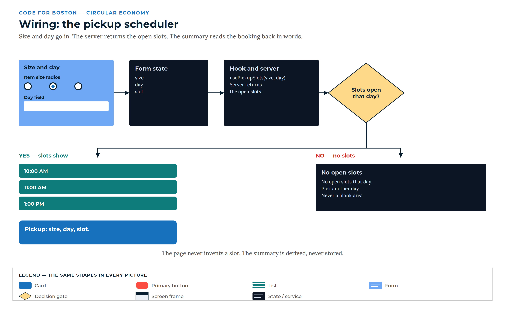

### Step 1 — Page model

| State | Lives | Changes it |
| --- | --- | --- |
| Item size | Form state | Radio change |
| Day | Form state | Date picker change |
| Time slot | Form state | Slot button press |
| Open slots | Query client, through the hook | Size and day change |
| Summary | Derived, no state | Size, day, and slot change |

The summary is derived, never stored, so it never goes stale. The open slots come from the server through a hook. The page never invents a slot.

Widgets: W-03, the pickup scheduler, and W-08, form validation. Fleet classes: `.pk` for the scheduler, `.pk-slots` for the slot list, `.pk-slot` for one slot button, `.txt-f` with `type="date"` and `type="time"` for the fields, `.ra-f` for the size radios.

### Step 2 — Size and day

What you build: the size radios and the date field. One idea only: the resident picks a size and a day. Pattern: State (GoF) for the chosen slot. Date and time picker (React idiom) for the fields.

Type this code in `client/src/components/donate/PickupScheduler.tsx`.

```tsx
// client/src/components/donate/PickupScheduler.tsx
// The form owns the size. It starts on "medium", so the page shows a choice from the first load.
const [size, setSize] = useState("medium");
// The day starts empty, so the page shows no slots until Jason picks a day.
const [day, setDay] = useState("");
// The slot starts empty, so the page shows no summary until Jason picks a slot.
const [slot, setSlot] = useState("");
// Size is a radio group. Arrow keys move between the choices, so a keyboard user never needs a mouse.
<div className="pk">
  <fieldset>
    <legend className="txt-l">Item size</legend>
    <label className="ra-l"><input className="ra-f" type="radio" name="size" value="small" checked={size === "small"} onChange={() => setSize("small")} /> Small</label>
    <label className="ra-l"><input className="ra-f" type="radio" name="size" value="medium" checked={size === "medium"} onChange={() => setSize("medium")} /> Medium</label>
    <label className="ra-l"><input className="ra-f" type="radio" name="size" value="large" checked={size === "large"} onChange={() => setSize("large")} /> Large</label>
  </fieldset>
  <label className="txt-l" htmlFor="day">Day</label>
  <input className="txt-f" id="day" type="date" value={day} onChange={(e) => setDay(e.target.value)} />
</div>
```

What you should see: a light-blue form box on a pale body. The words "ITEM SIZE" sit above three radios in a row: Small, Medium, Large. The Medium radio shows filled in Optimistic Blue. Below, the label "DAY" sits above a white date field with a 3px Charles Blue border. No slots show yet, because no day is picked.

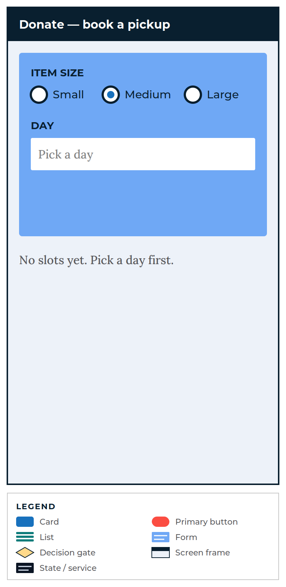

Check: press the Large radio. The Medium radio clears and the Large radio fills. Pick a day in the date field. The field keeps the day. If the radios do not move with arrow keys, they are not one group. Give them one name and fix it before you go on.

Your file tree looks like this now:

```text
client/src/
  components/
    donate/
      AcceptanceChecker.tsx
      PickupScheduler.tsx
  api/
    client.ts
    queryClient.ts
    search.ts
    schema.d.ts
    validate.ts
  pages/
    __root.tsx
```

### Step 3 — The open slots

What you build: the slots for the picked day. One idea only: ask the server, show what it returns. The hook follows the Stub 5 shape. It asks the server for the open slots, so the page never invents a slot.

Add this code to `client/src/components/donate/PickupScheduler.tsx`, inside the `.pk` box, below the date field.

```tsx
// The hook asks the server for the open slots for this size and day.
// The page shows what the server returns, so a slot on screen is always a real slot.
const slots = usePickupSlots(size, day);
// Each slot is a button. A button takes keyboard focus, so a keyboard user can reach it.
<div className="pk-slots">
  {slots.map((s) => <button key={s} className="pk-slot" onClick={() => setSlot(s)}>{s}</button>)}
</div>
// The slot buttons show only after Jason picks a day.
// A day with no open slots shows a plain-word sentence, never a blank area.
```

What you should see: after Jason picks a day, a row of white slot buttons with 3px Charles Blue borders shows under the date field. Each button names one time. The picked slot turns Optimistic Blue with white text. A day with no open slots shows the words "No open slots that day. Pick another day." in Body Gray.

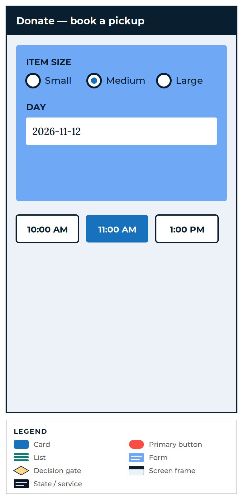

Check: pick a day with open slots. The slot buttons show. Press one slot. It turns Optimistic Blue with white text. Pick a day with no open slots. The plain-word sentence shows and no buttons show. If a slot shows with no day picked, the hook ran too soon. Fix it before you go on.

### Step 4 — The summary

What you build: the plain-word summary. One idea only: say the booking back in words. The summary is derived from the size, the day, and the slot, so it never goes stale.

Add this code to `client/src/components/donate/PickupScheduler.tsx`, below the slot list.

```tsx
// The summary reads the three choices back in words.
// It is derived, never stored, so it always matches the choices on screen.
<p>Pickup: {size}, {day}, {slot}.</p>
// The summary is the check. Jason reads it and sees his booking before he goes on.
// No slot picked yet means no summary yet, so the page never states a booking that does not exist.
```

What you should see: after Jason picks a slot, a line of Lora text reads "Pickup: medium, 2026-11-12, 10:00 AM." The size, the day, and the slot all match the choices above it. The summary sits below the slot buttons on the pale body.

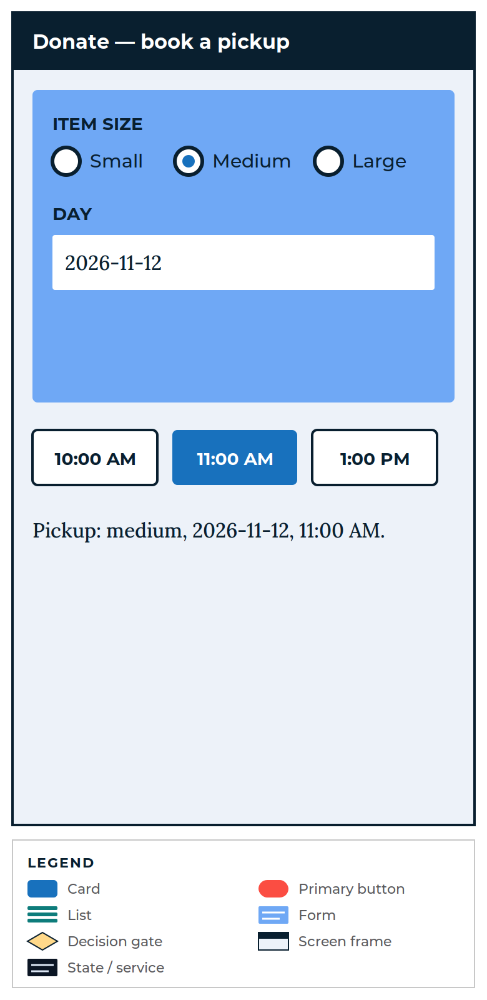

Check: pick a size, a day, and a slot. The summary names all three, in the same words as the choices. Change the size. The summary changes with it. If the summary keeps the old size, it is stored, not derived. Fix it before you go on.

### Step 5 — Check the form before it books

One validation function per form, in `client/src/lib/validate.ts`, checks each field and returns errors in plain words. A field with an error shows a red message under it. The form does nothing until it passes. For this form, the checks are: a size is picked, a day is picked, and a slot is picked. Each missing choice gets its own plain-word message under its field.

Check: press ahead with no day picked. The message under the date field reads "Pick a day first." and no slot list shows. If the slot list shows, the form did not call the check. Fix it before you go on.

### Step 6 — Loading, error, and empty states

The route shows loading and error. The page writes only its success view. Loading says "Loading slots…" with a progress bar. An error says what failed and what to do next. Empty says so in words: a day with no open slots is a sentence, never a blank area.

Check: pick a day while the slots load. The words "Loading slots…" show with the progress bar. If the load fails, the page says what failed and what to do next, and the size and day stay on screen.

### Step 7 — Keyboard and access

Size radios move with arrow keys. Date and time are native inputs, so the browser gives them keyboard behaviour. The slot buttons are real buttons, so Tab reaches them and Enter picks one. The summary is plain text, so a screen reader reads it in order. The focus ring is the 3px Optimistic Blue ring on every control.

Check: walk the scheduler by keyboard alone. Tab reaches the size radios, the date field, and the slot buttons. Arrow keys move between sizes. Enter picks a slot, and the summary reads aloud in the live region. Test at 200% zoom. The form goes full width and nothing clips.

### Step 8 — Verify it in the browser

Run `tsc -b && vite build`. Walk the scheduler fresh, with nothing picked. Walk it with a size, a day, and a slot. Walk it with a day that has no open slots. Walk it by keyboard alone. Walk it with a screen reader. Walk it at 200% zoom and at phone width. Only when every walk passes is this part done.

---

## Screen 3 — `/donate` — the drop-off locator

### What Jason does

Jason picks how he gets there: walking, transit, or car. The map shows the drop-off sites he can reach that way. He selects a site in the list or on the map. The list and the map stay in sync. This is the no-car part of the journey. Walking and transit are filter values on the map, not an afterthought. Jason has no car, so the walking and transit filters are the point.

The wiring picture shows how the parts connect. The travel chips pick one mode. One function per mode filters the sites. The page mediates the list and the map, so a selection on one side updates both sides. A site with no coordinates stays in the list only.

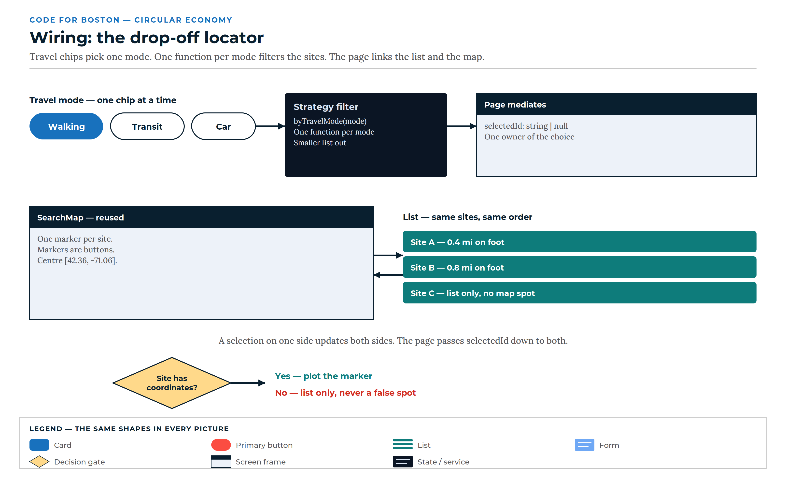

### Step 1 — Page model

| State | Lives | Changes it |
| --- | --- | --- |
| Drop-off sites | Query client | Location change |
| Travel mode | Component state | Chip click |
| Selected site | Component state | List click, map marker click |

The sites come from the API through the hook in section 2.2. The service type for donate maps to donation_drop only. Travel mode lives in the page, so it clears when the page closes. The selected site lives in the page alone.

Widgets: W-13, the drop-off locator, W-09, the map, and W-07, the filter chips. Fleet classes: `.do-loc` for the locator, `.mp` for the map, `.mp-filters` for the map filters, `.fl-chip` for the travel-mode chips, `.mp-mk` for a marker, `.mp-cl` for a cluster, `.mp-lg` for the legend.

### Step 2 — The travel chips

What you build: three chips that pick how Jason gets there. One idea only: one mode at a time. Pattern: Strategy (GoF) for the travel filters. Each mode is one function, so you add a mode by adding one function.

Type this code in `client/src/components/map/DropOffLocator.tsx`.

```tsx
// client/src/components/map/DropOffLocator.tsx
// Travel mode lives in the page. It starts on "walking", so the page shows walkable sites from the first load.
const [mode, setMode] = useState<"walking" | "transit" | "car">("walking");
// allSites is the full site list from the hook in section 2.2. The filter narrows it, never the source.
// Strategy: one function per mode. Each mode is one function, so you add a mode by adding one function.
// The filter takes the full site list and returns a smaller list. The list never knows the filters.
const sites = byTravelMode(mode)(allSites);
// Each chip is a button with aria-pressed. Pressed means active. Press again to clear it.
<div className="do-loc">
  <div className="mp-filters">
    <button className="fl-chip" aria-pressed={mode === "walking"} onClick={() => setMode("walking")}>Walking</button>
    <button className="fl-chip" aria-pressed={mode === "transit"} onClick={() => setMode("transit")}>Transit</button>
    <button className="fl-chip" aria-pressed={mode === "car"} onClick={() => setMode("car")}>Car</button>
  </div>
</div>
```

What you should see: three white chips with 3px Charles Blue borders in a row under the heading: Walking, Transit, Car. The Walking chip is Optimistic Blue with white text, because pressed means active. The other two stay white with Charles Blue text. The map below shows walkable sites only.

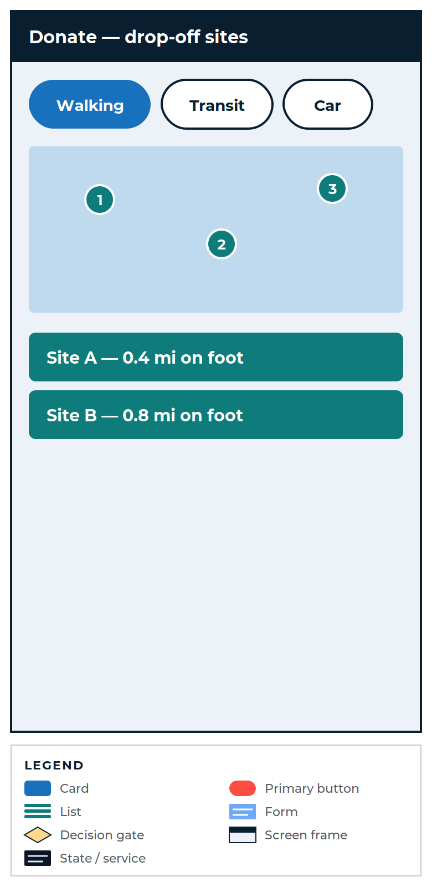

Check: press the Transit chip. The Walking chip clears to white, the Transit chip turns Optimistic Blue with white text, and the map shows transit sites. Press Transit again. It clears. If two chips stay pressed at once, the mode is not one value. Fix it before you go on.

Your file tree looks like this now:

```text
client/src/
  components/
    donate/
      AcceptanceChecker.tsx
      PickupScheduler.tsx
    map/
      DropOffLocator.tsx
  api/
    client.ts
    queryClient.ts
    search.ts
    schema.d.ts
    validate.ts
  pages/
    __root.tsx
```

### Step 3 — The map and the list in sync

What you build: the map, reused, with the list beside it. One idea only: one selection, two views. Pattern: Mediator (GoF) for the list-map sync. The page mediates. The list and the map never talk direct. Observer (GoF) for the shared selection.

Reuse `SearchMap` from `client/src/components/map/SearchMap.tsx`. Do not build a second map. The map never fetches. The map never sorts. It plots what the page gives it, so the map stays simple and the page stays in charge.

Add this code to `client/src/components/map/DropOffLocator.tsx`, below the chips.

```tsx
// The page owns selectedId. The map takes it as a prop and calls back onSelect.
// The page stays the one owner of the choice, so the list and the map can never disagree.
const [selectedId, setSelectedId] = useState<string | null>(null);
// One fetch, one list of ten. The list renders them, the map plots them, a selection in one place updates both.
<SearchMap results={sites} selectedId={selectedId} onSelect={setSelectedId} />
// Marker: one HTML button per provider. A button takes keyboard focus, so a keyboard user can reach it and a screen reader can read it.
// No marker at (0, 0). A site with no coordinates stays in the list only, so no site lands on a false spot.
// A selected marker uses Charles Blue. The list entry for the same site gets a 3px Charles Blue border.
```

What you should see: the map shows one marker per site, as teal rows in the list below it and as round markers on the map. The list and the map show the same sites, in the same order. Press a marker. The same site highlights in the list with a 3px Charles Blue border, and the marker turns Charles Blue. The map centres on a fixed Boston fallback, `[42.36, -71.06]`, because no geocoder exists. The page text states that distance filtering is not active. No radius circle is drawn, because a circle would be a false claim.

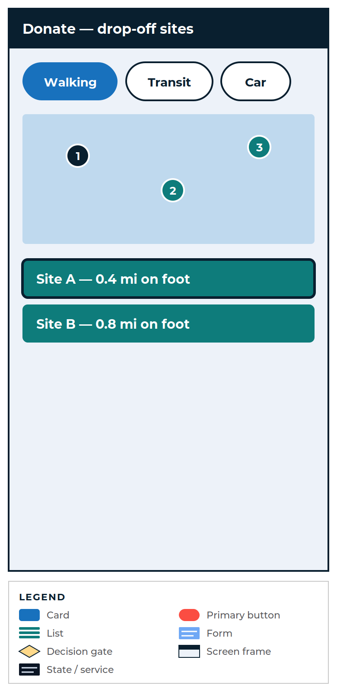

Check: press a marker on the map. The same site highlights in the list. Press the site in the list. The same marker turns Charles Blue. If one side updates and the other does not, the page is not the one owner of the choice. Fix it before you go on.

### Step 4 — When the map fails

What you build: the failed state. One idea only: the list works when the map does not. The map is lazy loaded, so the list page first paint does not wait for the map engine.

Add this code to the locator, around the map.

```tsx
// The map can fail. The failure is stated in text, and the list stays on screen.
// The page never shows a blank area where the map was.
<div className="mp-h">
  <p>The map did not load. The list below still works.</p>
</div>
// The list renders from the same sites the map would plot, so the resident loses nothing but the picture.
// A site with no coordinates was already list-only, so the failed map changes nothing for it.
```

What you should see: the map area shows a white card with the words "The map did not load. The list below still works." in Body Gray. Below the card, the teal list rows show every site, in the same order, with the travel chips still working above them.

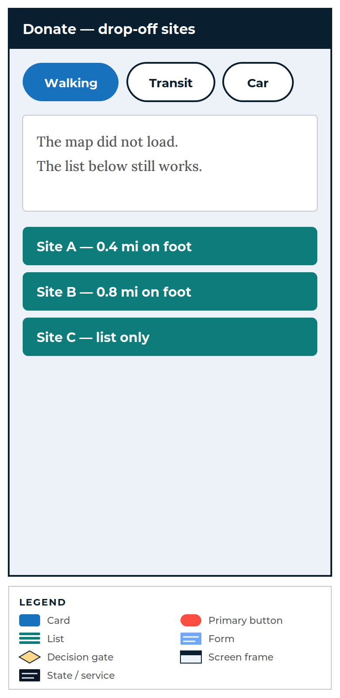

Check: block the map from loading and open the page. The message shows in words and the list still works. Press a travel chip. The list filters. If the page shows a blank area, the failed state is missing. Fix it before you go on.

### Step 5 — Loading, error, and empty states

The route shows loading and error. The page writes only its success view. Loading says "Loading results…" with a progress bar. An error says what failed and what to do next. Empty says so in words, never a blank area. A mode with no sites says "No drop-off sites for walking near you. Try transit or car." The count text sits in the live region, so a screen reader hears it when the sites arrive.

Check: pick a mode with no sites. The plain-word sentence shows and no map markers show. If the page shows a blank map, the empty state is missing. Fix it before you go on.

### Step 6 — Keyboard and access

The travel-mode chips are buttons with `aria-pressed`. Pressed means active. Map markers are Tab-reachable buttons. Enter selects a marker and highlights the same site in the list. If the selection came from the map, focus moves to the list entry. The focus ring is the 3px Optimistic Blue ring on every control. Meaning never rests on colour alone: the pressed chip also carries the word "pressed" through `aria-pressed`, and the selected site carries a border and a word, not a colour alone.

Check: walk the locator by keyboard alone. Tab reaches the chips, then the markers, then the list. Enter on a marker selects it and moves focus to the list entry. Test at 200% zoom. The list goes full width and the map grows taller.

### Step 7 — Verify it in the browser

Run `tsc -b && vite build`. Walk the locator fresh, with no mode picked beyond the starting mode. Walk it with walking, then transit, then car. Walk it by keyboard alone. Walk it with a screen reader. Walk it at 200% zoom and at phone width. Walk it with the map failed, so the list still works. Only when every walk passes is this part done.

---

## The finished journey

Walk the whole journey, in order, as Jason does.

1. Jason opens `/donate`. He names an item in the checker. The card answers Yes, No, or Maybe, in words, with the reason.
2. He picks a size, a day, and a slot in the scheduler. The summary reads his booking back in words.
3. He picks Walking in the locator. The map and the list show the sites he can reach on foot. He selects one site. The list and the map agree.

Run the final check. Build it with `tsc -b && vite build`. Walk it fresh and seeded. Walk it by keyboard alone. Walk it with a screen reader. Walk it at 200% zoom and at phone width. Walk it with the map failed, so the list still works. A passing gate count is text only. It is not a pass on its own. Only when every walk passes is the journey done.

Your file tree looks like this at the end:

```text
client/src/
  components/
    donate/
      AcceptanceChecker.tsx
      PickupScheduler.tsx
    map/
      DropOffLocator.tsx
      SearchMap.tsx
  api/
    client.ts
    queryClient.ts
    search.ts
    schema.d.ts
    validate.ts
  pages/
    __root.tsx
```
