# Find and swap — a tutorial guide

## Who this guide serves

Marisol clears out her home. She buys used goods. She donates goods. She pays for repair. She searches with category filters, nearby and pickup options, and Spanish-language support. She plans by matching wanted items with offered items. She stacks errands and carpools. At the end, three things block her: cost, distance, and unclear instructions. Every listing must show cost, distance, and clear instructions.

This guide builds the screens Marisol uses, in the order she sees them. It builds one real part of the Circular Economy app, screen by screen. At the end, the journey works.

The journey has three screens, all on the route `/find`:

1. `/find` — item search, with category filters, nearby and pickup options, and Spanish-language support
2. The wanted and offered board — matching wanted items with offered items
3. Results with pagination — the list, the count, and the pages

Each screen follows the same eight steps. The steps come from the Developer Guide. Do not skip a step. Each step ends when its check passes.

1. Start from the journey and the page model.
2. Pick the widgets from the register.
3. Pick the Fleet classes from the theme.
4. Compose the page tree.
5. Wire the state.
6. Add the loading, error, and empty states.
7. Add keyboard and accessibility behaviour.
8. Verify it in the browser.

A page model is the state a page holds, where each piece lives, and what changes it. If a piece of state has no home, it does not exist yet. Do not write a component first.

One owner holds each piece of state. Two owners for one piece is a defect. Shareable state goes in the URL. Results go in the query client. Form state stays in the form. Selection stays in the page.

A container fetches data or holds state. A presentational part takes props and renders. A part that fetches is a container. A part that only renders takes props. Do not mix the two in one file.

The pattern names in this guide come from two books only. GoF is Gamma, Helm, Johnson, and Vlissides, "Design Patterns" (1994). Repository is Fowler, "Patterns of Enterprise Application Architecture" (2002). Dependency Injection is Fowler (2004). A row marked "React idiom" has no GoF name and gets none.

The Fleet theme is the look of the site. Fleet is the authority where it and Figma disagree on a class name or a value. Figma is the authority for which widgets the app uses and what their filled states look like. Keep the Fleet name where Fleet defines one.

Fleet colours:

- Charles Blue `#091F2F` — headings, dark bands, field borders, table headers
- Optimistic Blue `#1871BD` — links, primary button, card hover, focus ring
- Freedom Trail Red `#FB4D42` — button hover, close button, link hover
- Dark Red `#D22D23` — active tab, breadcrumb, link active state
- Yellow `#FCB61A` — yellow button, active nav in the yellow variant
- Body Gray `#58585B` — body text
- Mid Gray `#828282` — disabled text, grey progress fill
- Border Gray `#C8C8C8` — light borders, breadcrumb separator
- Divider Gray `#E0E0E0` — dividers, disabled background
- Background Gray `#F3F3F3` — light grey background
- White `#FFFFFF` — cards, page background

Type: headings, buttons, and navigation use Montserrat, Arial, sans-serif. Headings are uppercase and bold. Body, quotes, and field text use Lora, Georgia, serif. Body text is `#58585B` at 16px, line-height 1.5.

Focus: Fleet fields use a 3px Optimistic Blue ring (`0 0 0 3px #1871BD`). Every button, link, marker, chip, tab, and card link gets the same ring on `:focus-visible`.

Meaning never rests on colour alone. Every state also changes text, a border, or an icon. FREE and PAID, open and closed, yes and no are always words.

## The journey map

Marisol moves left to right. Each box is one stage. The diamond asks one question. The answer picks the next stage.

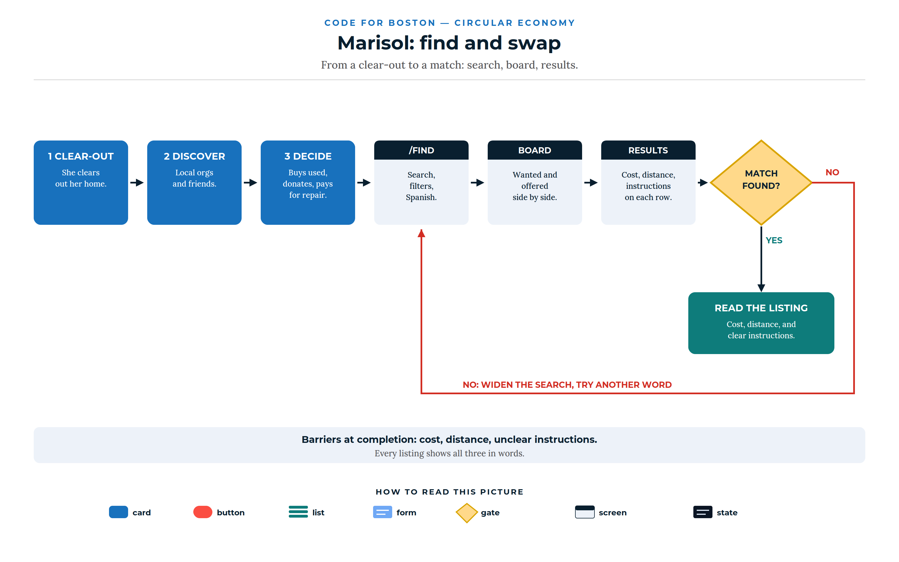

Read the map before you read the steps. It shows the whole journey on one page. The guide builds the three blue stages: search, board, and results.

## The build map

The build runs left to right, in the order Marisol sees the screens. Shared parts come first. Each screen ends in a check. A check that fails stops the build. Fix it, then move on.

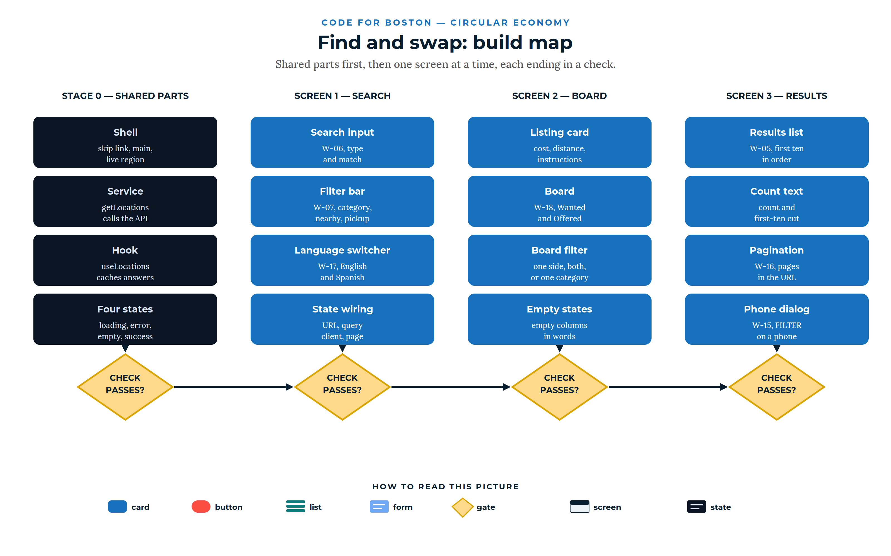

## How each step works

Every build step in this guide has the same shape:

- **What you build** — one idea, in plain words.
- **The diagram** — the wiring for that screen, when the step changes it.
- **The code** — the exact code to type, with comments that say why each line exists.
- **What you should see** — a small picture of the screen at that point in the build.
- **Check** — the exact thing to see in the browser before you move on.

One step holds one idea. A step never adds two new ideas at once. The picture next to the code shows what the code just made. If the browser shows something else, stop and fix it before the next step.

The file tree appears after every change. It shows where the new file sits. It shows where you are.

---

# Part 1 — Start from zero

Part 1 assumes no prior knowledge. It explains every technical term in plain words on first use. If you already build webpages, skip to Part 2.

## Step 1.1 — What a webpage is

A webpage is a text file. The file holds words in a language the browser reads. The browser turns those words into a screen you can see and use.

Three kinds of text live in a webpage:

- **Structure** — the words that say what each part is: a heading, a paragraph, a button, a list. The structure language is HTML.
- **Look** — the words that say how each part looks: its colour, its size, its place on the screen. The look language is CSS.
- **Behaviour** — the words that say what each part does: what happens when you press a button, what shows when you type. The behaviour language is JavaScript.

This app adds one more layer. The behaviour is written in TypeScript, which is JavaScript with types. A type is a note that says what shape a value has. The app also uses React, a tool that builds the screen from small parts called components.

A **component** is one reusable part of a screen: a search box, a card, a button. You write it once. You use it in many places. A component takes **props**. Props are values a parent passes down, like the name on a card. A component holds **state** when it remembers something, like the text you typed.

A **route** is an address in the app, like `/find`. The route says which screen the browser shows. A **URL param** is a value carried in the address, like `?page=2`. The param says which page of results to show.

The app talks to a **server** through an **API**. The API is a set of addresses the app can ask for data. The app asks the API for listings. The API answers with a list. The screen shows the list.

## Step 1.2 — The tools to install

You need four tools. Install them in this order.

1. **A text editor.** A text editor is a program that edits plain text files. Use Visual Studio Code. It is free. It shows file trees, highlights code, and marks errors.
2. **A web browser.** A browser is a program that shows webpages. Use Chrome or Firefox. You open your files in it to see your work.
3. **Node.js.** Node.js runs JavaScript outside the browser. The app build tools need it. Install the LTS release, the long-term support release, from the Node.js site.
4. **A terminal.** A terminal is a text window where you type commands. Visual Studio Code has one built in. Open it with the Terminal menu.

Check each tool after you install it. Type each command in the terminal and press Enter.

```sh
node --version
npm --version
```

What you should see: two numbers, one per tool. The numbers will differ on your machine. Any recent number is fine.

**Check:** the terminal prints two numbers and no error. If it prints "command not found", install Node.js again and close and reopen the terminal.

## Step 1.3 — The project and the first file

The project is a folder of files. The app lives in a folder named `client`. Inside it, `src` holds the code. `src/pages` holds the screens. `src/components` holds the parts. `src/api` holds the typed client, the query client, and the search query. `src/lib` holds the small helpers: validation, filters, and rules.

A **service** is the one place that calls the API. A **hook** is a reusable piece of behaviour that sits over a service. A **query client** is a store that caches API answers, so a repeat visit loads fast. A **cache** is a saved copy of an answer.

Make a first file. It proves the tools work. In `client/src/pages`, make a file named `hello.tsx`. Type this code:

```tsx
// A page is a component that a route shows. This page shows one line of text.
export function Hello() {
  return <h1>Hello, Marisol</h1>;
}
```

The file tree now looks like this:

```text
client/
  src/
    pages/
      hello.tsx
```

**Check:** the file `hello.tsx` exists in `client/src/pages/`. The editor shows no red marks in it.

## Step 1.4 — Open it in the browser

A build turns the code into files the browser can read. The app builds with this command, typed in the terminal at the project root:

```sh
tsc -b && vite build
```

`tsc` checks the types. `vite` builds the files. The `&&` means: run the second command only if the first passes.

Then start the local server. A local server is a small program on your machine that serves the built files to your browser.

```sh
vite preview
```

The terminal prints an address, like `http://localhost:4173`. Open that address in the browser.

What you should see: the app. Your new page sits at its route.

**Check:** the browser shows the app with no blank page and no error text. If the build fails, read the error first. Step 1.5 shows how.

## Step 1.5 — Read an error

An error message has three parts. Read them in order.

1. **The file and the line.** The message names the file and the line number where the problem sits. Open that file at that line.
2. **The kind.** The message names the kind of problem. It may be a missing import, a wrong type, or a name that does not exist.
3. **The hint.** The message often suggests the fix. Read the hint before you change anything.

Fix one error at a time. Change one thing, then build again. If the error moves, your change moved it. If the error stays, undo the change and read the message again.

Common errors and their fixes:

- "Cannot find module" — the import path is wrong. Check the file name and the folder.
- "is declared but never used" — a name is imported but not used. Remove the import.
- "Type X is not assignable to type Y" — a value has the wrong shape. Check the type the function expects.

**Check:** the build prints no errors. The browser shows the page.

## Step 1.6 — The words this guide uses

These words appear in every screen. Learn them once.

- **Widget** — a named part in the register, like W-06 search input. The register is `WIDGET-INVENTORY.md`. Each widget has a stub number. A widget with no stub does not exist yet.
- **Fleet class** — a class name from the theme, like `.btn` or `.fl-chip`. A class name links the code to the look. Keep the Fleet name where Fleet defines one.
- **Filter** — a choice that narrows a list. Each filter is one function that takes a list and returns a smaller list.
- **Chip** — a filter choice shown as a button. Pressed means active. Press again to clear it.
- **Live region** — a hidden part of the page that a screen reader reads aloud when its text changes. It announces results in words.
- **Screen reader** — software that reads the screen aloud for a user who cannot see it. It reads real buttons, real inputs, and real text.
- **Skip link** — a link at the top of the page that jumps past the header to the main content. It shows only when it has keyboard focus.
- **Focus** — the place the keyboard acts. The focus ring is the 3px Optimistic Blue ring around the control that has focus.
- **Dialog** — a box that opens over the page. Escape closes it. Focus moves inside it when it opens and returns to the opener when it closes.
- **Pagination** — the controls that move between pages of results: First, Previous, a page number, Next, Last.

---

# Part 2 — Build this journey

Part 2 builds the three screens in the order Marisol sees them. Shared parts come first, because every screen uses them. Then each screen follows the eight steps, one component per step, simple to full.

Build in this order:

- Stage 0 — Shared parts: the shell, the service, the hook, the four states.
- Screen 1 — `/find`: search input, filter bar, language switcher, state wiring.
- Screen 2 — The wanted and offered board: listing card, board, board filter.
- Screen 3 — Results with pagination: results list, count text, pagination, phone dialog.

## Stage 0 — Shared parts

Four parts serve every screen. Build them once. Every screen composes them. No screen copies them.

### Step 0.1 — The shared shell

**What you build:** the shell every page inherits. It holds the skip link, the main content area, and the live region. Build this before any other widget. A screen reader user needs the skip link and the live region from the first screen.

**The code:** type this in `client/src/pages/__root.tsx`.

```tsx
// client/src/pages/__root.tsx — the shared shell, every page inherits this.
// The skip link jumps past the header to the main content. It shows only on focus, so it stays out of the way until a keyboard user needs it.
<a className="a11y--h" href="#main">Skip to main content</a>
// The main area holds the page. Outlet is the place where the current page renders, so each route shows its own page here.
<main id="main"><Outlet /></main>
// The live region announces results in words. It has no visual style of its own. A screen reader reads its text aloud when the text changes.
<div aria-live="polite" className="sr-only">{announce}</div>
// Rule: meaning never rests on colour alone. Every state also changes text, a border, or an icon. Words carry the meaning for a user who cannot see colour.
```

The file tree now looks like this:

```text
client/
  src/
    pages/
      __root.tsx
      hello.tsx
```

**What you should see:**

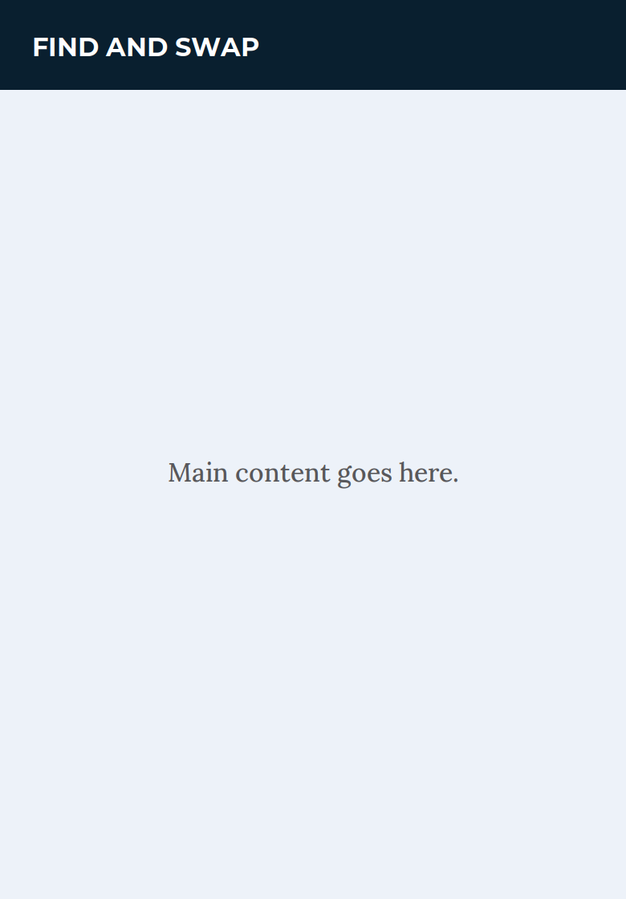

The header sits at the top. The main content sits below it. Nothing else shows yet. The skip link stays hidden until you press Tab.

**Check:** press Tab once in the browser. The skip link "Skip to main content" appears at the top. Press Enter. Focus moves to the main content. The page shows no error.

### Step 0.2 — The service that calls the API

**What you build:** the one place that calls the API. No page writes its own fetch. All calls pass through one place, so a change to the call touches one file.

**The code:** type this in `client/src/api/search.ts`.

```ts
// client/src/api/search.ts — the search query. It is the one place that calls the API for locations.
// The search query takes no values. The route returns every location, and the page filters the list.
// Contract types come from the API schema, so the page and the server agree on the shape.
import { queryOptions } from '@tanstack/react-query'
import { api, unwrap } from './client'
import type { components } from './schema'

export type SearchResult = components['schemas']['SearchResult']

// GET /api/v1/search returns every location. The page filters the list.
export const searchQueryOptions = queryOptions({
  queryKey: ['search'],
  queryFn: async (): Promise<SearchResult[]> => {
    const response = await unwrap(api.GET('/api/v1/search'))
    return response.results ?? []
  },
  // Results change only when the ETL runs, so the answer stays fresh longer.
  staleTime: 10 * 60_000,
})
```

The typed client lives in `client/src/api/client.ts`. It builds the client from the generated schema. `unwrap` turns a failed call into a thrown error. The query client lives in `client/src/api/queryClient.ts`. The app entry provides it.

The server route is `GET /api/v1/search`. It returns every location. The page filters the list by the search values and shows the first 10 that match. A location record is a `SearchResult` with id, name, lat, lon, address, services, contact, availability, and last_verified. The id form is `<data_source>:<data_source_id>`. The server is a proxy for any key-based service. The browser never talks to a key-based service direct, and API keys never enter the client bundle.

The file tree now looks like this:

```text
client/
  src/
    api/
      client.ts
      queryClient.ts
      search.ts
      schema.d.ts
    pages/
      __root.tsx
      hello.tsx
```

**What you should see:**

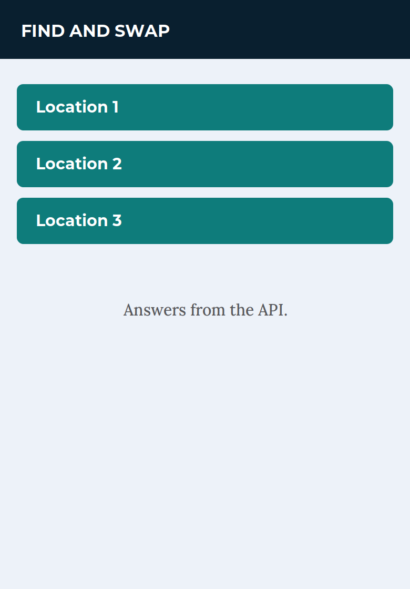

Nothing visible changes yet. The service has no screen of its own. The list area below is where its answers will appear. That is correct at this step.

**Check:** the build passes with `tsc -b && vite build`. The service file exists. No page calls the API direct.

### Step 0.3 — The hook over the service

**What you build:** the hook that reads the search query on the page. The hook is `useSuspenseQuery`. The query client caches the answer, so a repeat visit loads fast. The route loader warms the cache before the page shows.

**The code:** type the loader line in the route, and the read line in the page.

```tsx
// The loader starts the request before the page shows. It reuses the saved answer when fresh.
loader: ({ context }) => context.queryClient.ensureQueryData(searchQueryOptions),
// useSuspenseQuery reads the saved answer. The page filters by the search values and shows the first 10 that match.
const { data: listings } = useSuspenseQuery(searchQueryOptions)
```

The file tree now looks like this:

```text
client/
  src/
    api/
      client.ts
      queryClient.ts
      search.ts
      schema.d.ts
    pages/
      __root.tsx
      hello.tsx
```

**What you should see:**

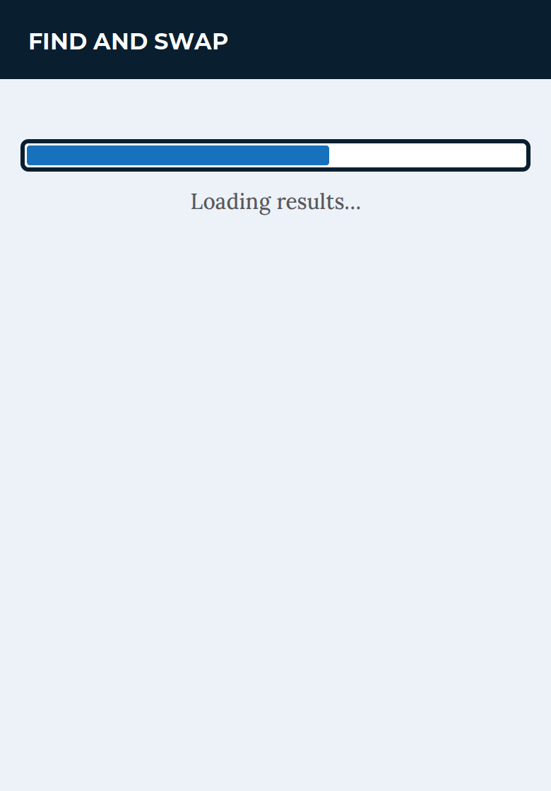

Nothing visible changes yet. The hook has no screen of its own. The loading line is what the next step shows while the hook waits.

**Check:** the build passes. The route loader warms the cache. The page reads the saved answer. Loading shows the loading line, and an error shows a plain-word message.

### Step 0.4 — The four states

**What you build:** the shared wrapper that renders loading, error, and empty around the success view. Every data page has four states: loading, error, empty, success. One shared component renders the first three, so each page writes only its success view.

**The code:** wrap each list in `DataState`.

```tsx
// DataState is the Decorator (GoF). It adds the loading, error, and empty views around the success view, so the page writes only its success view.
// Loading says so in words. An error says what failed and what to do next. Empty says so in words, never a blank area.
<DataState query={locationsQuery}>
  {(locations) => <ResultsList locations={locations} />}
</DataState>
// Zero results says "No results found" with the EDIT SEARCH button beside it. A page with no items shows the empty state, not a blank page.
```

**What you should see:**

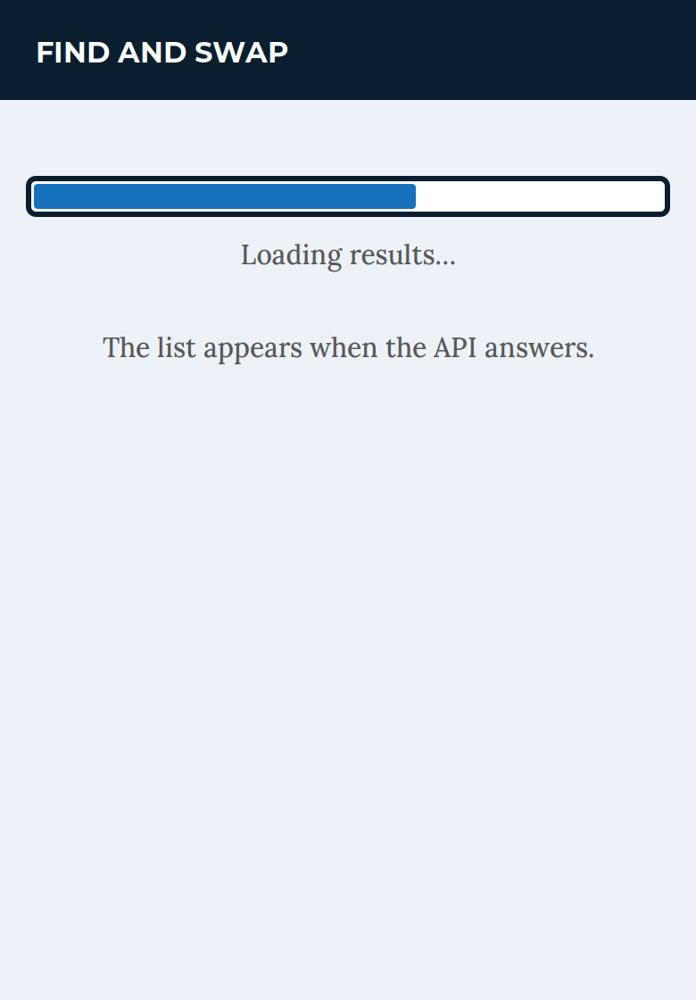

The loading state shows a progress bar (`.prg`) and the words "Loading results…". When the API answers, the list replaces it. When the answer is empty, the words "No results found" replace it.

**Check:** load the page with the API slow. The loading words show. Load it with no results. The empty words show, and no blank area appears. Load it with a failed API. The error words show, with a next step.

---

## Screen 1 — `/find`: search, filters, and Spanish

**What Marisol does:** she types what she wants and picks a category. She picks nearby or pickup. She reads the page in Spanish when she wants it. She presses SEARCH. The page shows listings that each carry cost, distance, and clear instructions.

**Page model:**

| State | Lives | Changes it |
|---|---|---|
| Board filter (wanted / offered / all) | Component state | Chip click (Stub 25) |
| Listings | Query client | API answers |
| Category filter | URL + component state | Filter bar (Stub 14) |
| Page number | URL `?page=` | Pagination click (Stub 23) |
| Language | Provider, at the app entry | Language switcher (Stub 24) |

The URL owns the search values, so Back and Forward work and a link can be shared. The query client owns the listings, cached under one key. The board filter lives in component state only, so it clears when the page closes. The language value is provided at the app entry through context and reaches every screen. The choice survives a reload.

**Widgets on this screen:** W-06 search input, W-07 filter bar, W-17 language switcher, W-26 loading / error / empty views, W-23 skip link, live region, focus management.

### Step 1.1 — Write the page model first

**What you build:** the page model as a comment at the top of the page. No component yet. If a piece of state has no home, it does not exist yet.

**The code:** type this comment at the top of the find page file in `client/src/pages/`.

```tsx
// Page model: /find — the URL owns the search. The query client owns the listings. The query client is the store that caches API answers, so a repeat visit loads fast.
// const params = useSearch({ from: "/find" }); // category, nearby, pickup, language, page. The params come from the URL, so the page never stores a copy.
// const { data } = useSuspenseQuery(searchQueryOptions); // The query client caches under one key. The answer stays fresh for ten minutes, so a repeat visit loads fast.
// const [boardFilter, setBoardFilter] = useState("all"); // Component state only. The choice lives in the page, so it clears when the page closes.
// const [language, setLanguage] = useLanguage(); // The provider at the app entry holds the language. Every screen reads it from context, so one change reaches all screens.
```

**What you should see:**

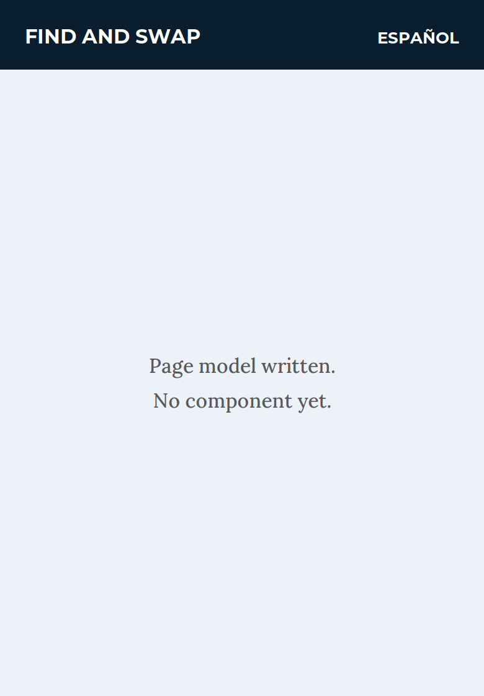

The screen is empty below the header. That is correct. The model is written, and no component exists yet.

**Check:** every piece of state in the table has a home in the comment. No state appears twice. The build passes.

### Step 1.2 — The search input

**What you build:** the text field that searches as Marisol types, with matching letters in bold. W-06, Stub 13. Pattern: Observer (GoF). The parent owns the query. The input holds nothing.

**The code:** type this in `client/src/components/ui/SearchInput.tsx`.

```tsx
// client/src/components/ui/SearchInput.tsx — W-06, the search input.
// The parent owns the query. The input holds nothing, so the value lives in one place and the page can read it.
const [query, setQuery] = useState("");
// The hook waits 200 ms for a pause, then calls the service. The pause stops a call on every keystroke, so typing stays fast.
const results = useDebouncedSearch(query, 200);
// The matched letters show in bold (Yellow background, Charles Blue text, bold). The match is never marked by colour alone, so a user who cannot see colour still sees it.
<input className="sf" type="text" value={query} onChange={(e) => setQuery(e.target.value)} />
{results.map((r) => <li key={r.id}><HighlightedItem item={r.name} match={query} /></li>)}
// An empty query shows nothing, not the whole list. Nothing is better than a wrong list, so the page waits for a word.
```

Fleet classes: `.sf`, `.sf-hl` for the bold match, `.txt-f`.

The file tree now looks like this:

```text
client/
  src/
    components/
      ui/
        SearchInput.tsx
    lib/
      locations.ts
      use-locations.ts
    pages/
      __root.tsx
      hello.tsx
```

**What you should see:**

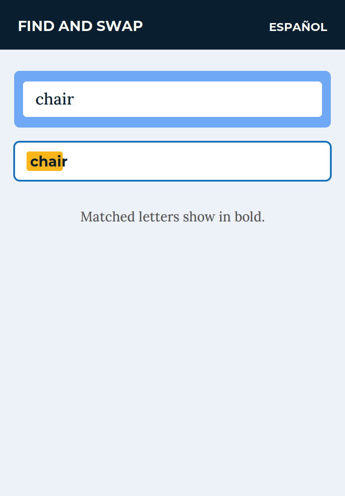

The big search field sits under the header. Type a word. Matches appear below it, with the matched letters in bold. Clear the field. The matches go away.

**Check:** type one letter. No call runs until you pause. Type a full word. Matches appear with the matched letters bold. Clear the field. Nothing shows, not the whole list.

### Step 1.3 — The filter bar

**What you build:** the bar above the results list. Category, nearby, pickup, language. Each filter narrows the list. CLEAR ALL resets them all. W-07, Stub 14. Pattern: Strategy (GoF). Each filter is one strategy: a function that takes a list and returns a smaller list.

**The code:** type this in `client/src/components/search/FilterBar.tsx`, and put one filter function per filter in `src/lib/filters.ts`.

```ts
// client/src/components/search/FilterBar.tsx — W-07, the filter bar.
// The bar never filters the list itself. It only holds the values the page sends to the API, so the list never needs to know the filters.
const filters: Filter[] = [byCategory(category), byPickup(pickup), byLanguage(language)];
// Strategy: one function per filter. Each filter is a pure function, so you add a filter by adding one function.
const shown = filters.reduce((list, f) => f(list), results);
// Each filter is a pure function: (list: SearchResult[]) => SearchResult[]
// The nearby choice is a value the bar holds and sends to the API with the other values. The server narrows by it, so the list code never changes for it.
// CLEAR ALL resets every filter to "Any". One button clears the whole bar, so the resident starts fresh with one press.
```

Fleet classes: `.fl`, `.fl-g`, `.fl-c`, `.fl-chip`, `.sel-f`. Chips are buttons with `aria-pressed`. Pressed means active. Press again to clear it.

The file tree now looks like this:

```text
client/
  src/
    components/
      search/
        FilterBar.tsx
      ui/
        SearchInput.tsx
    lib/
      filters.ts
      locations.ts
      use-locations.ts
    pages/
      __root.tsx
      hello.tsx
```

**What you should see:**

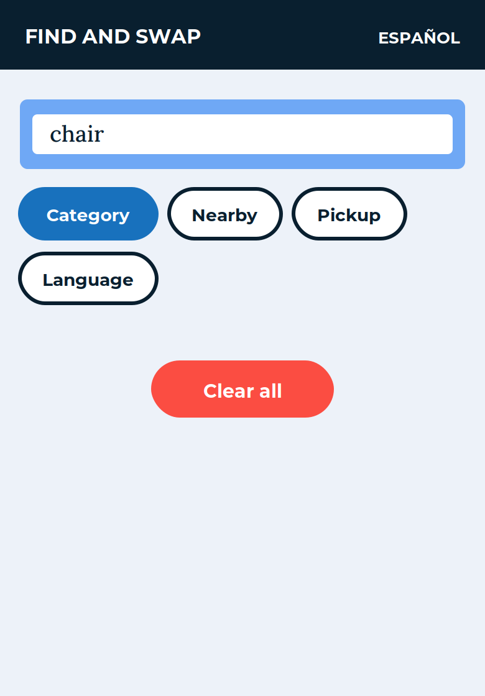

The chips sit in a row under the search field. Press a chip. It turns Optimistic Blue with white text and the word "pressed" reaches the screen reader. Press it again. It clears. Press CLEAR ALL. Every chip clears at once.

**Check:** press the category chip. The list narrows to that category. Press CLEAR ALL. The full list returns. At 390 px the filter groups stack full width.

### Step 1.4 — The language switcher

**What you build:** the ESPAÑOL control in the header. It changes the language of the page. It does not hold the translations. W-17, Stub 24. Pattern: Provider (React idiom). One language value, provided at the entry, reaches every screen through context. Language support is a launch gate.

**The code:** put the provider at the app entry, then type this in `client/src/components/ui/LanguageSwitcher.tsx`.

```tsx
// At the app entry: <LanguageProvider value={language}> wraps the router.
// The provider holds one language value. Every screen reads it through context, so one change reaches all screens at once.
<select className="tr" value={language} onChange={(e) => setLanguage(e.target.value)}>
  <option value="en">English</option>
  <option value="es">Español</option>
</select>
// The switcher changes the language only. Translations live in one strings file per language, so a new language adds one file and no code change.
// A string with no translation shows the English words, never a blank. English is the fallback, so the page never shows an empty space.
```

Fleet classes: `.tr`, `.tr-link`, `.tr-dd`, `.tr-dd-link`, `.tr-dd--visible`. The switcher is hidden below 480 px. Its dropdown opens on click, and Escape closes it.

The file tree now looks like this:

```text
client/
  src/
    components/
      search/
        FilterBar.tsx
      ui/
        LanguageSwitcher.tsx
        SearchInput.tsx
    lib/
      filters.ts
      locations.ts
      use-locations.ts
    pages/
      __root.tsx
      hello.tsx
```

**What you should see:**

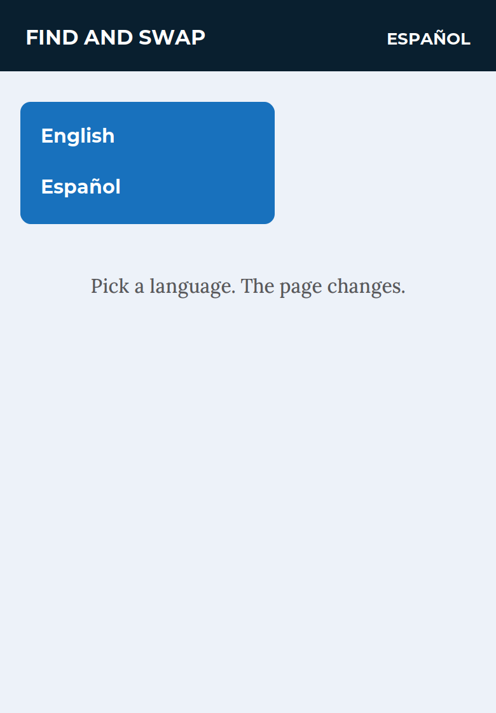

The header shows ESPAÑOL. Open it. Two choices appear: English and Español. Pick Español. The page words change to Spanish. Pick English. They change back.

**Check:** pick Español. Every screen word changes language. Reload the page. The choice survives the reload. Pick a word with no Spanish translation. The English words show, never a blank.

### Step 1.5 — Wire the state

**What you build:** the page code that joins the parts. The URL owns the search. The query client owns the listings. The page owns the board filter. One owner per piece of state.

**The code:** type this in the find page file in `client/src/pages/`.

```tsx
// The URL owns the search, so Back and Forward work and a link can be shared. The query client owns the results, cached under one key.
// The search and the filters write the URL; the list only reads it. The page never stores a copy of the search, so the URL and the page can never disagree.
const params = useSearch({ from: "/find" });
const { data: listings } = useSuspenseQuery(searchQueryOptions); // The query client follows the Stub 5 shape. It caches under one key, so a repeat visit loads fast.
// The board filter lives in the page alone. The choice clears when the page closes, so a new visit starts at "all".
const [boardFilter, setBoardFilter] = useState("all");
```

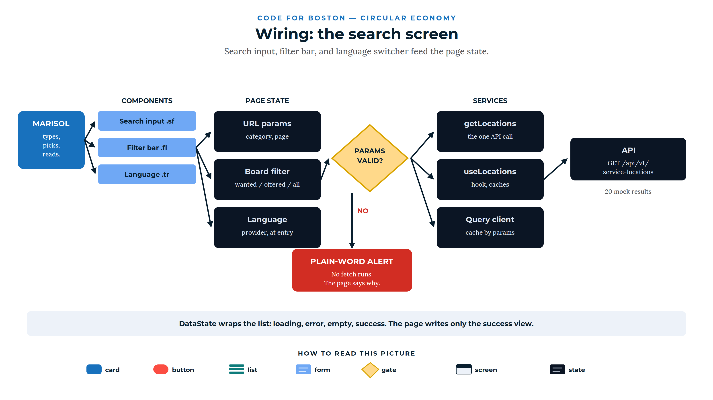

**What you should see:**

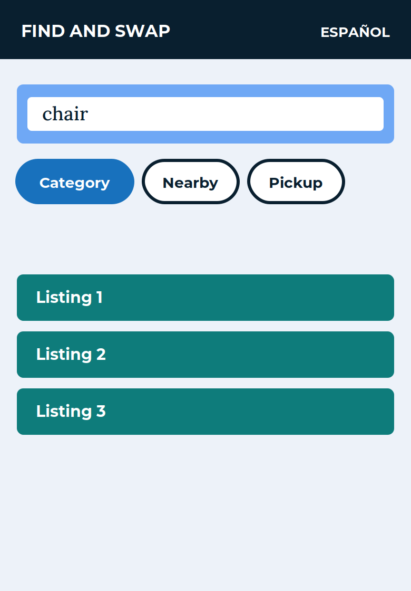

Search, chips, and list sit together on one screen. Type a word. The list narrows. Press a chip. The list narrows again. The URL in the address bar changes with each choice.

**Check:** type a word and press a chip. The URL shows the new values. Press Back. The old values return. Copy the URL into a new tab. The same search opens.

### Step 1.6 — Keyboard and accessibility

**What you build:** the keyboard and screen reader behaviour for this screen. Every control works by keyboard alone. Focus moves to the page heading on load.

- The search input is a real input. Tab reaches it. Typing works.
- The filter chips are real buttons with `aria-pressed`. Tab reaches each chip. Enter or Space presses it. The pressed state is announced.
- The language switcher is a real select. Arrow keys move through the options. Escape closes its dropdown.
- The count text sits in a live region, a plain `<div aria-live="polite">` holding `.sr-count` text. It has no visual style of its own. The count is announced when it changes.
- The skip link jumps past the header to `#main`. Focus goes to the page heading on load.
- The focus ring is the 3px Optimistic Blue ring on every control.
- At 200% zoom the page behaves like a narrow viewport. The header nav collapses, the filter groups stack full width, and nothing clips.

**What you should see:**

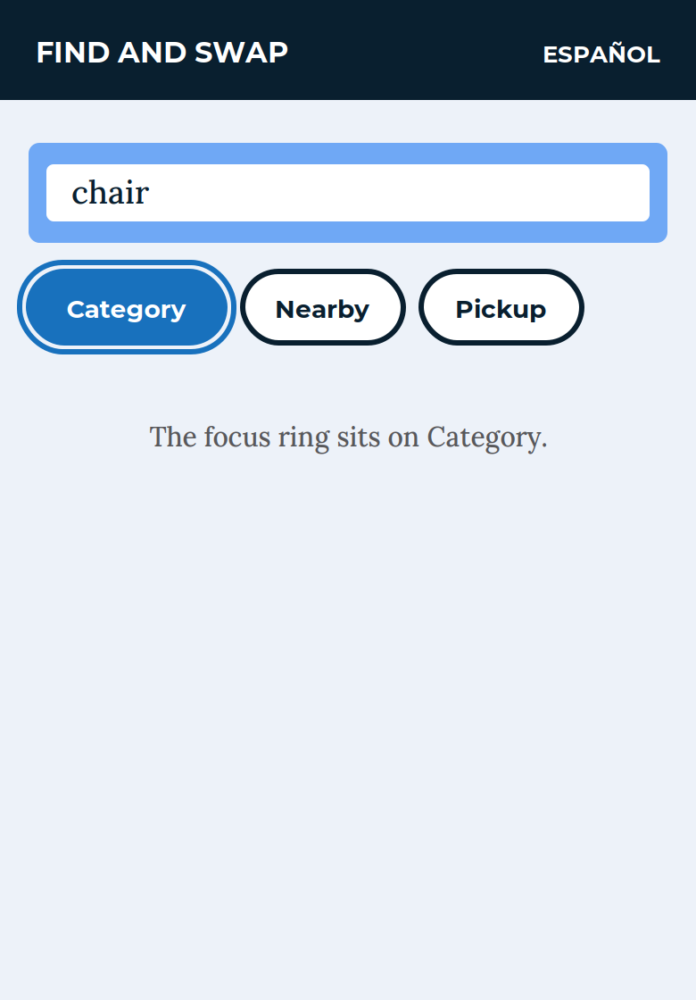

Tab through the screen. The focus ring moves from the search field to each chip to the language switcher. Nothing is reachable by mouse only. Nothing is carried by colour alone.

**Check:** unplug the mouse. Tab from the top to the bottom of the screen. Every control takes focus in order. The screen reader announces each chip state and the result count. At 200% zoom no text clips and no control hides.

### Step 1.7 — Verify in the browser

**What you build:** the check that ends this screen. Build it, then walk it.

```sh
tsc -b && vite build
```

- Walk it fresh, with no results yet, and seeded, with results.
- Walk it by keyboard alone: tab from the search field to a chip to the language switcher.
- Walk it with a screen reader: the count and the chip states must all be announced.
- Walk it at 200% zoom and at 390 px.
- A passing gate count is text only. It is not a pass on its own.

**Check:** the build passes. Every walk above passes. Only then is this screen done. Move on to the board.

---

## Screen 2 — The wanted and offered board

**What Marisol does:** she reads two columns. Wanted on one side, Offered on the other. Each item is a card. A filter shows one side, both sides, or one category. She matches what someone wants with what someone offers.

**Page model:** the board filter (wanted / offered / all) lives in component state and changes on chip click. The listings live in the query client and come from the API. The category filter lives in the URL plus component state and changes through the filter bar.

**Widgets on this screen:** W-18 wanted / offered board, W-07 filter bar, W-26 loading / error / empty views, W-23 skip link, live region, focus management.

### Step 2.1 — Confirm the board with Kitty first

**What you build:** nothing yet. Confirm the board with Kitty first. The Figma file has only the icon cards, no board screen. Kitty owns the use cases. Ask her to confirm the two columns, the card content, and the filter choices before you write the component. Her answer fixes the design, so you build it once.

**Check:** Kitty confirms the board. Two columns, Wanted and Offered. Each item a card. A filter shows one side, both sides, or one category. Build only after her answer.

### Step 2.2 — The listing card

**What you build:** one card per listing. Each card shows cost, distance, and clear instructions in text. Cost, distance, and unclear instructions are Marisol's three barriers, so the card answers all three in words. W-18, Stub 25. Pattern: Composite (GoF). The board holds two lists. Each list holds cards.

**The code:** type the card in the find components folder. The board uses it next.

```tsx
// The listing card is a presentational part. It takes a listing as props and renders it. It fetches nothing, so it stays simple.
// Every listing shows cost, distance, and clear instructions in text. Cost, distance, and unclear instructions block Marisol, so the card answers all three.
<div className="gcd">
  <h3>{listing.name}</h3>
  <p>Cost: {listing.cost}</p>
  <p>Distance: {listing.distance}</p>
  <p>Instructions: {listing.instructions}</p>
</div>
// The card shows words, never colour alone. A user who cannot see colour still reads the cost, the distance, and the instructions.
```

Fleet classes: `.gcd`, `.gcd-ic`, `.gcd-c`, `.gcd-st`, `.gcd-t`, `.gcd-d`. The grid card has min-height 350px, a title in Montserrat 700 uppercase 18–28px, and a subtitle in Lora italic 16–18px.

The file tree now looks like this:

```text
client/
  src/
    components/
      find/
        ListingCard.tsx
      search/
        FilterBar.tsx
      ui/
        LanguageSwitcher.tsx
        SearchInput.tsx
    lib/
      filters.ts
      locations.ts
      use-locations.ts
    pages/
      __root.tsx
      hello.tsx
```

**What you should see:**

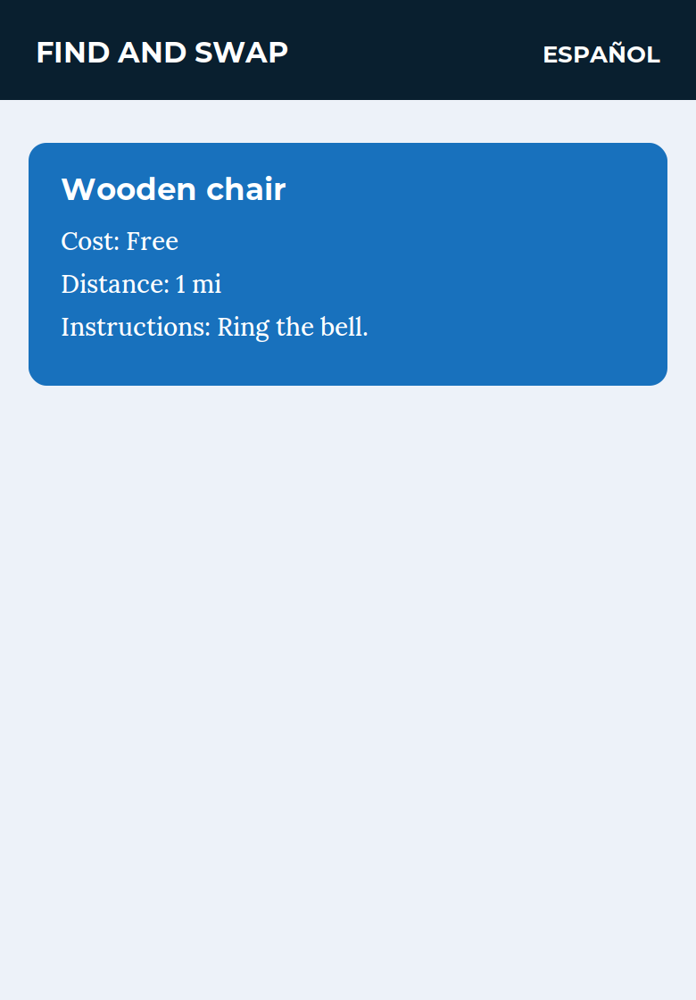

One card sits under the header. It shows a name, a cost, a distance, and instructions, each on its own line. Nothing is missing. Nothing is carried by colour alone.

**Check:** the card shows cost, distance, and instructions in text. Remove one value from the listing. The card still shows the other two, and the missing line says so in words, never a blank.

### Step 2.3 — The board

**What you build:** the two columns. Wanted on one side, Offered on the other. Each column holds cards. W-18, Stub 25. Pattern: Composite (GoF). The board holds two lists. Each list holds cards.

**The code:** type this in `client/src/components/find/WantedOfferedBoard.tsx`.

```tsx
// client/src/components/find/WantedOfferedBoard.tsx — W-18, the wanted and offered board.
// The board splits the listings into two lists. One line per side keeps the split in one place, so the columns can never disagree.
const wanted = listings.filter((l) => l.kind === "wanted");
const offered = listings.filter((l) => l.kind === "offered");
// Composite: the board holds two lists, and each list holds cards. The page holds the board, and the board holds the columns, so each part has one job.
<div className="wo">
  <section className="wo-col"><h3>Wanted</h3>{wanted.map((l) => <ListingCard key={l.id} listing={l} />)}</section>
  <section className="wo-col"><h3>Offered</h3>{offered.map((l) => <ListingCard key={l.id} listing={l} />)}</section>
</div>
// The listings come from the query client. The board never fetches, so the board stays a presentational part and the page stays in charge of data.
```

Fleet classes: `.wo`, `.wo-col`, `.wo-i`, `.gcd`.

The file tree now looks like this:

```text
client/
  src/
    components/
      find/
        ListingCard.tsx
        WantedOfferedBoard.tsx
      search/
        FilterBar.tsx
      ui/
        LanguageSwitcher.tsx
        SearchInput.tsx
    lib/
      filters.ts
      locations.ts
      use-locations.ts
    pages/
      __root.tsx
      hello.tsx
```

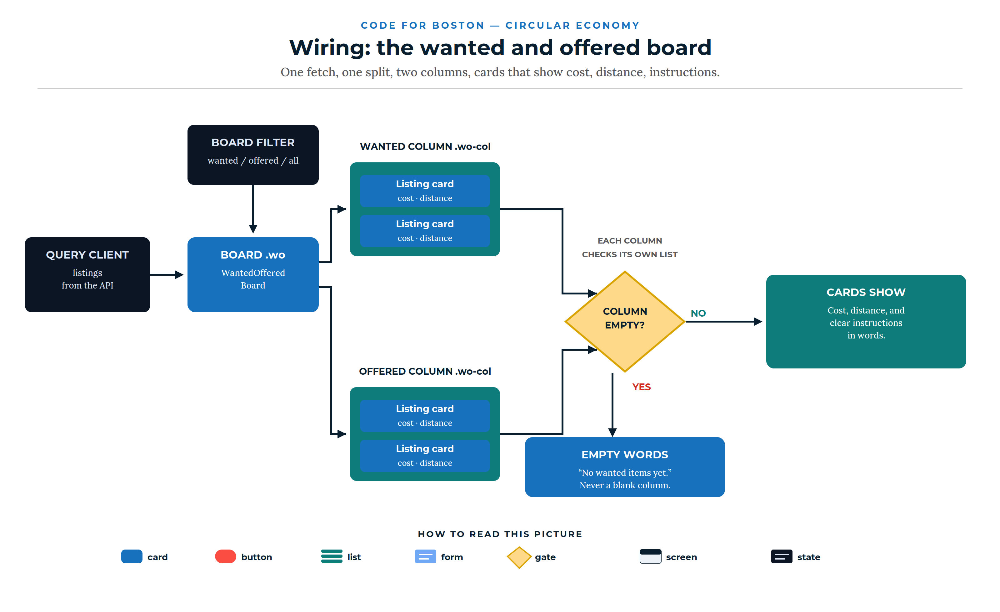

**What you should see:**

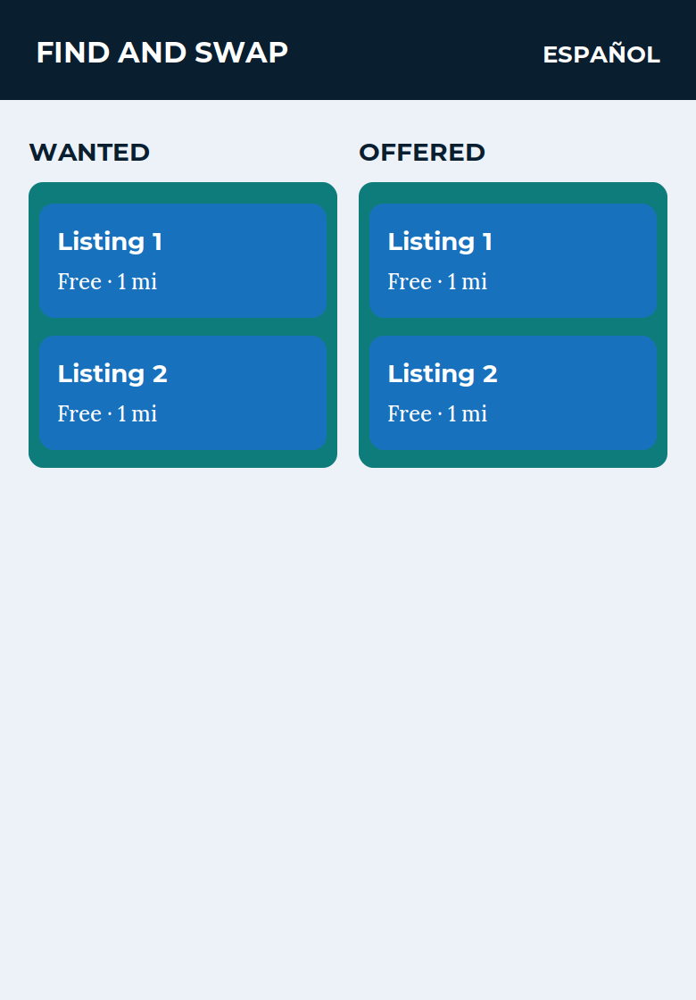

Two columns sit side by side. Wanted holds the wanted cards. Offered holds the offered cards. Each card shows cost, distance, and instructions. At 390 px the columns stack full width, one above the other.

**Check:** the Wanted column holds only wanted listings. The Offered column holds only offered listings. A listing never appears in both columns. At 390 px the columns stack and no card clips.

### Step 2.4 — The board filter

**What you build:** the chips that show one side, both sides, or one category. The board filter lives in component state. It changes on chip click.

**The code:** add the chips above the board in the find page.

```tsx
// The board filter lives in component state. The choice clears when the page closes, so a new visit starts at "all".
const [boardFilter, setBoardFilter] = useState("all");
// The filter picks which columns show. "all" shows both. "wanted" shows Wanted only. "offered" shows Offered only.
const shown = boardFilter === "all" ? listings : listings.filter((l) => l.kind === boardFilter);
// Chips are buttons with aria-pressed. Pressed means active. Press again to clear it, so the resident controls the filter by touch and by keyboard.
<button className="fl-chip" aria-pressed={boardFilter === "wanted"} onClick={() => setBoardFilter("wanted")}>Wanted</button>
<button className="fl-chip" aria-pressed={boardFilter === "offered"} onClick={() => setBoardFilter("offered")}>Offered</button>
<button className="fl-chip" aria-pressed={boardFilter === "all"} onClick={() => setBoardFilter("all")}>All</button>
```

**What you should see:**

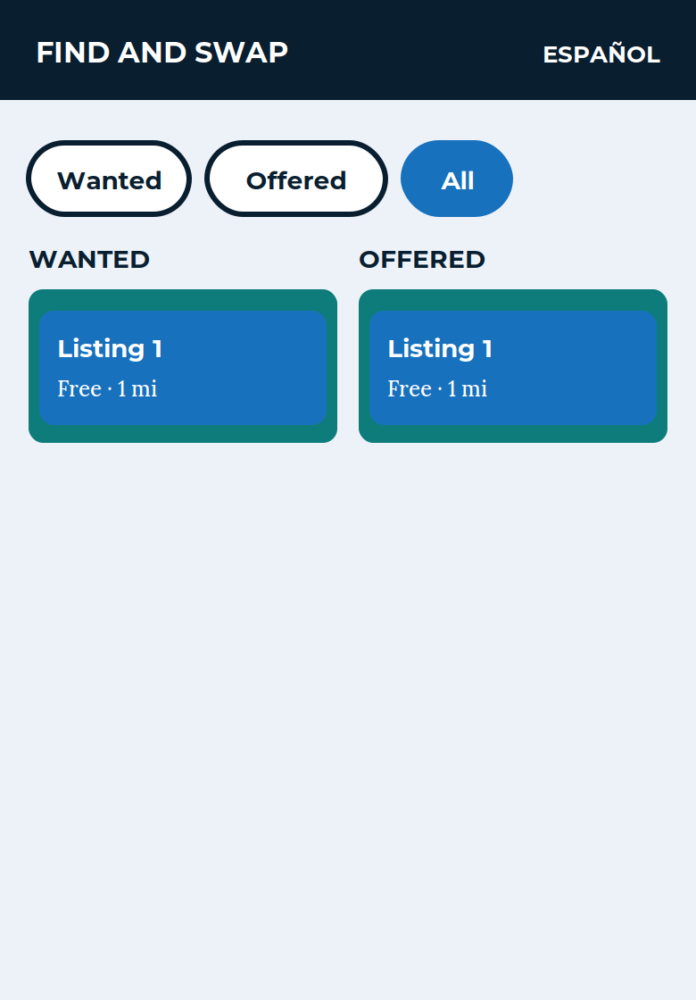

Three chips sit above the board: Wanted, Offered, All. Press Wanted. Only the Wanted column shows. Press All. Both columns return.

**Check:** press Wanted. The Offered column hides. Press Offered. The Wanted column hides. Press All. Both columns show. The pressed chip is announced to the screen reader.

### Step 2.5 — Empty columns in words

**What you build:** the empty state for a column with no items. A column with no items says so in words, never a blank area.

**The code:** wrap each column in the empty check.

```tsx
// A column with no items says so in words. An empty column is a fact, and the words state it, so the resident never wonders if the page broke.
<section className="wo-col">
  <h3>Wanted</h3>
  {wanted.length === 0 ? <p>No wanted items yet.</p> : wanted.map((l) => <ListingCard key={l.id} listing={l} />)}
</section>
// The same rule holds for Offered. Each column checks its own list, so one empty column never hides the other.
```

**What you should see:**

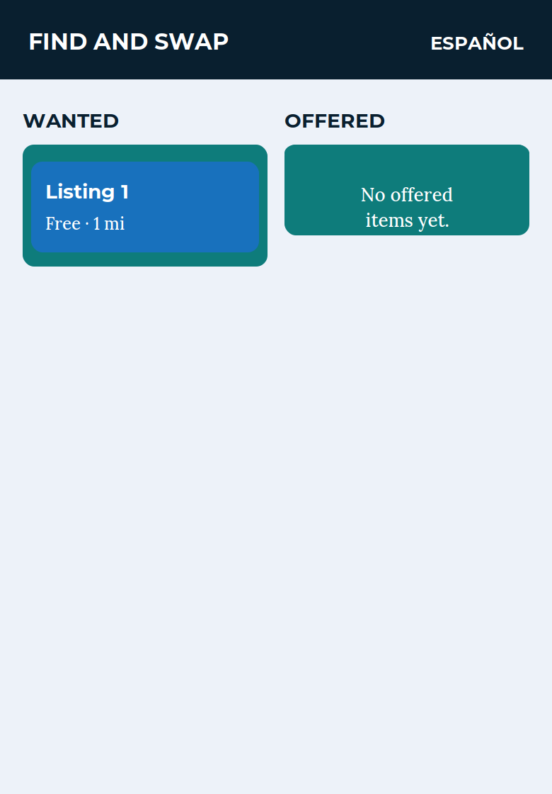

One column holds cards. The other holds the words "No offered items yet." No blank area appears anywhere.

**Check:** filter to a category with no offered items. The Offered column shows the empty words. The Wanted column still shows its cards.

### Step 2.6 — Keyboard, access, and verify

**What you build:** the keyboard and screen reader behaviour for the board, then the check that ends this screen.

- The board filter chips are real buttons. Tab reaches each chip. Enter or Space presses it.
- Each card is a real link or a real button, so a keyboard user can open it. Cards that act as links are `<a>` elements.
- Focus moves to the page heading on load. The board columns stack full width at 200% zoom.
- The count text is announced through the live region when the filter changes.

Build it, then walk it:

```sh
tsc -b && vite build
```

- Walk it fresh and seeded. Walk it by keyboard alone, from the chips to the cards.
- Walk it with a screen reader. The column headings, the card text, and the empty words must all be announced.
- Walk it at 200% zoom and at 390 px. The columns stack. No card clips.

**Check:** the build passes. Every walk above passes. Only then is this screen done. Move on to results.

---

## Screen 3 — Results with pagination

**What Marisol does:** she reads the count, reads the first ten listings, and moves through pages of results. Each listing shows cost, distance, and clear instructions. A page with no items shows the empty state, not a blank page.

**Page model:** the listings live in the query client and come from the API. The page number lives in the URL (`?page=`). The URL owns the page, so Back and Forward work and a link can be shared.

**Widgets on this screen:** W-05 search results list, W-29 results list first 10, W-16 pagination, W-15 dialog, W-26 loading / error / empty views, W-23 skip link, live region, focus management.

### Step 3.1 — The results list

**What you build:** the list of the first ten results, in response order. W-05 and W-29, Stub 4. Pattern: Provider / hook / container (React idiom). The page is the container. The list is presentational.

**The code:** type the list in the find page, wrapped in `DataState`.

```tsx
// The page writes only its success view. DataState renders loading, error, and empty, so the list code never handles those states.
<DataState query={locationsQuery}>
  {(locations) => (
    // The list shows the first ten, in response order. Ten is the page size, so page two never repeats page one.
    <ul className="sr-list">
      {locations.slice(0, 10).map((l) => <ListingCard key={l.id} listing={l} />)}
    </ul>
  )}
</DataState>
// The list takes the listings as props and renders them. It fetches nothing, so the page stays the one place that holds data.
```

Fleet classes: `.sr-list`, `.sr`, `.sr-c`, `.sr-t`, `.sr-st`, `.sr-d`, `.sr-m`, `.sr-tag`, `.sr-tag--free`, `.sr-tag--paid`, `.sr--sel`. A selected result gets a 3px Charles Blue border. FREE and PAID are text tags, never colour alone.

**What you should see:**

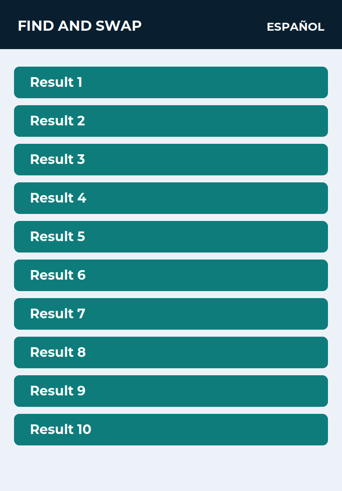

Ten rows sit under the header. Each row shows cost, distance, and instructions. The rows sit in the same order the API returned them.

**Check:** the list shows ten rows, no more. The order matches the API order. An eleventh result waits on page two.

### Step 3.2 — The count text

**What you build:** the plain text before the list, in reading order, stating the count and the first-ten cut. The count text sits in a live region, so the screen reader announces it when it changes.

**The code:** put the count above the list.

```tsx
// The count text states the count and the first-ten cut in plain words. It sits before the list, in reading order, so a screen reader meets it first.
<p className="sr-count">Displaying 1 - 10 of {results.length} results.</p>
// The live region holds the same text. A plain <div aria-live="polite"> holds the count, so the screen reader announces it when the results change.
<div aria-live="polite" className="sr-only">Displaying 1 - 10 of {results.length} results.</div>
// The count has no visual style of its own beyond the text. Words carry the count, so the resident always knows how many results exist.
```

Fleet classes: `.sr-count`.

**What you should see:**

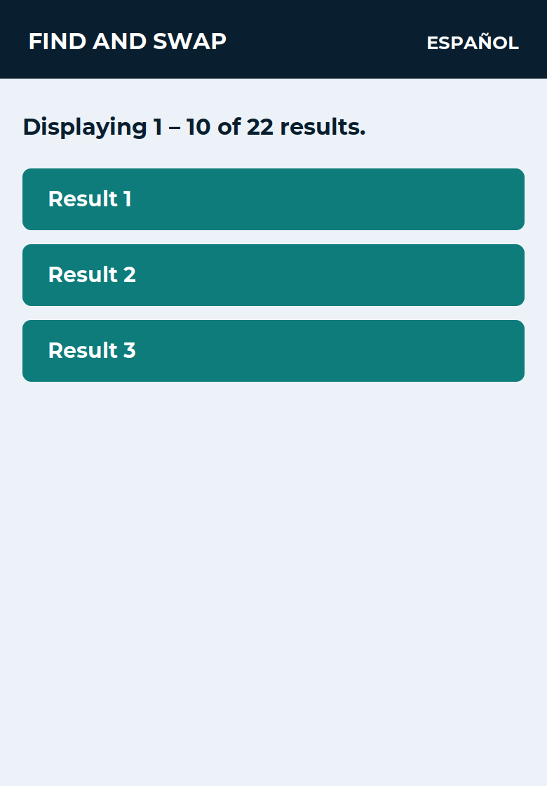

The count line sits above the list: "Displaying 1 - 10 of 22 results." The list follows below it.

**Check:** search for a word with 22 results. The count says "Displaying 1 - 10 of 22 results." Search for a word with 3 results. The count says "Displaying 1 - 3 of 3 results." The screen reader announces each change.

### Step 3.3 — Pagination

**What you build:** the controls that move between pages. First, Previous, a page number, Next, Last. W-16, Stub 23. Pattern: Iterator (GoF). Take the results in order, stop after ten, move to the next ten on the next page. No re-sort, no copy.

**The code:** type this in `client/src/components/ui/Pagination.tsx`.

```tsx
// client/src/components/ui/Pagination.tsx — W-16, pagination.
// The page number lives in the URL. Back and Forward work, and a link can be shared, because the URL holds the page.
const page = Number(search.page ?? 1);
// Iterator: take the results in order and stop after ten. Order keeps the list stable, so page two never repeats page one.
const shown = results.slice((page - 1) * 10, page * 10);
// The links are real links. A real link takes focus and works with Back and Forward, so the keyboard user and the browser both follow it.
<a className="pg-li-i--link" href={`/find?${params}&page=${page + 1}`}>Next</a>
// A page with no items shows the empty state, not a blank page. The empty words say so, so the resident never sees a blank.
```

Fleet classes: `.pg`, `.pg-li`, `.pg-li-i`, `.pg-li-i--link`, `.pg-li-i--a`, `.pg-li-i-h`, `.pg-disabled`. First and last are hidden below 768 px.

The file tree now looks like this:

```text
client/
  src/
    components/
      find/
        ListingCard.tsx
        WantedOfferedBoard.tsx
      search/
        FilterBar.tsx
      ui/
        LanguageSwitcher.tsx
        Pagination.tsx
        SearchInput.tsx
    lib/
      filters.ts
      locations.ts
      use-locations.ts
    pages/
      __root.tsx
      hello.tsx
```

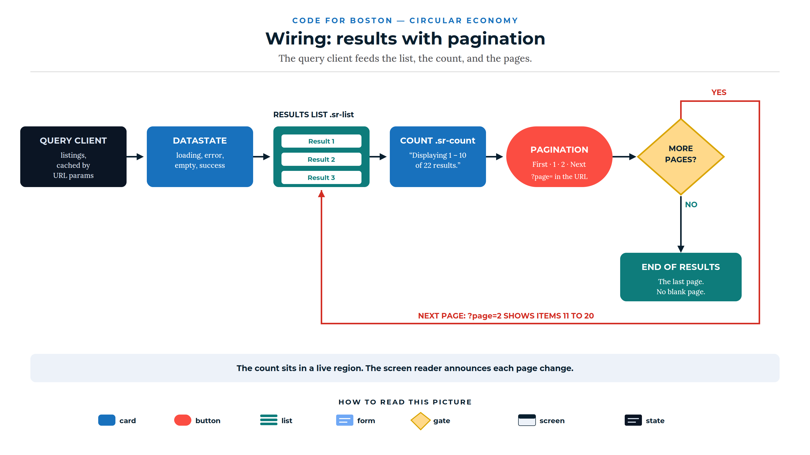

**What you should see:**

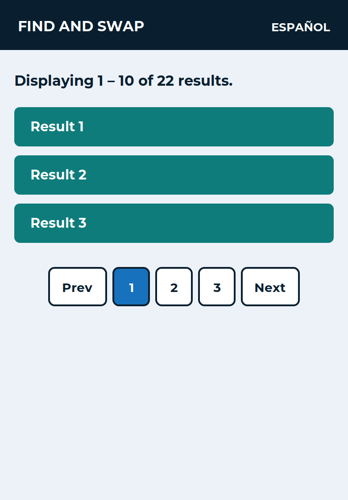

The pagination controls sit below the list: Previous, 1, 2, 3, Next. The active page shows Optimistic Blue with white text. Press 2. The list shows items 11 to 20. The count says "Displaying 11 - 20 of 22 results."

**Check:** press Next. The URL gains `?page=2`. The list shows items 11 to 20. Press Back. Page 1 returns. Open page 3 with only 22 results. The empty state shows, not a blank page.

### Step 3.4 — The FILTER dialog on a phone

**What you build:** the dialog that holds the filters on a phone. On a narrow screen the filter bar does not fit, so a FILTER button opens it as a dialog. W-15, Stub 22. Pattern: Decorator (GoF). The dialog opens over the page.

**The code:** type this in `client/src/components/ui/Dialog.tsx`.

```tsx
// client/src/components/ui/Dialog.tsx — W-15, the dialog.
// Open: focus the first control inside. Close: return focus to the opener. Focus tells the keyboard user where they are, so they never lose their place.
export function Dialog({ open, onClose, children }: DialogProps) {
  // Escape calls onClose. A click on the dimmed layer behind the dialog calls onClose. A click inside does not, so the dialog stays open while the user works in it.
  if (!open) return null;
  return <div className="md" role="dialog" aria-modal="true">{children}</div>;
}
```

Fleet classes: `.md`, `.md-c`, `.md-cb`, `.md--fw`. The dialog is fixed, with background rgba(24,113,189,.75). The close button is 45px, Freedom Red background, white close mark. Escape closes it. Focus moves inside it when it opens and returns to the button that opened it when it closes.

The file tree now looks like this:

```text
client/
  src/
    components/
      find/
        ListingCard.tsx
        WantedOfferedBoard.tsx
      search/
        FilterBar.tsx
      ui/
        Dialog.tsx
        LanguageSwitcher.tsx
        Pagination.tsx
        SearchInput.tsx
    lib/
      filters.ts
      locations.ts
      use-locations.ts
    pages/
      __root.tsx
      hello.tsx
```

**What you should see:**

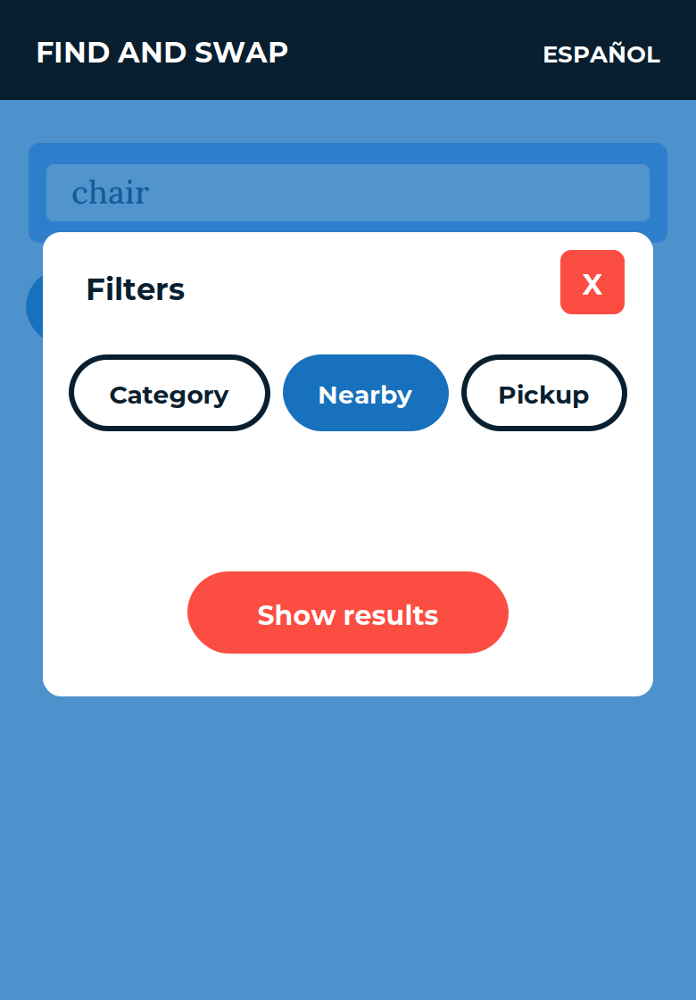

The FILTER button opens the dialog over the page. The filter chips sit inside it. The close button sits at the top. Press Escape. The dialog closes, and focus returns to the FILTER button.

**Check:** open the dialog on a 390 px screen. Focus moves inside it. Tab stays inside it until it closes. Press Escape. Focus returns to the FILTER button. The filters still hold their values.

### Step 3.5 — Keyboard, access, and verify

**What you build:** the keyboard and screen reader behaviour for the results screen, then the check that ends the journey.

- The pagination links are real links. Tab reaches each one. Enter follows it. Back and Forward work.
- The FILTER button is a real button. Enter or Space opens the dialog. Escape closes it.
- The count text is announced through the live region when the page changes.
- Focus moves to the page heading on load. At 200% zoom the list goes full width.
- If the map fails to load, the failure is stated in text and the list stays on screen.

Build it, then walk it:

```sh
tsc -b && vite build
```

- Walk it fresh and seeded. Walk it by keyboard alone: tab from the count to a card to pagination.
- Walk it with a screen reader: the count, the sections, and the page change must all be announced.
- Walk it at 200% zoom and at 390 px. Walk it with the map failed, so the list still works.
- A passing gate count is text only. It is not a pass on its own.

**Check:** the build passes. Every walk above passes. Only then is this screen done.

---

## What you built

You built one working journey, in order:

1. Shared parts: the shell, the service, the hook, and the four states.
2. Screen 1: search, filter bar, and language switcher on `/find`.
3. Screen 2: the wanted and offered board, with its filter and its empty states.
4. Screen 3: the results list, the count, pagination, and the phone dialog.

Walk the whole journey as Marisol, end to end. Open `/find`. Type a word. Pick a category. Pick nearby or pickup. Switch to Spanish and back. Open the board. Press Wanted, then All. Read a card: cost, distance, instructions. Move to page two. Open the filters on a phone. Every step works by keyboard alone. Every state is announced in words. Every listing shows cost, distance, and clear instructions.

**Final check:** the build passes. The journey works fresh and seeded, by keyboard alone, with a screen reader, at 200% zoom, and at 390 px. The journey is done.
