# Repair results — a tutorial guide

## Who this guide serves

Denise is a senior resident of Boston. She has a TV and a jacket. She wants both fixed. She wants to save money. She drives from Dorchester, four miles. This guide builds the screens she uses, in the order she sees them.

The journey has six screens:

1. `/repair` — the repair form and the estimator
2. `/repair/results` — the results list, FREE and PAID sections, and the map
3. `/repair/form` — the item registration form
4. `/repair/events` — the event finder
5. `/providers/:id` — the provider page
6. Confirmation and feedback — the share card and the feedback widget

You build one real screen of the Circular Economy app, screen by screen, in the order Denise sees them. At the end the six screens work as one journey. This guide is not a set of samples. Each screen builds on the last one, and the finished journey works end to end.

## Overview — the journey map and the build map

Read these two pictures first. They show the whole job before any detail.

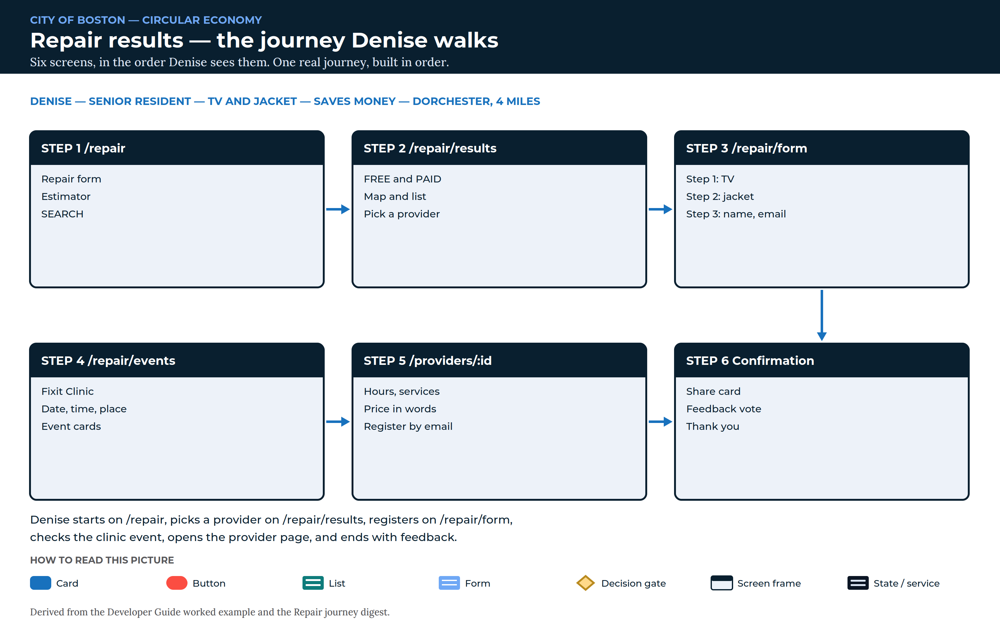

The journey map shows the six screens left to right, top row then bottom row. Denise starts on `/repair`, picks a provider on `/repair/results`, registers on `/repair/form`, checks the clinic event, opens the provider page, and ends with feedback.

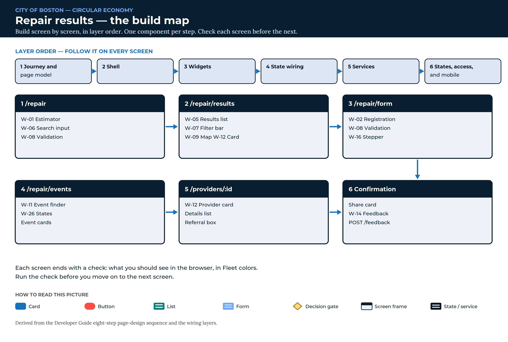

The build map shows the same six screens as a build order. The top strip shows the layer order. Follow it on every screen: journey and page model, shell, widgets, state wiring, services, then states, access, and mobile. One component per step. Never introduce two new ideas in one step.

Every diagram in this guide uses one fixed visual language. Learn it once. It never changes:

- Card: Optimistic Blue `#1871BD`, rounded rectangle
- Button (primary action): Freedom Trail Red `#FB4D42`, pill shape
- List: teal `#0E7C7B`, stacked horizontal rows
- Form: light-blue `#6FA8F5`, rectangle with input lines
- Decision gate: amber `#FFD98A` diamond
- Screen frame: Charles Blue `#091F2F` header bar with pale `#EDF2F9` body
- State and services: navy `#0B1524` with pale `#DCE6F4`

Every diagram carries this mapping in its legend.

Every screen in Part 2 uses the same step shape:

1. What you build — one idea, in plain words
2. The diagram — the wiring for that screen
3. The code — what to type, with comments that say why each step exists
4. What you should see — the exact screen state in the browser, in Fleet colors
5. Check — the one thing to confirm before you move on

Each screen follows the same eight steps. The steps come from the Developer Guide. Do not skip a step. Each step ends when its check passes.

1. Start from the journey and the page model.
2. Pick the widgets from the register.
3. Pick the Fleet classes from the theme.
4. Compose the page tree.
5. Wire the state.
6. Add the loading, error, and empty states.
7. Add keyboard and accessibility behaviour.
8. Verify it in the browser.

A page model is the state a page holds, where each piece lives, and what changes it. If a piece of state has no home, it does not exist yet. Do not write a component first.

One owner holds each piece of state. Two owners for one piece is a defect. Shareable state goes in the URL. Results go in the query client. Form state stays in the form. Selection stays in the page.

A container fetches data or holds state. A presentational part takes props and renders. A part that fetches is a container. A part that only renders takes props. Do not mix the two in one file.

The pattern names in this guide come from two books only. GoF is Gamma, Helm, Johnson, and Vlissides, "Design Patterns" (1994). Repository is Fowler, "Patterns of Enterprise Application Architecture" (2002). Dependency Injection is Fowler (2004). A row marked "React idiom" has no GoF name and gets none.

The Fleet theme is the look of the site. Fleet is the authority where it and Figma disagree on a class name or a value. Figma is the authority for which widgets the app uses and what their filled states look like. Keep the Fleet name where Fleet defines one.

Fleet colours:

- Charles Blue `#091F2F` — headings, dark bands, field borders, table headers
- Optimistic Blue `#1871BD` — links, primary button, card hover, focus ring
- Freedom Trail Red `#FB4D42` — button hover, close button, link hover
- Dark Red `#D22D23` — active tab, breadcrumb, link active state
- Yellow `#FCB61A` — yellow button, active nav in the yellow variant
- Body Gray `#58585B` — body text
- Mid Gray `#828282` — disabled text, grey progress fill
- Border Gray `#C8C8C8` — light borders, breadcrumb separator
- Divider Gray `#E0E0E0` — dividers, disabled background
- Background Gray `#F3F3F3` — light grey background
- White `#FFFFFF` — cards, page background

Type: headings, buttons, and navigation use Montserrat, Arial, sans-serif. Headings are uppercase and bold. Body, quotes, and field text use Lora, Georgia, serif. Body text is `#58585B` at 16px, line-height 1.5.

Focus: Fleet fields use a 3px Optimistic Blue ring (`0 0 0 3px #1871BD`). Every button, link, marker, chip, tab, and card link gets the same ring on `:focus-visible`.

Meaning never rests on colour alone. Every state also changes text, a border, or an icon. FREE and PAID, open and closed, yes and no are always words.

---

# Part 1 — Start from zero

## 1.1 What a webpage is

A webpage is a text file. The file holds words in a language called HTML. HTML marks each part of the page. A heading is one mark. A paragraph is one mark. A button is one mark.

A web browser reads the file. It turns the marks into a page on the screen. The browser is the program you use to visit sites. Chrome, Firefox, and Safari are browsers.

A second file holds the look. It is called a stylesheet. It sets colours, type, and spacing. This app uses one stylesheet: `design-theme/fleet-theme.css`. The stylesheet holds numbered sections 0 to 23. A widget can be found in all three files by its section number.

A third file holds the behaviour. It is written in a language called TypeScript. TypeScript is JavaScript with types. A type names the shape of a value. The browser runs JavaScript. A build step turns TypeScript into JavaScript.

A component is a reusable part of a page. A card is a component. A button is a component. A form is a component. You build a page by joining components in a tree. The page is the root. Containers hold the state. Presentational parts take props and render.

Props are values a parent passes to a child. A child reads its props and renders them. A child never fetches data on its own if it only renders. State is a value a component holds and can change. When state changes, the page renders again with the new value.

A route is the address of a page. `/repair` is a route. `/repair/results` is a route. `/providers/:id` is a route where `:id` stands for one provider id. The address bar shows the route. A link to a route opens that page.

The URL can hold state. A search lives in the URL so Back and Forward work and a link can be shared. `/repair/results?item=tv&item=jacket&mode=self&priority=money&zip=02122&distance=4` holds the whole search in the address. The page reads it from the link. The page never stores a copy.

The query client is the store that caches API answers. An API is a server that answers questions with data. The client asks the API for results. The query client keeps the answer. A repeat visit loads fast because the answer is already there. The cache uses one key, `search`. The answer stays fresh for ten minutes. A new visit reuses the saved answer.

## 1.2 The tools to install

Install three tools. A code editor writes the files. A browser shows the page. A terminal runs commands.

Install a code editor. Visual Studio Code is a free editor. Open its site, download it, and run the installer. Open the editor. Open the project folder in it. The editor shows the files in a list on the left.

Install Node.js. Node.js runs JavaScript outside the browser. It also brings a command called `npm`. Open the Node.js site, download the long-term support release, and run the installer. Then open a terminal and type:

```
node --version
```

The terminal prints a version number, such as `v22.0.0`. If it prints an error, Node.js did not install. Run the installer again.

A terminal is a text window that runs commands. On a Mac, open Terminal from Applications. On Windows, open the Command Prompt or PowerShell. You type a command, press Enter, and read the result.

Install the project tools once, inside the project folder:

```
npm install
```

This reads the project list of tools and downloads them. It takes a few minutes. It prints a short summary when it ends.

## 1.3 The first file

Make a folder for your work. Call it `repair-guide`. Inside it, make a file called `hello.html`. Type this text into it:

```html
<!DOCTYPE html>
<html lang="en">
<head>
  <meta charset="utf-8">
  <title>Hello</title>
</head>
<body>
  <main>
    <h1>Hello, Denise</h1>
    <p>This is a webpage.</p>
  </main>
</body>
</html>
```

Each line does one job:

- `<!DOCTYPE html>` tells the browser this file is a webpage.
- `<html lang="en">` opens the page and says the text is English.
- `<head>` holds facts about the page that the reader never sees.
- `<meta charset="utf-8">` says the text uses the UTF-8 letter set.
- `<title>Hello</title>` sets the text the browser tab shows.
- `<body>` holds the parts the reader sees.
- `<main>` marks the main content of the page.
- `<h1>Hello, Denise</h1>` is the page heading.
- `<p>This is a webpage.</p>` is a paragraph.

Save the file. Open it in the browser. In the editor, right-click the file and pick "Open in Browser". Or drag the file into a browser window. The browser shows "Hello, Denise" and the paragraph. You have built a webpage.

Your file tree now looks like this. Read it after every change, so you always know where you are:

```
repair-guide/
  hello.html
```

Change the heading text. Save the file. Press the browser refresh button. The page shows the new text. This loop is the whole craft: change, save, refresh, look.

## 1.4 How to open the app in a browser

The real app is not one file. It is many files that a build step joins. The build command is:

```
tsc -b && vite build
```

`tsc -b` checks the TypeScript for type errors. `vite build` joins the files into a site the browser can read. Run it from the project folder. If it ends with no errors, the build passed.

To see the app while you work, run the development server. The project start command runs it. Open the address it prints in your browser. The page loads. Change a file and save it. The browser shows the new page without a manual refresh.

Walk each page two ways. Walk it fresh, with no results yet. Walk it seeded, with the results already there. A fresh walk shows the loading and empty states. A seeded walk shows the success view.

## 1.5 How to read an error

An error is a message that names what went wrong. Read it from the top. The first line names the problem. The lines after it name the file and the line number.

A type error names a value with the wrong shape. It says the file and the line. Open that file at that line. Read the value. Fix the shape. Run the build again.

A build error names a file the build cannot find. Check the path letter by letter. A path with one wrong letter is a different path. The file list in Part 2 gives each path exactly.

A blank page means the app stopped before it rendered. Open the browser console. The console is a panel in the browser developer tools. Press F12, or right-click the page and pick "Inspect", then pick the "Console" tab. The console shows the error in red. Read the first line. It names the file and the line.

A page that shows the wrong data means the state lives in the wrong place. Check the page model. Ask: who owns this piece of state? The URL, the query client, the form, or the page? If two owners hold one piece, that is a defect. Give it one owner.

Fix one error at a time. Change one thing. Build again. If the error stays, undo the change and read the message again.

## 1.6 The shared shell every screen inherits

Every screen carries the same shell. The shell lives in `client/src/pages/__root.tsx`. Build it before any other widget.

```tsx
// client/src/pages/__root.tsx — the shared shell, every page inherits this
// The skip link comes first in the page, so a keyboard user finds it before anything else.
<a className="a11y--h" href="#main">Skip to main content</a>
// The main element holds the page. Its id matches the skip link, so the link jumps straight to it.
<main id="main"><Outlet /></main>
// The live region holds announcements in words. It has no visual style of its own, so sighted readers never see it.
<div aria-live="polite" className="sr-only">{announce}</div>
```

A skip link jumps past the header to `#main`. It stays hidden until focus reaches it. Then it shows at the top. A screen reader is a program that reads the page aloud. A live region is a part of the page that announces changes in words. `aria-live="polite"` tells the screen reader to announce the change when it can, without cutting off what it reads now.

Focus moves follow one rule. Page loads: focus goes to the page heading. A dialog opens: focus goes inside it and stays there until it closes. A dialog closes: focus returns to the button that opened it. Escape closes a dialog. A click on the dimmed layer behind the dialog closes it. A click inside does not.

The shell also carries the shared chrome on every screen: the City of Boston banner (`.site-banner`), the header (`.h`, `.lo`, `.the-b`, `.mo-t`, `.nv-m`, `.nv-h-l-a`, `.nv-dd`, `.tr`, `.brg-b`, `.h-srch`), the secondary nav (`.nv-s`), the sticky submenu (`.ssm`), the breadcrumb (`.brc`), and the footer (`.ft`, `.seal`).

Your file tree now looks like this:

```
client/
  src/
    pages/
      __root.tsx
```

Check: open the app. Press Tab once. The skip link "Skip to main content" shows at the top. Press Enter. Focus jumps to the main content. That is the shell working.

The breadcrumb shows the path back to parent pages. The current page is plain text, not a link. The breadcrumb hides below 840px.

## 1.7 The four states of every data page

Every data page has four states: loading, error, empty, success. The route shows loading and error. The page shows empty and success. This is the Decorator pattern (GoF): the route adds the loading and error views around the page.

```tsx
// The route shows loading while the query runs. It shows the error view when the query fails.
// The page reads the saved answer and writes only its success view.
const { data: locations } = useSuspenseQuery(searchQueryOptions)
<ResultsList locations={locations} />
```

Loading says so in words. On the Repair results page, "Loading results…". The loading view is a progress bar (`.prg`) plus a plain-word sentence. Fleet has no spinner. None is styled.

An error says what failed and what to do next. The error view uses a Dark Red or Freedom Red border plus a message in plain words. The message names the field and what a good value looks like. No stack trace, route name, or type name is shown.

Empty says so in words, never a blank area. Zero results says "No results found" with the EDIT SEARCH button beside it. A page with no items on pagination shows the empty state, not a blank page.

## 1.8 The service and the hook

The API layer lives in `client/src/api/`. Three files hold it. `client.ts` holds the typed client. `queryClient.ts` holds the query client. `search.ts` holds the search query. No page writes its own fetch.

`client.ts` builds the client from the API schema. The schema is `schema.d.ts`. A build step makes it from `openapi.json`. The command is `npm run gen:api`. The client is typed, so a wrong path or field fails the build. `unwrap` turns a failed call into a thrown error, so the query enters its error state.

`queryClient.ts` builds one query client. It keeps an answer fresh for 60 seconds. It retries once for a network or server error. It never retries a 4xx error, because a new try cannot fix a bad request.

`search.ts` holds `searchQueryOptions`. It is the one place that calls the API for locations. The call goes to `GET /api/v1/search`. The route returns every location. The page filters the list and shows the first 10 that match. The query key is `['search']`. The answer stays fresh for ten minutes. The result type is `SearchResult`.

The app entry provides the query client. `main.tsx` wraps the app in `QueryClientProvider` and passes the query client to the router. A route loader warms the cache before the page shows. The page reads the answer with `useSuspenseQuery`. Loading shows a plain-word sentence. An error shows a plain-word message with the role `alert`. Tests provide a mock client with the same contract shape. This is Provider and Dependency Injection (Fowler): concrete parts are built at composition points and passed in as parents. Do not build a concrete store, querier, or client inside a handler, a page, or a rule. Build it in a job or an entry file, and pass the parent type in.

The five search values live in the URL: item, mode, priority, zip, distance. The page reads them from the URL, never stores a copy. The page checks each value. A bad value shows one plain-word alert and no results. API keys never enter the client bundle. The server is a proxy for any key-based service. The browser never talks to a key-based service direct.

Location data is `SearchResult` with id, name, lat, lon, address, services, contact, availability, last_verified. Id form is `<data_source>:<data_source_id>`. The map centres on a fixed Boston fallback, `[42.36, -71.06]`, because no geocoder exists yet. The page text states that distance filtering is not active.

---

# Part 2 — Build this journey screen by screen

Build the screens in the order Denise sees them. Finish one screen before you start the next. Verify each screen in the browser before you move on.

---

## Screen 1 — `/repair` — repair search and estimator

### What Denise does

Denise enters her items, up to three. The worked example uses a TV and a jacket. She picks a repair mode and a priority. She enters where she is coming from: getting-there, zip, distance. She presses SEARCH. The page shows an estimated impact for her items.

### Step 1 — Journey and page model

Journey: Repair, Denise, senior persona. The page model:

| State | Lives | Changes it |
| --- | --- | --- |
| Items, up to three | Form state | Typing, Add more |
| Repair mode, priority | Form state | Radio change |
| Location (getting-there, zip, distance) | Form state, then URL on SEARCH | Select, typing |
| Estimated impact | Derived, no state | Items and mode change |
| Results, selected provider | Query client, component state | As on `/search` |

```tsx
// Page model: /repair — the form holds the search.
// SEARCH moves it to the URL, so the results page can read it from the link.
// The estimator reads the form and writes nothing, so it cannot change the search.
const [items, setItems] = useState<Item[]>([{ name: "TV" }, { name: "jacket" }]);
```

Estimated impact is derived from the items and the mode. It is not stored, so it never goes stale.

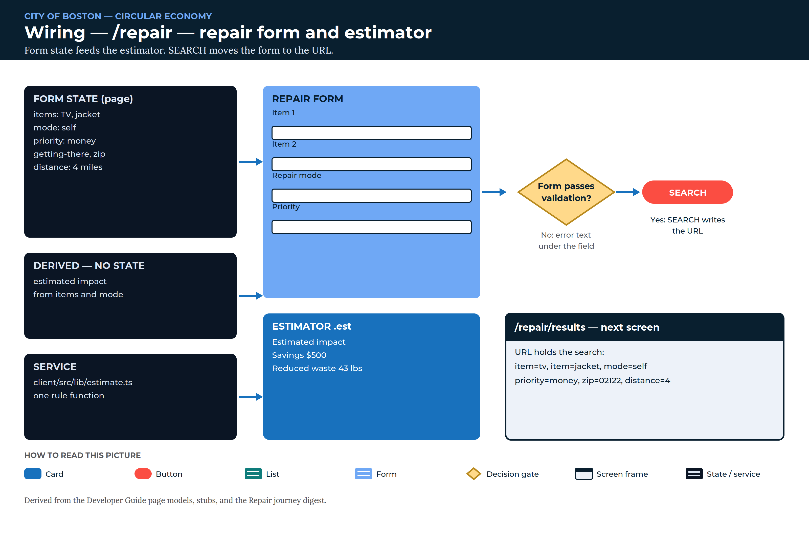

The wiring picture reads left to right. Form state on the left feeds the form and the estimator in the middle. The amber diamond asks: does the form pass validation? Yes moves to SEARCH. No shows error text under the field. SEARCH writes the URL, which opens the next screen.

Check: you can name the owner of each piece of state on this screen — form, derived, or service. If a piece has no owner, stop. Do not write a component yet.

### Step 2 — Widgets from the register

- W-01 Repair estimator (Stub 9)
- W-06 Search input (Stub 13)
- W-08 Form validation (Stub 15)

### Step 3 — Fleet classes from the theme

- Estimator: `.est`, `.est-t`, `.est-v`, `.est-d`, `.est-row`
- Search form fields: text inputs `.txt-f`, selects `.sel-f`, radios `.ra-f`, field groups `.fld`, labels `.txt-l`, hint text `.fld-hint`, error text `.fld-err`
- Buttons: SEARCH as `.btn`

A textbox (`.txt-f`) is Lora 16px, 3px Charles Blue border, height 57px. A select (`.sel-f`) is white, 3px Charles Blue border, Lora 16px. A radio (`.ra-f`) is 30px, 3px Charles Blue border, radius 100%. Required fields carry a red asterisk, always paired with the word "required" for screen readers.

### Step 4 — Compose the page tree (Composite)

The page is the root. Containers hold the state. Presentational parts take props and render.

```tsx
// The repair form page — containers first, parts last
<main>
  <h1>Repair</h1>
  <Estimator items={items} />           {/* W-01, Stub 9, presentational */}
  <form>
    {/* Item fields: one text input per item, up to three */}
    {/* Repair mode radios, priority radios */}
    {/* Getting-there select, zip text input, distance select */}
    <button className="btn" type="submit">Search</button>
  </form>
</main>
// The form owns the values. The estimator only reads them, so it cannot change the search.
```

### Step 5 — Wire the state

Form state stays in the form. SEARCH moves the values to the URL. The results page reads the URL. The form never stores a copy after SEARCH.

```tsx
// SEARCH moves the form values to the URL.
// The URL then owns the search, so a shared link carries it to the results page.
function onSearch() {
  navigate(`/repair/results?item=tv&item=jacket&mode=self&priority=money&zip=02122&distance=4`);
}
```

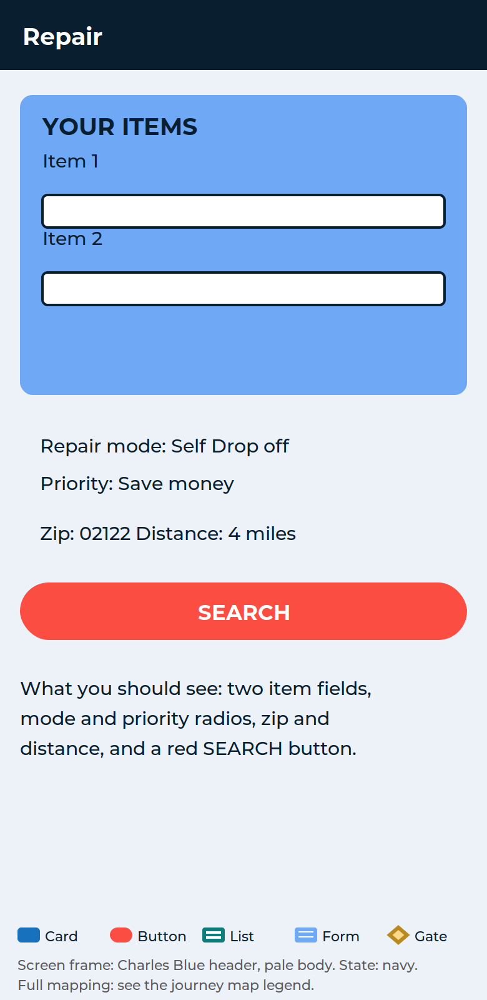

What you should see: two item fields, mode and priority radios, zip and distance, and a red SEARCH button on a pale screen with a Charles Blue header.

Check: press SEARCH. The browser address shows `/repair/results` with the items, mode, priority, zip, and distance in the URL. If the address does not change, the form did not write the URL.

### The estimator (Stub 9, W-01)

What it is: two plain-word values, money saved and waste kept out. Figma shows it as "Estimated impact" on the Repair page: TV and jacket, $500 saved, 43 lbs reduced.

Pattern: Strategy (GoF). Each scoring rule is one function. The page picks the rule set. The rules never live in the page.

Build first: `client/src/lib/estimate.ts` with one rule function, then `client/src/components/repair/Estimator.tsx`. One issue, one component.

```tsx
// client/src/components/repair/Estimator.tsx
export function Estimator({ items }: { items: Item[] }) {
  // One rule set in src/lib/ scores each item.
  // The page shows the result and holds no rule, so a rule change touches one file.
  const { saved, wasteLbs } = estimateRepair(items);
  return (
    <div className="est">
      <p className="est-v">Savings ${saved}</p>
      <p className="est-d">Reduced waste {wasteLbs} lbs.</p>
    </div>
  );
}
// The figures come from the rule set, never from a number typed in the page.
// One source of truth keeps the numbers honest.
// The rule set itself is server-owned in later work.
// The page only renders it, so the server can change a rule with no page change.
```

Pseudocode: read items, score each item with the rule set, add the scores, show the two totals in words.

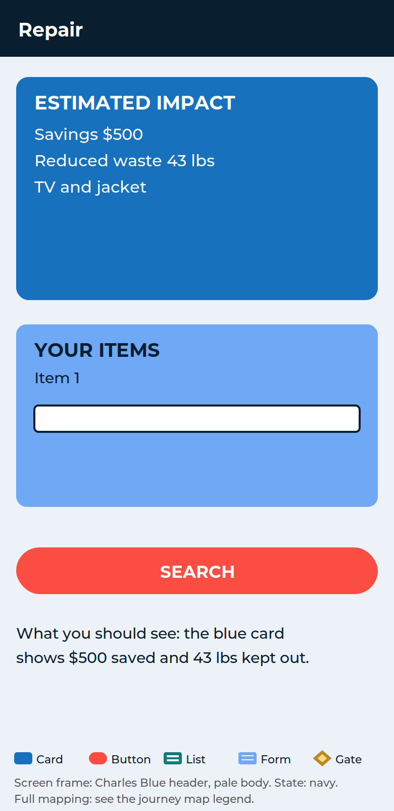

What you should see: a blue card that reads "Estimated impact", "Savings $500", "Reduced waste 43 lbs".

Your file tree now looks like this:

```
client/
  src/
    lib/
      estimate.ts
    components/
      repair/
        Estimator.tsx
```

Check: type a TV and a jacket. The card shows $500 saved and 43 lbs reduced. Change an item. The totals change. The page holds no rule, so a rule change touches one file only.

### The search input (Stub 13, W-06)

What it is: a text field that searches as the resident types, with matching letters in bold. The dev prototype `fuzzy-search` shows it.

Pattern: Observer (GoF). The parent owns the query. The input holds nothing. Debounce (React idiom): wait for a pause before the search runs.

Fleet classes: `.sf`, `.sf-hl` for the bold match, `.txt-f`.

```tsx
// client/src/components/ui/SearchInput.tsx
// The parent owns the query, so the input holds nothing and cannot drift from the page.
const [query, setQuery] = useState("");
// The hook waits for a pause, then matches the typed word against the list.
// The pause stops work on every keystroke, so typing stays fast.
const results = useDebouncedSearch(query, 200);
<input className="sf" type="text" value={query} onChange={(e) => setQuery(e.target.value)} />
{results.map((r) => <li key={r.id}><HighlightedItem item={r.name} match={query} /></li>)}
```

Build first: `client/src/components/ui/SearchInput.tsx` plus the debounce hook in `src/lib/`. Test the hook alone: it must not match on every keystroke. An empty query shows nothing, not the whole list.

### Form validation (Stub 15, W-08)

What it is: one function per form that checks each field and returns errors in plain words. A field with an error shows a red message under it. SUBMIT does nothing until the form passes.

Pattern: Validation (React idiom). No GoF name fits, so the guide gives it none.

Fleet classes: `.fld`, `.fld-err`, `.t--err`, `.txt-f--err` on the field.

```ts
// client/src/lib/validate.ts
export function validateRegistration(form: RepairForm): FieldError[] {
  const errors: FieldError[] = [];
  // A plain-word message tells the resident what to fix, and an error code would not.
  if (!form.email.includes("@")) errors.push({ field: "email", message: "Enter an email address." });
  if (!form.agreed) errors.push({ field: "agreed", message: "Agree to the waiver to continue." });
  // An empty list means the form passes.
  // The caller reads one value, so no field needs its own check call.
  return errors;
}
```

Build first: `client/src/lib/validate.ts` with one function per form, then call it from each form's SUBMIT. Test the function alone, with no page. The page shows one message per field, in words.

Check: submit the form empty. Each missing field shows a plain-word error under the field. No error code shows. The form does not submit.

### Step 6 — Loading, error, and empty states (Decorator)

This page holds a form, not results, so it has no loading state for data. The estimator shows its two values as soon as the items change. A field with an error shows a red message under it. The form never submits until it passes validation.

Check: type an item. The estimator updates at once. Leave a field empty and submit. The error shows under that field only.

### Step 7 — Keyboard and accessibility (Stub 30)

Every control is a real button, input, or select. Radios move with arrow keys. Focus ring is the 3px Optimistic Blue ring. Per-field errors appear under the field in plain words (W-08). The skip link (`.a11y--h`) jumps past the header to `#main`. Focus goes to the page heading on load.

A keyboard user tabs from the item field to the mode radios to the priority radios to the location fields to SEARCH. Arrow keys move inside each radio group. Space toggles a checkbox. A screen reader reads each label, each hint, and each error in plain words.

Check: press Tab from the top of the page. Every control takes focus in order. The focus ring is a 3px Optimistic Blue ring on each one. No control is skipped.

### Step 8 — Verify it in the browser

Build it (`tsc -b && vite build`). Type a TV and a jacket. Check the estimator shows $500 saved and 43 lbs reduced. Pick a mode and a priority. Type a zip. Press SEARCH. Check the browser address shows `/repair/results` with the items, mode, priority, zip, and distance in the URL. Walk it by keyboard alone. Walk it with a screen reader. Walk it at 200% zoom and at phone width. Submit the form empty and check each missing field shows a plain-word error. Only when every walk passes is the page done.

---

## Screen 2 — `/repair/results` — repair search results

### What Denise does

Denise reads the count, sees the estimator, filters the list, looks at the same providers on the map, and selects a provider in the list or on the map. The list and the map show the same ten results, in the same order.

Worked example URL: `/repair/results?item=tv&item=jacket&mode=self&priority=money&zip=02122&distance=4`. The journey step: Denise has a TV and a jacket. She repairs them herself. Saving money matters most. She drives from Dorchester, 4 miles. Figma shows "DISPLAYING 1 - 10 OF 22", a FREE section with Fixit Clinic, and a PAID section with four cards.

### Step 1 — Journey and page model

Journey: Repair, Denise, senior persona. The page model:

| State | Lives | Changes it |
| --- | --- | --- |
| Items, mode, priority, zip, distance, page | URL | Repair form, filter bar, pagination, Back / Forward |
| Results | Query client (cache) | API answers change |
| Selected provider | Component state | List click, map marker click |
| Estimated impact | Derived, no state | Items change |

```tsx
// Page model: /repair/results
// URL: item=tv&item=jacket&mode=self&priority=money&zip=02122&distance=4&page=1
// Query client: every location, cached under the key search.
// The answer stays fresh for ten minutes, so a repeat visit loads fast.
// Component state: selectedId: string | null
// Derived: estimated impact (Stub 9), FREE / PAID sections (priority = money).
// Derived values come from the URL, so they never go stale.
```

The URL owns the search. The query client owns the results. The page owns the selected provider. The estimator is derived from the items. Nothing else lives on this page.

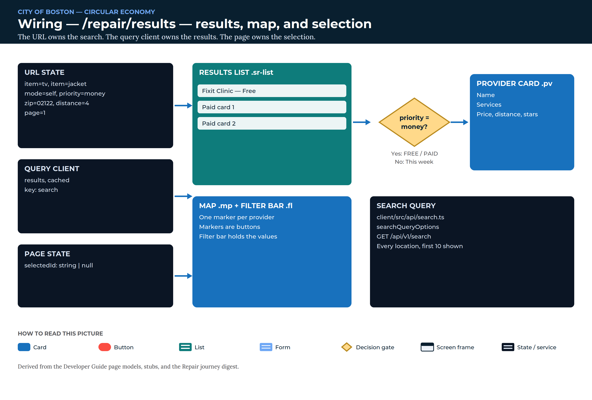

The wiring picture reads left to right. URL state, the query client, and page state on the left feed the results list, the map, and the filter bar in the middle. The amber diamond asks: does priority equal money? Yes splits the list into FREE and PAID. No splits it into "This week". The provider card sits on the right. Services sit below.

Check: you can name the owner of each piece of state on this screen. The URL owns the search. The query client owns the results. The page owns `selectedId`. Nothing else lives here.

### Step 2 — Widgets from the register

- W-01 estimator (Stub 9)
- W-05 search results list (Stub 4)
- W-07 filter bar (Stub 14)
- W-09 map (Stub 16)
- W-12 provider card (Stub 19)
- W-15 dialog, for the FILTER button on a phone (Stub 22)
- W-16 pagination (Stub 23)
- W-29 results list, first 10
- W-26 loading, error, and empty views

### Step 3 — Fleet classes from the theme

- Estimator: `.est`
- Filter bar: `.fl`, `.fl-chip`
- Map: `.mp`, `.mp-mk`, `.mp-cl`
- Results list: `.sr-list`, `.sr`
- Provider card: `.pv`
- Pagination: `.pg`
- Dialog: `.md`
- Buttons: `.btn` for SEARCH AGAIN, `.btn--br` for EDIT SEARCH

### Step 4 — Compose the page tree (Composite)

```tsx
// client/src/pages/repair/results.tsx — the tree, containers first, parts last
<main>
  <h1>Search results</h1>
  <Estimator items={params.items} />          {/* W-01, Stub 9, presentational */}
  <FilterBar params={params} />               {/* W-07, Stub 14, container */}
  <SearchMap results={results} selectedId={selectedId} onSelect={setSelectedId} /> {/* W-09, Stub 16 */}
  <ul className="sr-list">                     {/* W-05, Stub 4 */}
    {results.map((r) => <ProviderCard key={r.id} provider={r} />)} {/* W-12, Stub 19 */}
  </ul>
  <Pagination page={params.page} total={22} /> {/* W-16, Stub 23 */}
</main>
// The page holds selectedId and passes it down.
// The list and the map never talk direct (Mediator), so the page stays the one place that links them.
```

### Step 5 — Wire the state

The URL owns the search, so Back and Forward work and a link can be shared. The query client owns the results, cached under one key. The form on `/repair` wrote the URL. This page only reads it. Selection lives in the page alone.

```tsx
// client/src/pages/repair/results.tsx
// The params come from the URL, so the page never stores a copy.
const params = useSearch({ from: "/repair/results" });
// The query client follows the Stub 5 shape.
// It caches under one key, so a repeat visit loads fast.
// The page filters the list by the URL values and shows the first 10 that match.
const { data: results } = useSuspenseQuery(searchQueryOptions);
// The choice lives in the page, so it clears when the page closes.
const [selectedId, setSelectedId] = useState<string | null>(null);
```

The search query lives in `client/src/api/search.ts`. Type this code there:

```ts
// client/src/api/search.ts
// This file is the one place that calls the API for locations.
// One place means a change to the call touches one file.
import { queryOptions } from '@tanstack/react-query'
import { api, unwrap } from './client'
import type { components } from './schema'

export type SearchResult = components['schemas']['SearchResult']

// GET /api/v1/search returns every location. The page filters the list.
export const searchQueryOptions = queryOptions({
  queryKey: ['search'],
  queryFn: async (): Promise<SearchResult[]> => {
    const response = await unwrap(api.GET('/api/v1/search'))
    return response.results ?? []
  },
  // Results change only when the ETL runs, so the answer stays fresh longer.
  staleTime: 10 * 60_000,
})
```

The typed client lives in `client/src/api/client.ts`. It builds the client from the generated schema. `unwrap` turns a failed call into a thrown error. The query client lives in `client/src/api/queryClient.ts`. It keeps an answer fresh for 60 seconds. The app entry provides it. Type this line in the route in `client/src/pages/repair/results.tsx`, so the request starts before the page shows:

```tsx
// The loader warms the cache before the page shows. It reuses the saved answer when fresh.
loader: ({ context }) => context.queryClient.ensureQueryData(searchQueryOptions),
```

Your file tree now looks like this:

```
client/
  src/
    api/
      client.ts
      queryClient.ts
      search.ts
      schema.d.ts
    lib/
      estimate.ts
      validate.ts
      filters.ts
    components/
      search/
        FilterBar.tsx
        ProviderCard.tsx
      map/
        SearchMap.tsx
      ui/
        Pagination.tsx
        Dialog.tsx
    pages/
      repair/
        results.tsx
```

Check: open `/repair/results` with the worked example URL. The page shows 22 results, 10 on the first page. Change `?page=2` in the address bar. The list shows items 11 to 20.

### The service call and the hook (Stubs 4 and 5)

Pattern: Provider, hook, and container (React idioms) and Decorator (GoF). The API client, provided at the entry, is the one typed client. Pages and services use that client. Tests provide a mock client with the same contract shape.

The page: `client/src/pages/search/index.tsx` shows the shape. This results page follows the same shape:

```tsx
// The route shows loading and error. The page reads the saved answer and writes only its success view.
const { data: locations } = useSuspenseQuery(searchQueryOptions)
<ResultsList locations={locations} />
```

### The filter bar (Stub 14, W-07)

What it is: the bar above a results list. Category, nearby, pickup, language. Each filter narrows the list. Clear-all resets them all.

Pattern: Strategy (GoF). Each filter is one strategy: a function that takes a list and returns a smaller list. The bar picks the set. The list never knows the filters.

Fleet classes: `.fl`, `.fl-g`, `.fl-c`, `.fl-chip`, `.sel-f`.

```ts
// client/src/components/search/FilterBar.tsx
const filters: Filter[] = [byCategory(category), byPickup(pickup), byLanguage(language)];
// Strategy: one function per filter.
// Each filter is a pure function, so you add a filter by adding one function.
const shown = filters.reduce((list, f) => f(list), results);
// Each filter is a pure function: (list: SearchResult[]) => SearchResult[]
// The filter bar holds the choices. The list holds the render only, so the list never needs to know the filters.
```

Build first: `client/src/components/search/FilterBar.tsx` and one filter function per filter in `src/lib/filters.ts`. Add a filter by adding one function and one chip. Do not edit the list to add a filter. The bar never filters the list itself. It only holds the values the page filters by. At 390 px the groups stack full width.

### The map (Stub 16, W-09)

What it is: the map on the search results page. One marker per provider. Markers cluster at low zoom. The list and the map show the same ten results, in the same order. A click on either side selects the same provider.

Pattern: Mediator (GoF). The search page mediates. The list and the map never talk direct. Observer (GoF) for the shared selection.

Fleet classes: `.mp`, `.mp-mk` for a marker, `.mp-cl` for a cluster, `.mp-filters`.

```tsx
// client/src/components/map/SearchMap.tsx
// The page owns selectedId. The map takes it as a prop and calls back onSelect.
// The page stays the one owner of the choice.
// The map never fetches. The map never sorts.
// It plots what the page gives it, so the map stays simple and the page stays in charge.
<SearchMap results={results.slice(0, 10)} selectedId={selectedId} onSelect={setSelectedId} />
// Marker: one HTML button per provider.
// A button takes keyboard focus, so a keyboard user can reach it and a screen reader can read it.
// No marker at (0, 0). A result with no coordinates stays in the list only, so no provider lands on a false spot.
```

Build first: the map plan's spike first (MapLibre against Leaflet, tile terms checked). Then `client/src/components/map/SearchMap.tsx` with an adapter behind it, so the library can change without the page changing. See the map plan in `harness-map/PLAN-ARCHITECTURE.md`.

The map is lazy loaded, so the list page first paint does not wait for the map engine. The map centres on a fixed Boston fallback, `[42.36, -71.06]`, because no geocoder exists yet. The page text states that distance filtering is not active. No radius circle is drawn: there is no geocoder and no distance filter yet, so a circle would be a false claim. A selected marker uses Charles Blue. Results without usable coordinates are listed, never plotted at (0,0) or at a default centre.

### The provider card (Stub 19, W-12)

What it is: one card per provider in a results list. Name, what it repairs, price in words (Free, $, $$, $$$), distance, stars. The card links to the provider page.

Pattern: Composite (GoF). The card is a presentational part. It takes a provider as props and renders it.

Fleet classes: `.pv`, `.sr`, `.cd`, `.lcd`. Referral tracking uses `.refbox` in `fleet-theme.css` §23.

```tsx
// client/src/components/search/ProviderCard.tsx
export function ProviderCard({ provider }: { provider: SearchResult }) {
  return (
    <li className="sr">
      <a href={`/providers/${provider.id}`}>
        <h3>{provider.name}</h3>
        <p>{provider.services.join(", ")}</p>
        <p>{provider.price} | {provider.distance} mi | {provider.rating} stars</p>
      </a>
    </li>
  );
}
// Referral tracking is server-side. The card only links.
// It records no click itself, so the card stays simple and the server owns the record.
// A visit from a referral link is shown in a `.refbox` box on the provider page.
// The link shows in full text, so the resident reads it and knows where it leads.
```

Build first: `client/src/components/search/ProviderCard.tsx`. Referral tracking is a server endpoint, not a card behaviour.

### Pagination (Stub 23, W-16)

What it is: the parts that move the resident between pages. Pagination takes the results in order, stops after ten, and moves to the next ten on the next page.

Pattern: Iterator (GoF). Take the results in order, stop after ten, move to the next ten on the next page. No re-sort, no copy.

Fleet classes: `.brc`, `.tab`, `.stp`, `.pg`, `.pg-li`, `.pg-li-i`, `.pg-li-i--link`, `.pg-li-i--a`, `.pg-li-i-h`, `.pg-disabled`.

```tsx
// client/src/components/ui/Pagination.tsx
// The page number lives in the URL. Back and Forward work, and a link can be shared, because the URL holds the page.
const page = Number(search.page ?? 1);
// Iterator: take the results in order and stop after ten.
// Order keeps the list stable, so page two never repeats page one.
const shown = results.slice((page - 1) * 10, page * 10);
<a className="pg-li-i--link" href={`/search?${params}&page=${page + 1}`}>Next</a>
```

Build first: `client/src/components/ui/Pagination.tsx`. The page number lives in the URL, never in component state alone. A page with no items shows the empty state, not a blank page. First and Last are hidden below 768 px.

### The dialog (Stub 22, W-15)

What it is: the FILTER button on a phone opens a dialog. The dialog opens over the page. Escape closes it. Focus goes inside it and stays there until it closes.

Pattern: Decorator (GoF). Fleet class: `.md`.

```tsx
// client/src/components/ui/Dialog.tsx
export function Dialog({ open, onClose, children }: DialogProps) {
  // Open: focus the first control inside. Close: return focus to the opener.
  // Focus tells the keyboard user where they are, so they never lose their place.
  // Escape calls onClose. A click on the dimmed layer behind the dialog calls onClose.
  // A click inside does not, so the dialog stays open while the user works in it.
  if (!open) return null;
  return <div className="md" role="dialog" aria-modal="true">{children}</div>;
}
```

Build first: one file per part in `client/src/components/ui/`: `Dialog.tsx`, `Toast.tsx`, `Badge.tsx`, `Chip.tsx`, `Tabs.tsx`, `Accordion.tsx`. One issue per part. Toast uses `.toast` and badge uses `.bdg` from the theme (`fleet-theme.css` §23).

A badge is a short label, such as "Free" or "New". Text only, never colour alone. A chip is a filter choice. Pressed means active. Press again to clear it. Tabs show one tab at a time. Arrow keys move between tabs. An accordion shows one section open at a time. The header is a button.

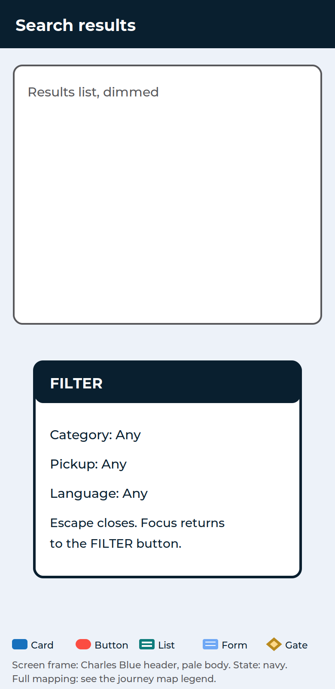

What you should see: on a phone, the FILTER button opens a dialog over the page with the filter choices inside. Escape closes it. Focus returns to the FILTER button.

Check: on a 390 px screen, press FILTER. The dialog opens and focus moves inside it. Press Escape. The dialog closes and focus returns to FILTER.

### Step 6 — Loading, error, and empty states (Decorator)

The route shows loading and error. The page shows the empty sentence when the list is empty. Loading says "Loading results…". An error says what failed and what to do next. Zero results says "No results found" with the EDIT SEARCH button beside it.

The FREE and PAID sections come from the priority: saving money splits the list into Free and Paid. Saving time splits it into "This week" instead, per the Figma note.

```tsx
// The page reads the saved answer. An empty list shows the empty sentence, never a blank area.
const { data: results } = useSuspenseQuery(searchQueryOptions)
if (results.length === 0) {
  return <p>No results found</p>
}
// The success view shows the first 10, in FREE and PAID sections.
<p>Displaying 1 - 10 of {results.length}</p>
<section><h2>Free</h2>{/* free cards */}</section>
<section><h2>Paid</h2>{/* paid cards */}</section>
```

Count text (`.sr-count`) is plain text before the list, in reading order, stating the count and the first-10 cut. Example: "Displaying 1 – 10 of 22 results for 'TV repair' near 02131." A selected result gets a 3px Charles Blue border (`.sr--sel`). FREE and PAID is a text tag (`.sr-tag--free`, `.sr-tag--paid`), never colour alone.

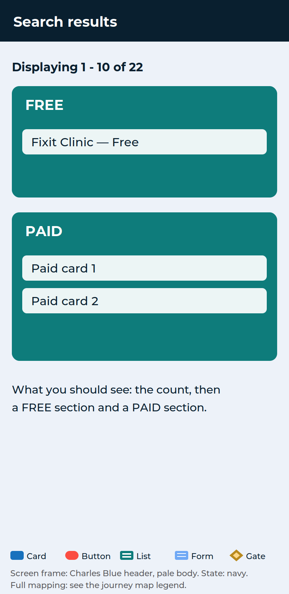

What you should see: the count "Displaying 1 - 10 of 22", then a FREE section with Fixit Clinic, then a PAID section with four cards. FREE and PAID are words, not colours.

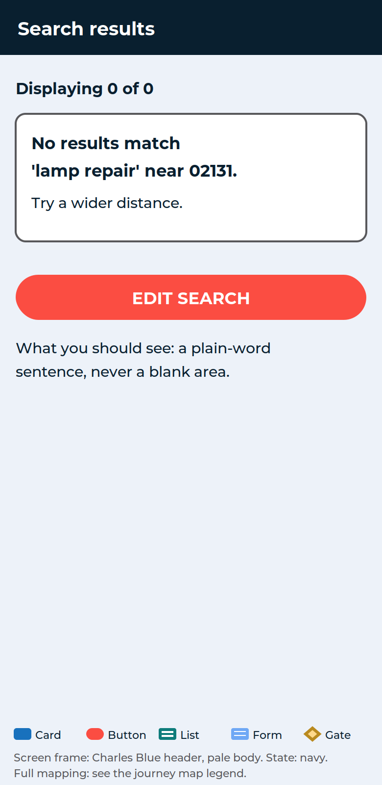

What you should see when nothing matches: a plain-word sentence, "No results match 'lamp repair' near 02131. Try a wider distance or a different word.", and an EDIT SEARCH button. Never a blank area.

Check: load the page seeded with 22 results. The count reads "Displaying 1 - 10 of 22". The FREE section holds Fixit Clinic. The PAID section holds four cards. Load it with zero results. The empty sentence shows with EDIT SEARCH beside it.

### Step 7 — Keyboard and accessibility (Stub 30)

The map markers are HTML buttons, so a keyboard can reach them and a screen reader can read them. A marker click and a card click select the same provider, and the selection is announced in the live region ("Fixit Clinic selected"). The FILTER button opens a dialog on a phone. Escape closes it and returns focus to the button. At 200% zoom the list goes full width and the map grows taller. Nothing is carried by colour alone: Free and Paid are words, not colours.

The count text sits in a live region, a plain `<div aria-live="polite">` holding `.sr-count` text. It has no visual style of its own. If the selection came from the map, focus moves to the list entry. Map markers are Tab-reachable buttons. Enter selects a marker and highlights the same provider in the list.

If the map fails to load, the failure is stated in text (`.mp-h` overlay) and the list stays on screen. Zero results are stated in text: "No results match 'lamp repair' near 02131. Try a wider distance or a different word." Invalid search values show one plain-word alert and no fetch.

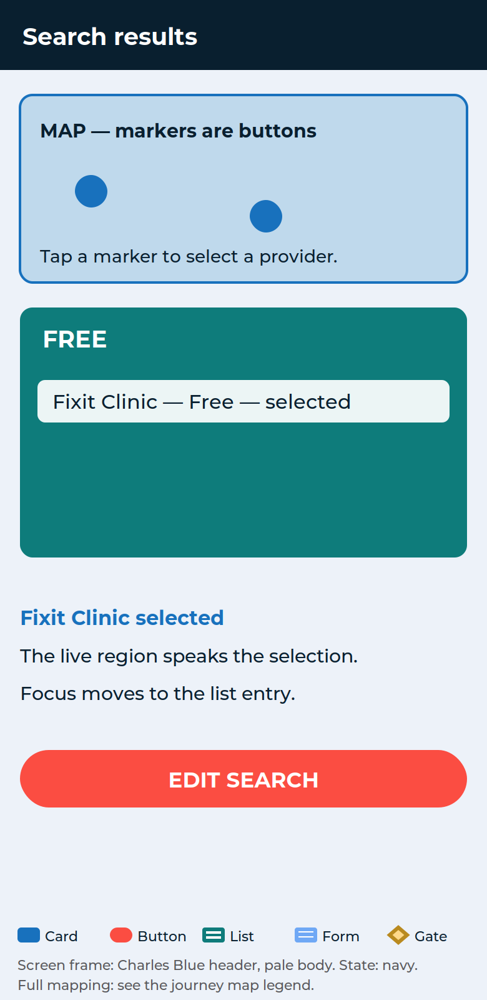

What you should see: tap a map marker and the same provider highlights in the list. The live region says "Fixit Clinic selected". Focus moves to the list entry.

Check: tab to a map marker and press Enter. The same provider highlights in the list and the screen reader says "Fixit Clinic selected". Click a card. The same marker highlights on the map.

### Step 8 — Verify it in the browser

Build it. Walk it fresh (no results yet) and seeded (the 22 results). Walk it by keyboard alone: tab from the filter bar to a marker to a card to pagination. Walk it with a screen reader: the count, the sections, and the selection must all be announced. Walk it at 200% zoom and at 390 px. Walk it with the map failed: the list still works, and the page says so in words. Only when every walk passes is the page done. A green gate count alone is not a pass.

---

## Screen 3 — `/repair/form` — item registration form

### What Denise does

Denise registers her items for the clinic, in three steps. Step 1: item 1 (TV). Step 2: item 2 (jacket). Step 3: name, email, liability waiver, media release, agreement checkbox. BACK moves back, NEXT moves forward, SUBMIT ends it. A step with no answer blocks NEXT.

### What you build

One form, one step at a time. Build it in layer order, one component per step. Never introduce two new ideas in one step.

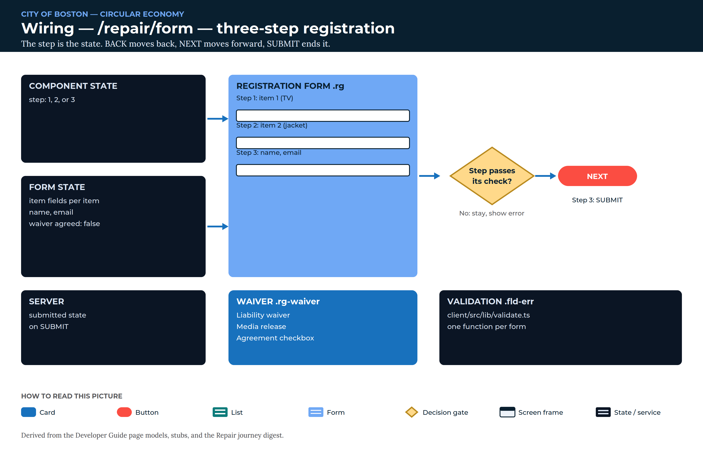

The wiring picture reads left to right. Component state holds the step. Form state holds the answers. The amber diamond asks: does the step pass its check? Yes moves to NEXT. No stays and shows an error. Step 3 shows SUBMIT. Validation lives in `client/src/lib/validate.ts`.

### Build step 1 — The page model

Write the page model first. Do not write a component first.

| State | Lives | Changes it |
| --- | --- | --- |
| Step, 1 to 3 | Component state | BACK / NEXT / SUBMIT |
| Item fields, per item | Form state | Typing |
| Name, email | Form state | Typing |
| Waiver agreed | Form state | Checkbox change |
| Submitted | Query client + server | SUBMIT answers |

```tsx
// Page model: /repair/form — step 1 is item 1, step 2 is item 2, step 3 is name, email, waiver.
// One step at a time keeps the form short, so the resident finishes it.
const [step, setStep] = useState(1);
const [form, setForm] = useState<RepairForm>({ items: [], name: "", email: "", agreed: false });
```

What you should see: nothing on screen yet. You have a plan, not a page. That is correct. The plan comes first.

Check: each piece of state has one owner. Step lives in the page. Answers live in the form. Submitted lives on the server.

### Build step 2 — The registration form

What you build: one form component with the step in state, and one `ItemFields` part reused for item 1 and item 2.

Pattern: State (GoF). The step is the state. BACK moves back, NEXT moves forward, SUBMIT ends it. Observer (GoF) for the controlled fields: the form owns the value, and the input holds nothing.

Fleet classes: `.rg`, `.rg-steps`, `.rg-actions`, `.rg-waiver`, `.fld`, `.txt-f`, `.sel-f`, `.ra-f`, `.cb-f`, `.stp`, `.btn`, `.t--legal`. The step indicator is `.stp`, `.stp-n`, `.stp--done`, `.stp--now`. The progress bar is `.prg`.

```tsx
// client/src/components/repair/RegistrationForm.tsx
// The step is the state. It holds 1, 2, or 3, so the page shows one step at a time.
const [step, setStep] = useState(1);
const [form, setForm] = useState<RepairForm>({ items: [], name: "", email: "", agreed: false });
{step === 1 && <ItemFields item={form.items[0]} onChange={setItem} />}
{step === 3 && <Waiver agreed={form.agreed} onChange={setAgreed} />}
<button className="btn" onClick={() => setStep(step + 1)}>Next</button>
```

Fields come from the clinic intake: item issue and repair attempt textareas, brand / make, model, year select, first / last name, email, liability waiver and media release, agreement checkbox.

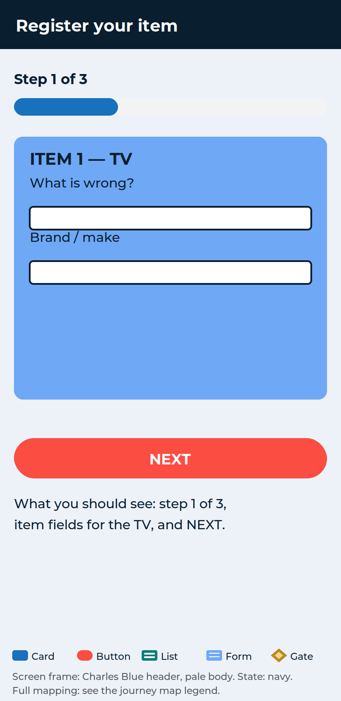

What you should see: "Step 1 of 3", a progress bar one third full, item fields for the TV, and a red NEXT button.

Your file tree now looks like this:

```
client/
  src/
    components/
      repair/
        RegistrationForm.tsx
        ItemFields.tsx
```

Check: open the form. Step 1 shows the TV fields only. Press NEXT with no answer. NEXT stays blocked. The page does not move to step 2.

### Build step 3 — Step 3 and SUBMIT

What you build: step 3 shows name, email, the waiver, and SUBMIT. NEXT checks the step before it moves on. SUBMIT calls the validation function from `client/src/lib/validate.ts`.

```ts
// SUBMIT calls one function, validateRegistration, and reads its list of errors.
// An empty list means the form passes, so SUBMIT sends the form.
// A list with errors means the page stays and shows one message per field.
const errors = validateRegistration(form);
if (errors.length === 0) submit(form);
```

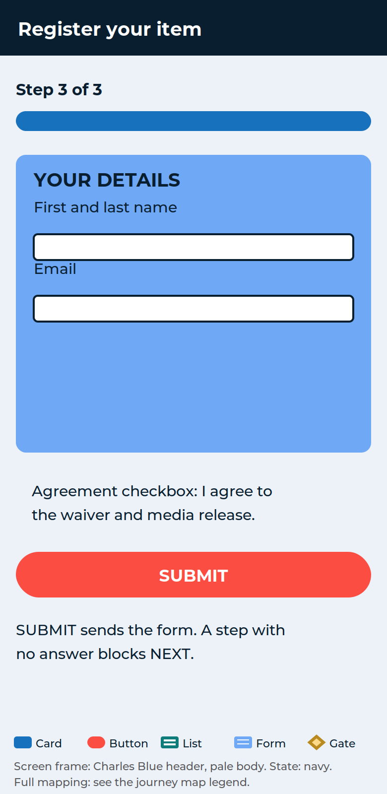

What you should see: "Step 3 of 3", a full progress bar, name and email fields, the agreement checkbox with the waiver text, and a red SUBMIT button.

Check: fill steps 1 and 2, then open step 3. Type a name and an email. Tick the agreement checkbox. Press SUBMIT. The form sends. Leave the email blank. SUBMIT does nothing, and the email field shows "Enter an email address."

### Build step 4 — States, access, and mobile

Loading, error, and empty states: the form has no results to load, so it has no loading view. An error shows under its field, in plain words. SUBMIT does nothing until the form passes.

Keyboard and accessibility: one step at a time keeps the form short. NEXT checks the step before moving on. Errors are per-field, in plain words, under the field. The waiver checkbox is a real checkbox. Space toggles it. Focus ring is the 3px Optimistic Blue ring. Focus moves to the page heading on load.

Check: walk the whole form by keyboard alone. Tab moves through each field in order. Space toggles the waiver checkbox. A screen reader reads each label and each error in plain words.

### Verify it in the browser

Build it (`tsc -b && vite build`). Walk it fresh and seeded. Walk it by keyboard alone. Walk it with a screen reader. Walk it at 200% zoom and at 390 px. Only when every walk passes is the page done.

---

## Screen 4 — `/repair/events` — repair event finder

### What Denise does

Denise reads a list of Fixit Clinic events, with date, time, and place. Each event links to its provider page.

### What you build

One list, one card. Build it in layer order, one component per step.

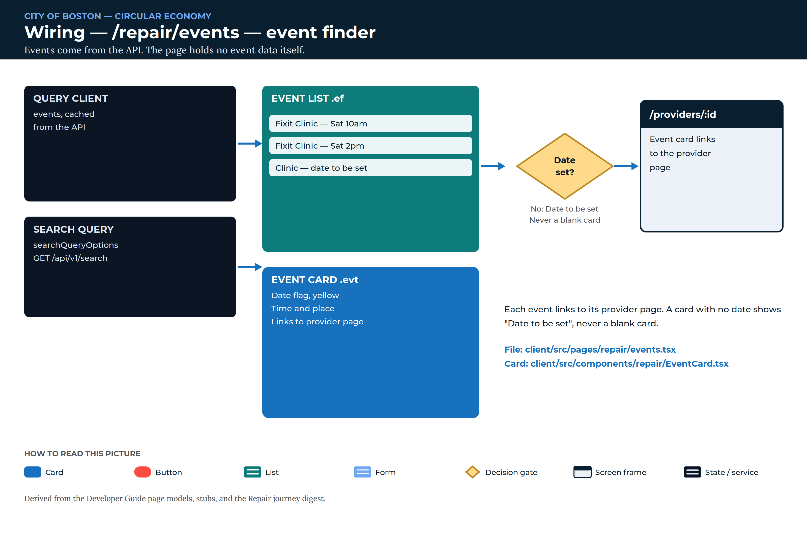

The wiring picture reads left to right. The query client holds the events from the API. The event list shows them as cards. The amber diamond asks: is the date set? No shows "Date to be set", never a blank card. Each card links to its provider page.

### Build step 1 — The page model

Events come from the API through the query client. The page holds no event data itself.

```tsx
// The events come from the API. Do not hard-code an event in the page.
// The page reads the saved answer and renders the event list from it.
const { data: events } = useSuspenseQuery(searchQueryOptions)
<ul className="ef">
  {events.map((e) => <EventCard key={e.id} event={e} />)}
</ul>
```

What you should see: nothing on screen yet. The page model is written. The list comes next.

Check: the page holds no event data. The query client owns the events. One owner, no copy.

### Build step 2 — The event card

What you build: one event card, reused for every event in the list.

Pattern: Composite (GoF). The list holds event cards. Each card holds the same parts.

Fleet classes: `.ef`, `.evt`, `.evt-t`, `.evt-st`, `.evt-d`, `.svg-date-flag`, event details `.dl`.

```tsx
// client/src/components/repair/EventCard.tsx
// Each card holds the same parts: date flag, time, place, and a link to the provider page.
// A card with no date shows "Date to be set", never a blank card.
```

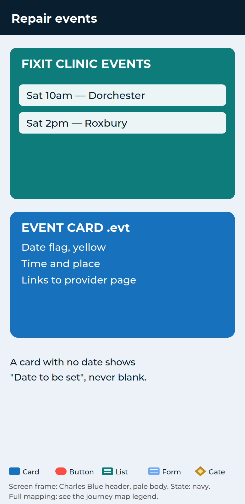

What you should see: Fixit Clinic event cards with a yellow date flag, time and place, each linking to its provider page. A card with no date reads "Date to be set".

Your file tree now looks like this:

```
client/
  src/
    components/
      repair/
        EventCard.tsx
    pages/
      repair/
        events.tsx
```

Check: open the page. Each event shows date, time, and place. Press an event card. The provider page opens. An event with no date shows "Date to be set", never a blank card.

### Build step 3 — States, access, and mobile

Loading says "Loading results…" with a progress bar (`.prg`). An error says what failed and what to do next. Empty says so in words, never a blank area. The skip link jumps past the header to `#main`. Focus goes to the page heading on load. Focus ring is the 3px Optimistic Blue ring.

Check: walk the list by keyboard alone. Each card link takes focus in order. At 200% zoom the cards go full width. With the API down, the page says so in words and shows no blank area.

### Verify it in the browser

Build it (`tsc -b && vite build`). Walk it fresh and seeded. Walk it by keyboard alone. Walk it with a screen reader. Walk it at 200% zoom and at 390 px. Only when every walk passes is the page done.

---

## Screen 5 — `/providers/:id` — provider page

### What Denise does

Denise opens one provider from a card, reads its details (hours, services, price), and can send a registration email.

### What you build

One provider, read from the URL. Build it in layer order, one component per step.

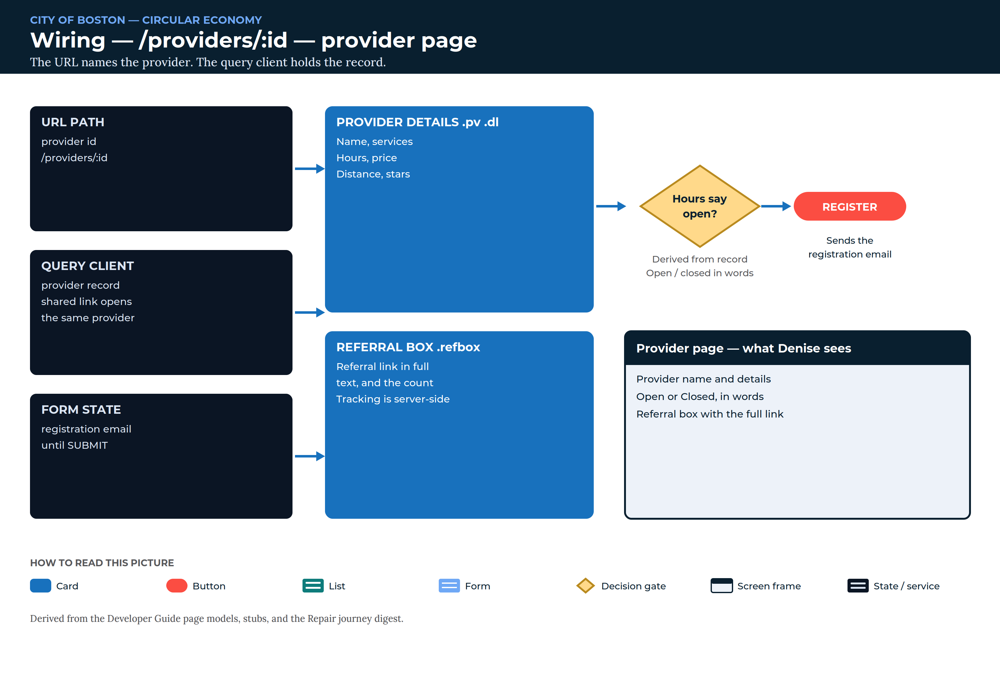

The wiring picture reads left to right. The URL path names the provider id. The query client holds the record. The amber diamond asks: do the hours say open? The answer is derived from the record, and it shows in words: Open or Closed. The referral box shows the referral link in full text, with the count.

### Build step 1 — The page model

| State | Lives | Changes it |
| --- | --- | --- |
| Provider id | URL path | List card click |
| Provider record | Query client | API answers |
| Hours open / closed | Derived from the record | Record loads |
| Registration email | Form state | Typing, SUBMIT |

```tsx
// Page model: /providers/:id — the URL names the provider.
// The query client holds the record, so a shared link opens the same provider.
const { id } = useParams({ from: "/providers/$id" });
const { data: provider } = useProvider(id);
```

What you should see: nothing on screen yet. The page model is written. The details come next.

Check: the URL names the provider. The query client holds the record. Hours are derived, never stored, so they never go stale.

### Build step 2 — Provider details

What you build: the provider card details and the referral box.

Fleet classes: `.pv` and `.dl` (definition list: term Lora italic Body Gray, description Montserrat uppercase Charles Blue). Referral box `.refbox` shows the referral link in full text and the count. Referral tracking is a server endpoint. The card only links. It records no click itself.

```tsx
// The provider record comes from the query client, so a shared link opens the same provider.
// Hours open / closed is derived from the record, so it always matches the record.
// The referral box shows the link in full text, so the resident reads it and knows where it leads.
```

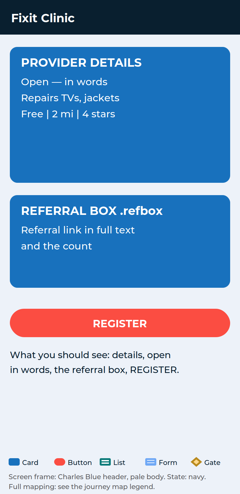

What you should see: the provider name and details, "Open" or "Closed" in words, the referral box with the full link, and a red REGISTER button.

Check: open the page from a result card. The details match the card. The hours read "Open" or "Closed" in words. The referral box shows the full link and the count. Open the same link in a new tab. The same provider opens.

### Build step 3 — States, access, and mobile

Loading says so in words with a progress bar (`.prg`). An error says what failed and what to do next. Empty says so in words, never a blank area. The skip link jumps past the header to `#main`. Focus goes to the page heading on load. Focus ring is the 3px Optimistic Blue ring. Meaning never rests on colour alone: open and closed are words.

Check: walk the page by keyboard alone. Every control takes focus in order. At 200% zoom the page goes full width. The registration email field takes typing, and SUBMIT sends it.

### Verify it in the browser

Build it (`tsc -b && vite build`). Walk it fresh and seeded. Walk it by keyboard alone. Walk it with a screen reader. Walk it at 200% zoom and at 390 px. Only when every walk passes is the page done.

---

## Screen 6 — Confirmation and feedback

### What Denise does

After registering, Denise sees a share card with estimated impact, Facebook / Instagram links, and a QR code note. She can give feedback: like or dislike, then a message, then the result "Thank you. Your feedback was sent."

### What you build

One share card and one feedback widget. Build them in layer order, one component per step.

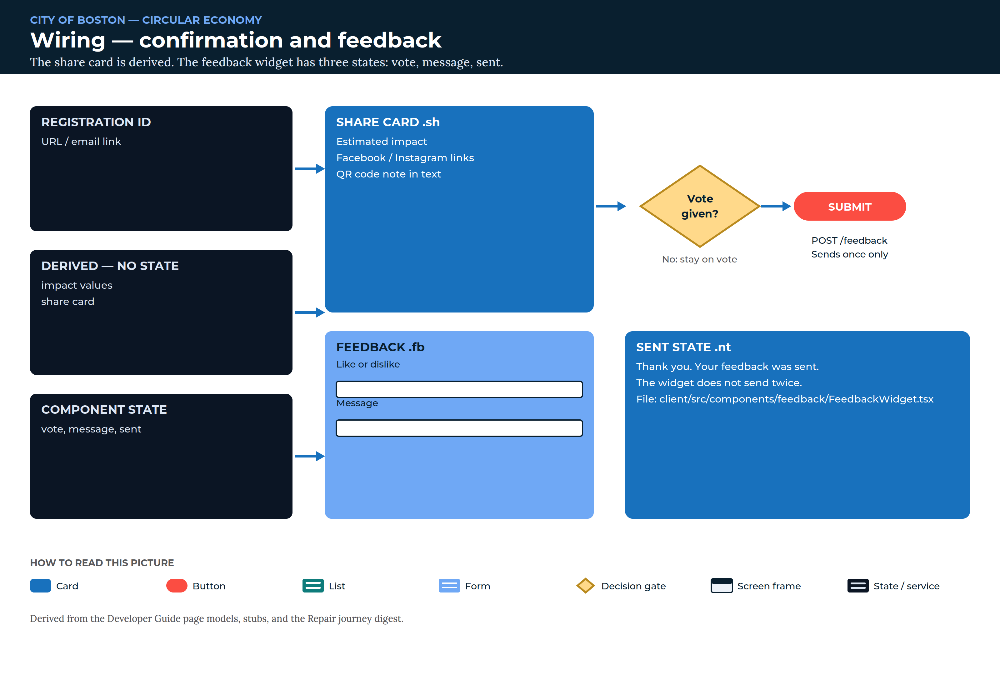

The wiring picture reads left to right. The registration id comes from the URL or email link. Impact values are derived from the registration. The amber diamond asks: is a vote given? Yes moves to the message and SUBMIT. No stays on the vote. SUBMIT calls `POST /feedback` once. The sent state shows "Thank you. Your feedback was sent."

### Build step 1 — The page model

| State | Lives | Changes it |
| --- | --- | --- |
| Registration id | URL / email link | Registration SUBMIT |
| Impact values | Derived from the registration | Server answers |
| Feedback vote, message, sent | Component state, then server | Vote, SUBMIT |
| Share card | Derived, no state | Registration answers |

What you should see: nothing on screen yet. The page model is written. The share card comes next.

Check: the share card is derived, never stored. The vote, message, and sent state live in the widget until SUBMIT sends them to the server.

### Build step 2 — The share card

What you build: a share card with estimated impact, Facebook / Instagram links, and a QR code note in text.

Fleet classes: `.sh`, `.sh-t`, `.sh-qr`, share links `.lwi`. The share card is a `.cd` with share links and the QR note in text.

```tsx
// The share card is derived from the registration answers, so it always matches the registration.
// It holds the estimated impact, the share links, and the QR code note in text.
```

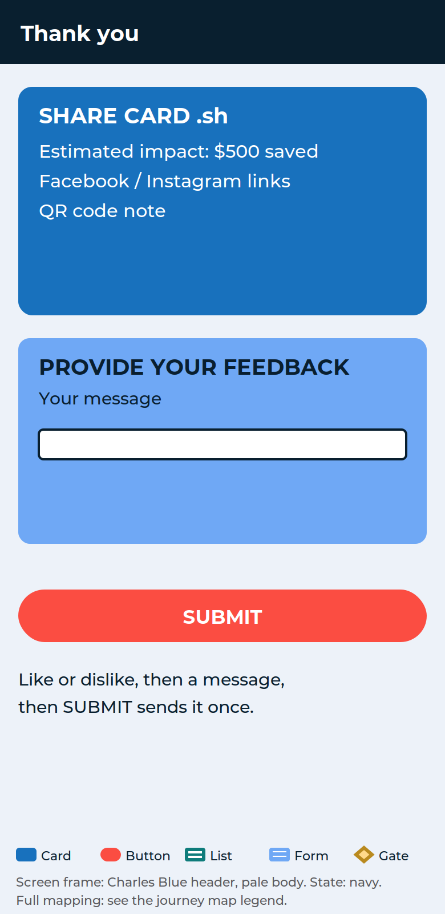

What you should see: a blue share card with the estimated impact ($500 saved), Facebook and Instagram links, and a QR code note, above the feedback form.

Check: open the page after a registration. The share card shows the impact from that registration. The links read Facebook and Instagram in words.

### Build step 3 — The feedback widget

What you build: the feedback widget in three states — vote, message, sent.

Pattern: State (GoF). The widget has three states: vote, message, sent.

Fleet classes: `.fb`, `.fb-vote`, `.fl-chip` votes, `.txt-f` textarea for the message, `.nt` for the result. The API route `POST /feedback` exists.

```tsx
// client/src/components/feedback/FeedbackWidget.tsx
// The widget has three states: vote, message, sent.
// One state at a time keeps the widget short, so the resident finishes it.
const [state, setState] = useState<"vote" | "message" | "sent">("vote");
async function submit() {
  // The service is the one place that calls the API.
  // One place means a change to the call touches one file.
  await postFeedback({ vote, message });
  setState("sent");
}
```

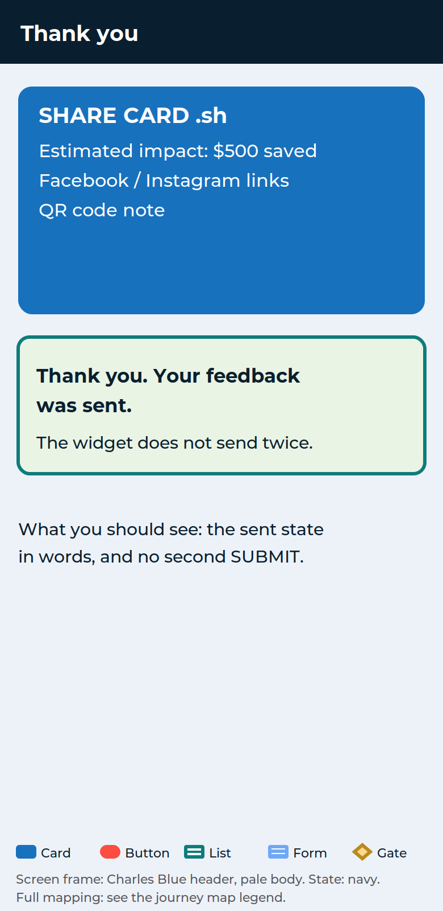

What you should see: after SUBMIT, the result reads "Thank you. Your feedback was sent." The widget does not send twice.

Your file tree now looks like this:

```
client/
  src/
    components/
      feedback/
        FeedbackWidget.tsx
```

Check: vote like or dislike, write a message, press SUBMIT. The page shows "Thank you. Your feedback was sent." Press SUBMIT again. Nothing sends twice.

### Build step 4 — States, access, and mobile

The vote chips are buttons with pressed state in words. The message is a real textarea. The sent state is a notice (`.nt`) in plain words. The skip link jumps past the header to `#main`. Focus goes to the page heading on load. Focus ring is the 3px Optimistic Blue ring.

Check: walk the widget by keyboard alone. Tab moves from the vote chips to the message to SUBMIT. A screen reader reads the vote, the message label, and the sent result in plain words.

### Verify it in the browser — the whole journey

Build it (`tsc -b && vite build`). Walk all six screens in order, as Denise walks them: `/repair`, `/repair/results`, `/repair/form`, `/repair/events`, `/providers/:id`, confirmation and feedback. Walk it fresh and seeded. Walk it by keyboard alone. Walk it with a screen reader. Walk it at 200% zoom and at 390 px. Walk it with the map failed, so the list still works.

Check: Denise can type a TV and a jacket, see $500 saved and 43 lbs kept out, pick Fixit Clinic from the FREE section, register in three steps, check the clinic event, open the provider page, and send feedback. Each screen ends with its check. The journey works end to end.
